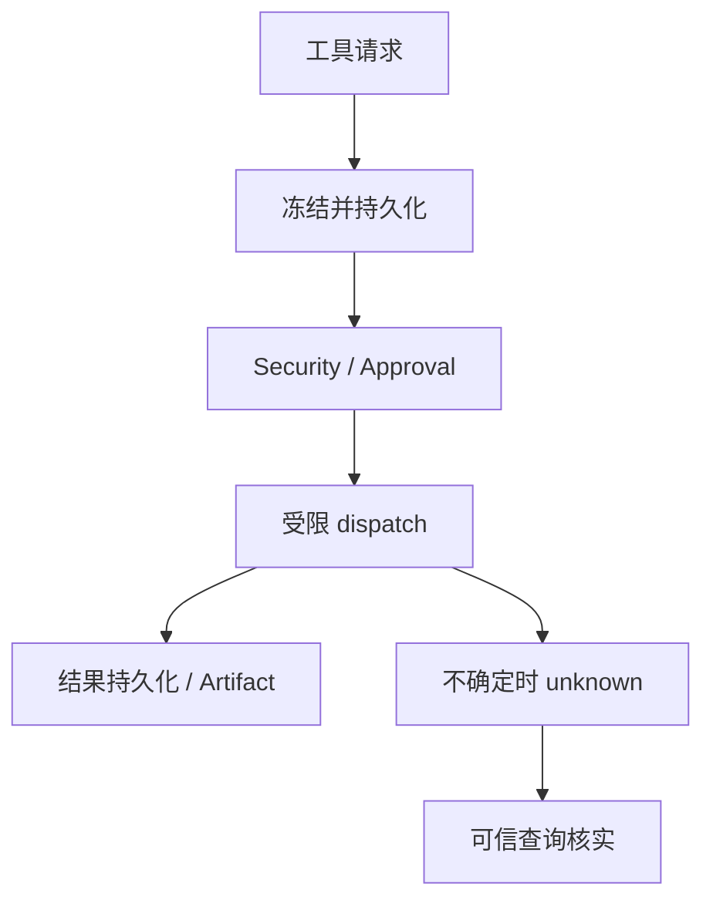

# 统一工具执行与审批：技术方案

[功能与需求](../features/tools-approvals.md) · [测试方案](../test-plans/tools-approvals.md) · [主索引](../feature-map.md)

最近核对：2026-10-28。本文的架构与流程描述当前有效实现；明确标记的待实现方案不表示已落地。实现级协议仍服从 [跨功能协议与约束](product-overview.md#contract-0-文档效力与实现规则)。

## 当前架构

统一 Executor 负责接受、策略、审批、资源调度、dispatch 和结果规范化；SQLite 是调用状态权威，外部 Provider 提供可用的核实证据。



## 当前流程与目标差异

校验冻结调用 → 必要时等待审批 → 获得资源后执行 → 保存结果 → 回到 Agent Loop；外部结果不明则记录 unknown 并仅查询核实。

- **F-007**：Direct Tools、嵌套工具、Child 与 Computer 共用 Executor；调用与审批持久化，unknown 走核实路径。 审批只约束具体冻结动作；无法可信核实的 unknown 必须保留，不承诺外部 exactly-once。

## 代码与依赖

- [internal/tool/executor.go](../../internal/tool/executor.go)
- [internal/tool/recovery.go](../../internal/tool/recovery.go)
- [internal/agent/sqlite/tools.go](../../internal/agent/sqlite/tools.go)
- [internal/agent/sqlite/approvals.go](../../internal/agent/sqlite/approvals.go)

## 验证与交付

验收场景、已有入口和剩余覆盖统一在 [测试方案](../test-plans/tools-approvals.md) 维护。本次建档未执行本功能的回归或 Live 验证，不以架构图替代运行证据。

## 协议、实现与配置约束

迁入内容按职责归属在此维护。既有编号用于追溯协议，不代表所有设计目标均已实现；完成状态以需求主索引为准。

<a id="contract-6-tooling-与-javascript-code-mode"></a>

### 6. Tooling 与 JavaScript Code Mode

<a id="contract-61-工具命名规范"></a>

#### 6.1 工具命名规范

所有工具使用 snake_case，并通过前缀体现来源：

```text
mcp__<server_name>__<tool_name>
builtin__<tool_name>
```

示例：

```text
mcp__browser_use__click_button
mcp__gmail__read_email
builtin__memory_search
builtin__skill_list
builtin__task_search
builtin__task_manage
```

该命名方式可作为 JavaScript 对象属性或字符串键使用，不要求工具名必须是 JavaScript 标识符。

`__` 仅用于来源/服务器的结构分界；名字内部保留单下划线。因此 `task_search` 是完整的 builtin 工具名，`browser_use` 和 `click_button` 分别是完整的 MCP server 名与工具名。MCP 配置拒绝名字内部的 `__`，防止分界歧义。Code Mode 的 `describeNamespace("task")` / `describeNamespace("builtin__task")` 按 `task_` 前缀发现内置工具；`browser_use` / `mcp__browser_use` 精确匹配 MCP server。

生产 Registry 不注册演示 echo 工具；`mcp__fixture__echo` 仅在显式 `-test-bridge` 中存在，返回模型数据，不发送用户消息。用户交付继续由 Main 的最终 AssistantMessage → DeliveryRequest/Outbox → Delivery Composer → UISpec 完成，Web 复用 OpenIntelligentUI 原生表格；Worker 没有用户发送能力。此次不新增第二个发送入口或模型 UI 代码。

<a id="contract-63-toolexecutor"></a>

#### 6.3 ToolExecutor

- `ToolExecutor` 是唯一的工具执行入口；Agent Loop 直接工具调用、JavaScript Code Mode、MCP、Builtin Tool 和 Computer 操作全部通过它执行。
- 统一管线负责工具解析、参数校验、安全策略、审批、幂等、超时、取消、执行、结果规范化和 RunTrace 记录。
- `ToolExecutor` 统一管理有界并发调用，提供全局、Agent、Run、Provider 和工具级并发限制，避免无限制创建 Goroutine。
- 模型或 Code Mode 可以提出并行调用；`ToolExecutor` 根据工具元数据、副作用等级、依赖关系和资源冲突做最终并发决策。
- 并发控制采用“有界并发额度 + 动态 `conflict_keys`”：调用在执行前根据参数和目标资源生成零到多个冲突键，只有存在互斥键冲突的调用才串行等待。
- 一期每个 Computer 使用独占 `DesktopLease`：同一时间只允许一个活跃 CUA 操作流，避免键盘焦点、鼠标、剪贴板、系统弹窗、文件选择器和应用 Modal 相互干扰；普通外部工具和不同 Computer 仍可并行。
- 后续只对可证明隔离的结构化 Browser Surface 放宽并发，例如 CDP/Playwright 按 Tab 使用冲突键；原生桌面继续保持 Computer 级串行，不在一期实现通用 Surface 冲突推断。
- 模型直接发出的调用使用 Provider 协议 `call_id/tool_call_id` 关联 ToolResult；Code Mode 内部调用使用 Runtime 生成的 `nested_call_key`。并发完成顺序不改变消息关联关系，返回 Agent Loop 时必须形成确定、可重放的 ToolResult 序列。
- 对齐 Pi 1.2.0 的嵌套执行模型：Code Mode 内部调用仍进入同一个 `ToolExecutor`，使用 `parent_tool_call_id` 关联顶层调用，并将有界 `nested_calls` 写入 RunTrace。
- Code Mode 可以用 `Promise.all` / `Promise.allSettled` 表达并行意图；只有脚本显式选择的输出进入顶层 ToolResult，内部调用结果不逐条污染模型上下文。
- 嵌套工具的安全策略、审批、参数校验和结果 Hook 与直接工具调用完全一致，Code Mode 不形成旁路。
- 并发完成事件可以实时按完成顺序发布，但最终注入 Agent Loop 的 ToolResult 按原始调用声明顺序稳定排列。
- 取消和超时向底层 Provider 传播；无法安全中止的外部副作用仍依赖幂等键和结果查询完成恢复。

每次实际工具调用都持久化为独立 `ToolInvocation`。它是 `tools.*`、`cua.*` 与 `agent.*` 共用的内部执行记录，不是 Task，也不会因工具类型不同而切换生命周期协议：

```text
queued → running ↔ waiting → succeeded / failed / cancelled / unknown
                                     unknown → succeeded / failed
```

- 不持久化 `created` 或 `prepared` 领域状态；成功写入 `queued` 就是 Host 接受调用的唯一边界。Host 只有在 `ToolInvocation`、最终参数、恢复策略、幂等键及必要 Outbox 事件原子落库后，才向调用方确认已经接受。
- `invocation_id` 是系统生成且跨恢复稳定的调用标识，不直接依赖 Provider 仅在单批次内有效的 `tool_call_id`。
- `waiting` 使用独立 `wait_reason: approval | child_run | external_event | retry_backoff | resource`；等待期间释放 Worker、JavaScript Runtime 和 Provider 连接，只保留持久化状态及唤醒条件。
- `agent.run()` 对应的 ToolInvocation 通常经历 `running → waiting(child_run) → succeeded/failed`；进入 `waiting` 不代表另外创建 Task，Child Run 仍由 `parent_run_id` 挂在原 Run 树下。
- 工具一旦产生完整结果就立即持久化终态，不等待同批次中更早或更慢的调用。`result_ready_at`、批次序号和投递标记负责按模型原始调用顺序注入 Agent Loop，结果投递顺序不再伪装成 ToolInvocation 生命周期状态。
- 宿主对限流、断连等瞬态基础设施错误只在同一个 ToolInvocation 内增加 `attempt_count` 并进入 `waiting(retry_backoff)`；不会为一次重试创建新的 ToolInvocation。模型、Agent、业务错误和普通超时直接返回调用方决策。
- 任意外部副作用不承诺 exactly-once；工具 Provider 必须尽可能使用自身幂等能力，并根据能力声明恢复策略：
  - `safe`：读取、查询等操作可在崩溃后安全重放。
  - `query_before_retry`：邮件发送、下单、支付等通过稳定幂等键查询外部结果，确认未执行后才允许复用同一键重试。
  - `never`：无法安全重放或查询的调用不自动重试，恢复为 `unknown`。
- `unknown` 表示副作用结果无法确认，不得伪装为普通失败，也不得自动重试；只有 Reconciler 根据外部权威证据才能将其收敛为 `succeeded` 或 `failed`。没有证据时保持 `unknown` 并交给 Main Agent 或用户处理。
- Parent Run 或承载调用的 ToolInvocation 被取消时，取消意图递归传播到可取消的后代 ToolInvocation 和 Child Run；已经发生或无法确认的外部副作用仍按恢复策略进入确定终态或 `unknown`。
- Code Mode 内部嵌套调用同样各自拥有 `ToolInvocation`，不能只持久化顶层 Code Mode 调用。

Pi 的参考边界必须保持明确：普通 Pi 使用 `tool_execution_start/update/end` 事件和统一 `execute()` 管线表达短时工具执行；Pi Durable 则把 generation 和每个 tool call 都建模为通用 Durable Task，并通过 ownership、`waiting/completing`、稳定嵌套调用 key 与 replay 恢复。本文只借鉴其统一工具管线、owner 边、稳定调用 key、持久化后暴露、等待释放资源、重放复用与自底向上取消；不采用“每个 Tool Call 都是 Task”，也不采用父调用结束时自动中止所有未等待嵌套调用的语义。

<a id="contract-8-security-与审批"></a>

### 8. Security 与审批

- 使用分级风险控制，而不是所有操作统一确认。
- 只读、可逆且低风险的操作默认自动执行；高风险操作以及发送、发布、购买、删除、转账等对外副作用，在具体副作用发生前要求用户确认。
- Approval 绑定最终参数已经冻结的具体 `ToolInvocation`，而不是绑定 Task、Run、Agent 或整段 Code Cell。批准一个 Task 或父 Run，不代表批准其中当前或未来的 Child Run。
- 每个需要审批的 Child Run 工具调用独立进入 `waiting(approval)`；相同操作只有在 Security Policy 明确支持且用户明确授予范围授权时才可复用，不做隐式批量放行。
- 重要结果的生成、保存和内部汇总不需要审批；只有其正式发送、发布或产生其他外部效果时才审批。
- 可提供更严格或更宽松的高级模式。
- Tooling 在执行 Computer/MCP 外部副作用前必须经过 Security Policy 判断。
- 投资理财场景中的每一笔真实交易都必须明确确认；具体规则在接入真实金融能力时再设计。
- Memory 的自动维护不需要人工审批。

<a id="main-loop-initial-direct-tool-contract"></a>

### Initial Direct Tool contract

| Tool | Input | Output | Permission | Replay | Limits |
| --- | --- | --- | --- | --- | --- |
| `mcp__fixture__echo` v1 | `{ "text": string }`, no extra fields | The same text | `read_only`, Main only in this slice | `safe` | 4096 input bytes; 10-second deadline; 16 KiB result |

This echo capability exists only under an explicit test bridge. Production does
not register it. It returns data to the model, never a user message. Main final
AssistantMessages use the shared Delivery/UISpec path.

The registry describes the frozen schema and resolves only Host-registered
definitions. The single Executor accepts/persists each invocation before
execution, validates arguments, applies bounded Host quotas and conflict keys, and commits each
completion immediately. Model results use original declaration order even when
calls finish in a different order. Direct calls are unique by Run, provider
exchange and call ID; a provider may reuse a call ID in a later exchange.
Each invocation has its own Host-generated ID and idempotency key.

Invalid echo arguments return `INVALID_ARGUMENT`. Unavailable tools return
`NOT_FOUND`; these safe error objects contain only code/message/retryable.
The registry requires explicit effect metadata and the durable approval path
for external effects (see `docs/features/tools-approvals.md`). No `agent.run()`, generic external transport, or
bypass is exposed here. Unknown tools retain replay policy `never`; recovery
can finish their rejection without executing a provider.

<a id="tools-provider-contract"></a>

### Provider contract

A registered definition declares `Spec` metadata and one execution boundary:

- `Execute(ctx, arguments)` is for read-only tools; trusted internal Task tools
  use `HostStore` under the same invocation and Run claim.
- `Invoke(ctx, Request)` is for external effects. `Request.IdempotencyKey` comes
  only from committed Host admission. The provider must use this key wherever its
  external system supports idempotency.
- `Query(ctx, Request)` returns `succeeded`, `failed`, `absent` or `unknown` from
  authoritative external state. `query_before_retry` requires it.

Every effective policy fixes version, risk, replay strategy, timeout, output byte
limit, provider concurrency scope and a versioned conflict-key generator (or
explicit `none`). An external tool must declare high risk, a bounded timeout and
output limit, provider scope and conflict policy. Missing replay policy means
`never`. Effectful tools cannot claim `safe`.

`Outcome.Ambiguous` takes priority over all retry flags. A provider may set
`Transient` only for a known infrastructure failure **before any effect**, using
`PROVIDER_UNAVAILABLE`. The Host allows three total attempts in one invocation
with persisted 50/100 ms backoff. Business errors and ordinary timeouts do not
retry. Uncertain external timeout/cancellation becomes `unknown`.

| Replay strategy | Incomplete running call after owner replacement |
| --- | --- |
| safe | Repeat the read with the same invocation/key |
| query_before_retry | Query by key; reuse a confirmed result, retry only confirmed absence, otherwise persist unknown |
| never (including omitted) | Persist unknown without dispatch; later query-only reconciliation may settle it |

Tool preparation checks the frozen Run capability before argument validation;
inaccessible Tool names return `NOT_FOUND` without revealing their schema.
Provider errors are reduced to the documented Host codes. Messages contain only
the safe code; no raw provider message/details, internal IDs, credentials, paths
or SQL cross this boundary. Only `PROVIDER_UNAVAILABLE` has `retryable=true`.
Successful tool output is trusted provider data; adapters must not return secrets.
External tool adapters never receive model-provider credentials.

The registry validates a bounded JSON Schema vocabulary: type, properties,
required, additionalProperties, items, oneOf, enum, const, numeric bounds, string
length and array length. Schema description/title/$schema annotations are carried
as metadata. Unsupported validation keywords reject registration. Arguments
reject duplicate keys, excessive depth/size, invalid types and bounds before
provider execution. Provider-specific semantic validation remains required.

<a id="tools-capacity-and-recovery"></a>

### Capacity and recovery

`tools` configuration sets global/Agent/Run/provider/tool concurrency and approval
TTL. Defaults are in `config.example.yaml`. Admission freezes dynamic conflict
keys after schema validation. SQLite dispatch transactions arbitrate limits and
intersecting keys across processes. Only live fenced Run owners retain capacity.
A live attempt cannot be redispatched by its own owner. Shutdown during a
scheduler scan or claim returns normal cancellation. Already owned local setup
reaches a stable release boundary without starting another model call. Recovery requires a new
Run claim; stale owners cannot commit a result.

Migration 10 upgrades empty and all prior schemas. Old immutable Model/Capability
Snapshots and Tool schemas remain unchanged. Capability format 1 and its existing
read-only/internal ToolSpecs keep the fixed policy-v1 defaults: low risk, 10 s,
16 KiB (Task search 64 KiB), builtin provider and no conflicts. These are the same
pre-M3 execution limits. New Capability Snapshots use format 2. Admission stores
the effective policy and keys independently; changing a frozen Spec fails closed.
No credentials are added to storage.

This is not an exactly-once guarantee for external systems. Providers with no
idempotency or authoritative query can leave an outcome unknown indefinitely.
Do not retry such an action manually without resolving the original outcome.

## Changelog

2026-10-28：按用户确认的命名规则统一为 `builtin__<tool_name>` 与 `mcp__<server_name>__<tool_name>`。更新直接调用、Code Mode 发现、Computer 桥接、角色裁剪和提示文案；JavaScript prelude 升至 v3。state schema 28 仅更新 Child 权限与 Code Mode 终态守卫，保留历史迁移、冻结快照、请求、审批与 hash 的原始字节。旧名不作为运行时别名，含旧名的冻结 Run 明确失败 `MODEL_INCOMPATIBLE`；升级前完成 Main 与未决外部效果核实，暂停的 Worker Task 可在升级后由新 Main append 创建新 Root。所有共享 data root 的进程需统一升级。

2026-10-28：测试入口随当前 Makefile/runner 对齐。旧说明中的 make verify、Delivery/security 分片与自动五轮是历史调度；当前默认单次，重复次数通过 runner --repeat 显式指定。保留机制验收要求。

2026-10-28：按统一文档结构迁入本功能的协议与历史决策，更新引用并移除旧文件；此为文档归属调整，不改变运行时协议。

本节追加记录每次架构/流程取舍。旧图不保留在正文；历史正式决定保留在本节。首次记录为现状建档，不推断历史决策日期。

| 日期 | 类型 | 决策与理由 | 取舍及影响 | 关联 |
| --- | --- | --- | --- | --- |
| 2026-10-28 | 现状建档 | 维持一条 ToolInvocation 管线和冻结动作审批；不把观测回放按钮或批量授权当作副作用重试入口。 | 明确当前边界与待补齐链路；本次仅建立文档，未修改运行时。 | [跨功能契约](product-overview.md#contract-0-文档效力与实现规则) |

后续记录需包含实际比较过的选项、采用理由、兼容/迁移影响和相关需求或 PR；未决建议不能写成已实施决策。

### 历史决策与演进记录

以下正文保留原决定、理由、兼容影响和当时证明范围，不作为当前完成声明。原记录中旧目录布局与旧验证命令属于历史上下文；现行入口以功能说明、当前架构及产品测试方案为准。

<a id="decision-005-005--consolidated-model-visible-tools"></a>

## 005 — Consolidated model-visible Tools

Status: accepted for the user-requested retired task #192 Tool consolidation.

Artifact exposes exactly `builtin__artifact_manage` and
`builtin__artifact_search`. Manage keeps strict operation-specific fields for
save/read/describe/publish; search browses or filters scoped metadata. The coarse
manage permission remains local `artifact_write`, with operation validation
before execution and before publication. Neither Tool grants external writes.
Run-derived scopes, immutable bytes, atomic result/publication commits, replay
keys, approval boundaries and Child reductions use the existing pipeline.

The former echo builtin only returned model data. Remove it from production;
explicit offline bridges use `mcp__fixture__echo`. Do not reinterpret a pure Tool
as sending a message. User output stays Main AssistantMessage → Delivery/Outbox →
Composer/UISpec, including the existing OpenIntelligentUI native table. No new
send Tool, Worker delivery permission or arbitrary generated UI is introduced.

Memory search and Main-only manage remain discoverable without configuration.
Their descriptions identify required configuration; calls return
`PROVIDER_UNAVAILABLE` without a mutation, privacy change, implicit provider or
credential. Unconfigured search freezes a disabled identity, so normal turns do
not attempt automatic recall. Configured recall still freezes its real provider
identity, and configured maintenance retains encryption and Curator receipts.
Worker-only `agent.run` remains singular and uses the same ToolInvocation path.

<a id="decision-005-compatibility-and-upgrade"></a>

### Compatibility and upgrade

工具命名升级遵循下述冻结契约。升级前排空 Main，并完成需要保留的旧 Run 和外部效果核实；新二进制不会以新名称执行旧快照。state schema 28 不重命名历史数据，只将 SQL 守卫适配为新命名；旧 Code Mode 名称仅保留在终态清理守卫中，不是可调用别名。升级后的数据库不能再由旧二进制打开，所有进程必须统一升级；Worker Task 可先暂停，升级后用新 Main 的 `task_manage(append)` 创建新 Root 接续。

以下为历史 Artifact 契约调整的升级说明；当前命名升级额外需要 schema 28。

No database schema changes or stored snapshot rewrites are required. This is a
model-visible contract break: the five old Artifact Tool names and production
echo are not aliases. Registry selection compares each frozen Spec exactly.
A Run with a removed/changed Spec fails `MODEL_INCOMPATIBLE`; it never silently
uses the new schema. Existing invocation results and audit records remain intact.

Drain or pause work before upgrading. Finish an active frozen Run with its
original binary/configuration when needed. After upgrading, use a new Main Run
or `task_manage(append)` to continue work with a new Root and new frozen view.
Do not revive or mutate the old Run. Model/embedding configuration changes follow
the same frozen-snapshot rule; they apply to newly created Runs.

<a id="decision-005-verification"></a>

### Verification

Schema tests cover all operations, cross-arm/duplicate/null/ownership rejection,
and removal of legacy names. Real SQLite tests cover bytes, metadata filtering
before the result limit, foreign scope denial, publication, replay reuse and
unconfigured Memory without mutation. Maintained CLI harnesses inspect actual
production HTTP projection, nested Code Mode calls, real CUA/Child behavior,
Artifact kill/restart recovery, configured Memory and channel delivery. See the
retired task #192 entries in [testing guide](../test-plans/product.md) for commands and evidence ownership.

2026-10-28：默认 read/bash/edit/write 属于统一 Host 工具目录。只有受信任 environment builtin 可以采用 external_effect / high / never 的 Host 执行；任意外部 Provider 不能借此跳过审批。原生与 Code Mode 的具体动作仍各自批准，未知效果不重发。旧 Workspace 无别名，schema 29 不重写旧请求；[迁移与环境边界](coding.md#默认设置与迁移)。
