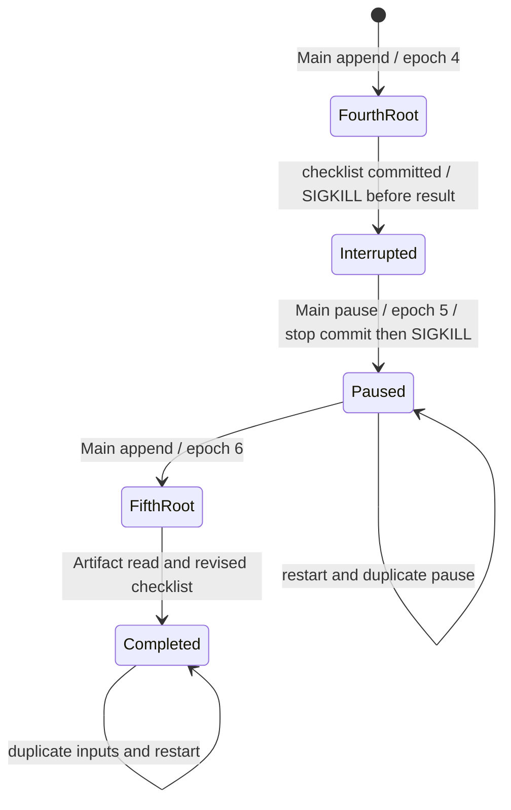

# GC-08 wedding checkpoint

The maintained CLI runner drives Golden §8.9's original three inputs and exact
clock, event, C1/C2/C3 deadlines and contacts. Six variants include three wordings
and three source order/noise changes. It selects an explicit scripted provider;
there is no answer/Tool plan added to user input and no production model claim.
An additional locked continuation fixture exercises pause, restart and changed
dates on that same Task. The original source and three turns remain unchanged.

```sh
make build
python3 scripts/verify_gc08.py --binary bin/erii --evidence evidence/gc08.json
python3 scripts/prepare_release_eval.py --input evidence/gc08.json --evidence evidence/gc08-judge.json
```

`make verify` includes this complete six-variant gate in its communication shard (the maintained MCP sandbox is provisioned there).
`--variant base` is a focused diagnostic, never a complete Judge input.

Launch uses an isolated MainHarness configuration and stdio MCP peer. Doctor
selects/tests an explicit fixture profile and validates the fixture/source lock.
Drive sends the three original inputs through `chat send/work`. Main reads the
fixture via MCP, creates one Task, then searches and appends that same Task twice.
The fixture's `task_wedding` is an external event alias; Host Task/Run identities
remain opaque and runtime generated. The source's clock is fixed; native audit
timestamps record actual execution time. No production clock is overridden.

The first Root saves the blocked C1→C2 checklist and lower priority C3. A new
Root saves 128 guests, completed C1, active C2 and unknown table/per-table counts.
Both results return through Reporter to Main. The third Root preserves those
facts in a new checklist with the hotel email draft and empty attachment list.
The ordinary external-effect Tool freezes that exact draft for approval. The
runner grants no send consent: the expected checkpoint is a waiting Root and
pending approval, zero provider attempts and zero remote mail. Owner CLI reopens
all three Artifacts and checks native content hashes, Task and Root ownership.

Evidence retains each turn's native Task/instruction/Run/model/Tool/Reporter/
conversation/Artifact/approval state, CLI-opened bytes, frozen call hash, wrong
hash rejection, actual SIGKILL at the pending scan boundary, and identical state
after restart plus duplicate input replay. A separate denial checkpoint verifies
APPROVAL_DENIED with zero attempts, one result per Root, terminal state and
idempotent denial replay. The independent peer has no network or domain DB
access, no Gold correction and no deduplication that could conceal a bad send.
Cleanup joins owned children and removes disposable state; failures retain their
receipts. Unit regressions reject dependency/fact/contact/hash/attempt drift and
the fixture's source-title/intent parsing errors found during development.

## Pause and continue variant

`gc08-lifecycle-v1.json` and its source lock extend each of the six journeys
after denial. A literal continue instruction creates Root 4. It saves and
selects a fourth checklist; a real SIGKILL at `before_result_commit` leaves that
committed work without a final result. Main searches the existing Task and
pauses it. A second SIGKILL at `after_stop_commit` preserves the accepted stop;
restart settles Root 4 as `cancelled` with `task_paused`. The paused state and
all committed output survive duplicate pause ingress.

The next original-language instruction changes the wedding date to November 8
and the C2/C3 deadlines to October 29/November 1. It does not repeat 128 guests.
Main appends the same Task and creates Root 5 at epoch 6, preserving all prior
Root rows. Compaction has clipped the original inline source in this bounded
fixture. The scripted Worker re-reads source through MCP and reads the prior
committed checklist through the ordinary scoped Artifact Tool. It saves the
new dates with 128 guests, completed C1, unblocked C2, and unknown table counts.
No Tool has domain-store access and no fixture increases the context window.



The 33 additional assertions inspect this finite trace, including frozen
completed model/Tool records, no stale result from Root 4, all five CLI-opened
Artifacts with hashes/ownership, one completion per successful Root, retained
denial and zero mail attempts. Mutation regressions reject wrong epochs, revived
Roots, stale dates, missing read results, lost Artifacts and unexpected effects.
They supplement the Task-control race/late-write tests, not replace them.

**Open policy gap:** normal `task_manage(create)` currently defaults to
`completion_policy=once`; only Automation explicitly creates `ongoing` Tasks.
The observed wedding Task therefore completes between successful Roots, while
keeping the same identity for later append. This does not satisfy §7 GC-08's
continuous active Task obligation or baseline §3.6 for ongoing work. The ledger
records that conflict and awaits an owner decision on the explicit creation
contract. This harness does not change the Task schema or invent a policy.

Judge preparation recomputes assertions and allowlists fixture, visible dialogue,
Artifact summaries, the locked continuation inputs and recomputed lifecycle
assertions. All six previews remain ineligible, scores
and comparison winner null. These observations prove scripted mechanics only.
They do not establish unscripted planning quality, weeks of event management,
calendar/reminder variants or real hotel delivery. Broader GC-08, all original
release thresholds, protected series, actual local/account comparison, current
L2/named human review and the individual normative audit remain required.
