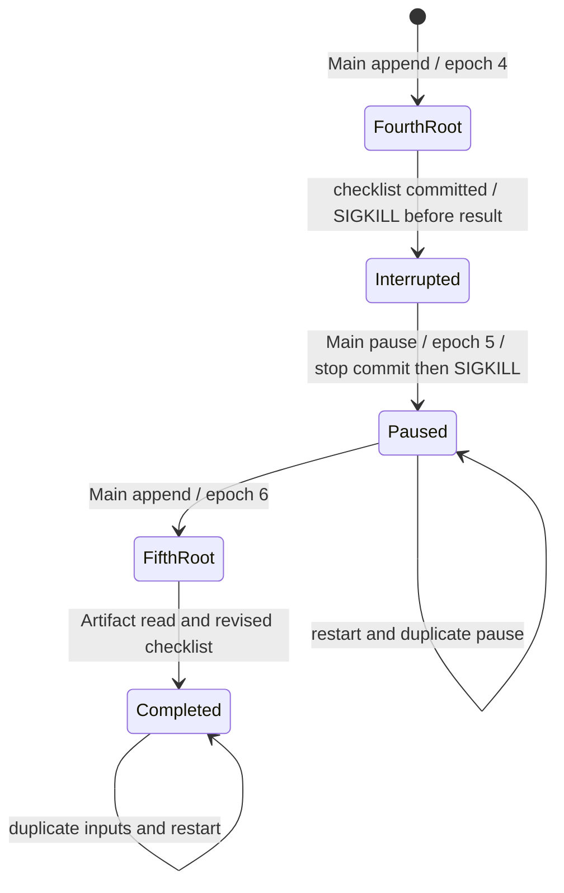

# GC-08 wedding verification

The maintained CLI runner drives Golden §8.9's original three inputs and exact
clock, event, C1/C2/C3 deadlines and contacts. The original six variants include three wordings
and three source order/noise changes. A seventh adds unrelated guest/table counts;
those counts must never become wedding facts. It selects an explicit scripted provider;
there is no answer/Tool plan added to user input and no production model claim.
An additional locked continuation fixture exercises pause, restart and changed
dates on that same Task. The original source and three turns remain unchanged.

```sh
make build
python3 scripts/verify_gc08.py --binary bin/erii --evidence evidence/gc08.json
python3 scripts/verify_gc08.py --binary bin/erii --evidence evidence/gc08.json --validate
python3 scripts/prepare_release_eval.py --input evidence/gc08.json --evidence evidence/gc08-judge.json
```

`make verify` repeats the seven-variant gate and four safety probes five times
in its communication shard. Repetitions remain serial. Two independent isolated
fixtures can run together through the maintained process-owning pool;
`--variant-jobs 1` selects serial diagnostics. The MCP sandbox is provisioned there.
`--variant base` is a focused diagnostic, never a complete Judge input.

Launch uses an isolated MainHarness configuration and stdio MCP peer. Doctor
selects/tests an explicit fixture profile and validates the fixture/source lock.
Drive sends the three original inputs through `chat send/work`. Main reads the
fixture via MCP, creates one explicit `ongoing` Task, then searches and appends
that same Task twice. Successful Roots leave the Task active between turns.
The fixture's `task_wedding` is an external event alias; Host Task/Run identities
remain opaque and runtime generated. The source's clock is fixed; native audit
timestamps record actual execution time. No production clock is overridden.

The first Root saves the blocked C1→C2 checklist and lower priority C3. A new
Root saves 128 guests, completed C1, active C2 and unknown table/per-table counts.
Both results return through Reporter to Main. The third Root preserves those
facts in a new checklist with the hotel email draft and empty attachment list.
The ordinary external-effect Tool freezes that exact draft for approval. The
original three-turn checkpoint grants no send consent: the expected checkpoint is a waiting Root and
pending approval, zero provider attempts and zero remote mail. Owner CLI reopens
all three Artifacts and checks native content hashes, Task and Root ownership.

Evidence retains each turn's native Task/instruction/Run/model/Tool/Reporter/
conversation/Artifact/approval state, CLI-opened bytes, frozen call hash, wrong
hash rejection, actual SIGKILL at the pending scan boundary, and identical state
after restart plus duplicate input replay. A separate denial checkpoint verifies
APPROVAL_DENIED with zero attempts, one result per Root, terminal state and
idempotent denial replay. The independent peer has no network or domain DB
access, no Gold correction and no deduplication that could conceal a bad send.
Cleanup joins owned children and removes disposable state; failures retain their
receipts. Unit regressions reject dependency/fact/contact/hash/attempt drift and
the fixture's source-title/intent parsing errors found during development.

## Pause and continue variant

`gc08-lifecycle-v1.json` and its source lock extend each of the seven journeys
after denial. A literal continue instruction creates Root 4. It saves and
selects a fourth checklist; a real SIGKILL at `before_result_commit` leaves that
committed work without a final result. Main searches the existing Task and
pauses it. A second SIGKILL at `after_stop_commit` preserves the accepted stop;
restart settles Root 4 as `cancelled` with `task_paused`. The paused state and
all committed output survive duplicate pause ingress.

The next original-language instruction changes the wedding date to November 8
and the C2/C3 deadlines to October 29/November 1. It does not repeat 128 guests.
Main appends the same Task and creates Root 5 at epoch 6, preserving all prior
Root rows. Compaction has clipped the original inline source in this bounded
fixture. The scripted Worker re-reads source through MCP and reads the prior
committed checklist through the ordinary scoped Artifact Tool. It saves the
new dates with 128 guests, completed C1, unblocked C2, and unknown table counts.
No Tool has domain-store access and no fixture increases the context window.



The 39 additional assertions inspect this finite trace, including frozen
completed model/Tool records, no stale result from Root 4, all five CLI-opened
Artifacts with hashes/ownership, one completion per successful Root, retained
denial and zero mail attempts. Mutation regressions reject wrong epochs, revived
Roots, stale dates, missing read results, lost Artifacts and unexpected effects.
They supplement the Task-control race/late-write tests, not replace them.

The recovery completion gate reads the native Worker result, TaskUpdate,
Reporter Inbox and final Main Conversation message, including the selected
Artifact reference and successful delivery row. It requires a successful revised
checklist receipt and exactly one source read, Artifact read, save and publish
in the resumed Root. A completed Run with a failure message is rejected even
when the revised Artifact is correct. Judge preparation recomputes these checks;
forged saved assertions cannot hide an inconsistent or failed delivery.

The scripted model handles completed save/publish receipts before recovering old
inputs. After a verified publish it delivers the revised checklist without
re-reading compacted source or repeating writes. Missing, failed or mismatched
Artifact receipts remain unverified. The Go regression uses the real Context
Builder across read → save → publish → completion and proves old reads were
removed. Python mutation tests cover each delivery boundary and the original
false-success report. This fixes fixture progress recognition; it neither widens
the context window nor changes the Host replay or publication protocol.

The incomplete pause Tool is intentionally interrupted after its domain receipt
commits but before its Tool result commits. Recovery starts one additional
`safe` attempt with the same invocation/call hash and returns that receipt; it
does not repeat the pause transition. Assertions require exactly one recorded
pre-crash attempt and two final attempts for that invocation, unchanged frozen
parameters and unchanged Task receipt tables. Every other successful Tool keeps
one attempt, every previously completed call stays unchanged, and mail stays at
zero attempts. The initial Ubuntu receipt exposed the incorrect assumption
that even this incomplete call must have one attempt; the replacement
regressions reject parameter drift, changed policy, extra attempts and duplicate
domain receipts. The original failed CI remains failed evidence.

## Completion and external-effect safety

After revised-checklist delivery, a supplemental explicit user instruction
completes the same ongoing Task. A SIGKILL after the completion transaction and
before the Tool result commits proves recovery reuses the domain receipt. The
Task retains its identity, policy, epoch and five CLI-reopened checklist versions;
completion creates no Root, synthetic TaskUpdate or Reporter follow-up. Duplicate
input and restart preserve complete final state.

Four additional isolated copies of the original three turns exercise consent:

| Probe | Native result |
| --- | --- |
| Approved frozen draft | Exactly one Fake mail row matching recipient, body, subject and empty attachments; one succeeded Tool attempt and verified Main delivery. |
| Lost acknowledgement | Peer commits mail then exits before reply; one unknown Tool attempt and unknown TaskUpdate, no false success or resend. |
| Crash after effect | SIGKILL at `before_tool_commit` after the independent mail row exists; restart preserves unknown with one attempt and one effect. |
| Cancel pending approval | Main cancels the same Task; SIGKILL after stop commit, then restart invalidates consent, fences the Root and sends nothing. |

All variants retain wrong-hash rejection, original denial, pause/continue,
completed-call reuse and duplicate-ingress assertions. These are synthetic
consent probes, never authorization to contact a real hotel. No application,
payment, attachment revision or Child is requested by this wedding fixture;
native inventories assert no invented Tool or Child. Empty attachments are part
of the exact frozen draft.

## Receipts and proof limits

The supplemental journey lock binds the unchanged original fixture/continuation
locks and all 19 frozen GC-08 blocks from manifest SHA256
`0120228762abfe54dd477bc27853b3b45338d0ea5f19363a3d3b742224f5c556`.

| Frozen source lines | Mechanical boundary |
| --- | --- |
| 257, 259, 267 | Original event/checklist plus bounded continuation; weeks and calendar/reminder coverage remain incomplete. |
| 261, 262, 265 | One ongoing Task, dependency/fact checklist, append/new Root, explicit final completion and retained audit Artifacts. |
| 263 | Existing-Task reminder admission is missing; ERII-377 owns the shared prerequisite. No daily-reminder claim. |
| 264 | Frozen hotel draft, wrong hash/denial/consent, cancellation and unknown-effect non-retry; applications/payments are not requested. |
| 726, 728, 738, 740, 741, 742 | Exact original source clock, deadlines, contacts and all three original inputs. |
| 744, 746, 747, 748, 749 | C1→C2, 128 guests, unknown table counts, pending frozen draft, lower-priority C3. Scripted planning quality remains ungraded. |

`--validate` recomputes every original, denial, lifecycle, completion and safety
assertion, including native save Tool arguments/results against CLI-reopened
Artifact bytes. Source SHA/diff, binary SHA/build, platform, Python, Node and Go
identities are retained. A small `gc08_native_manifest` binds full raw bytes by
relative path, size and SHA256 under `.gc08-native/`. CI excludes that hidden
folder from routine uploads; retain it locally for independent review. Missing,
changed or symlinked evidence is inconclusive, never a PASS. Regression probes
reject forged flags, summary/native drift, stale facts, duplicate effects,
changed attempts/epochs, false crashes, lost Artifacts and revoked cancellation.

Judge preparation recomputes all gates and emits seven ineligible previews with
null scores/winner. `semantic_score=null`, `release_ready=false` and
`acceptance_complete=false` remain explicit. Hashes bind consistency, not trusted
execution attestation. Clean exact-SHA independent review remains required.

The maintained `unscripted_cases.py freeze --case GC-08 --variant base` transports
only locked source data and the three original user turns through production Pi
Bridge and an operator-prepared profile. Loopback verifies transport and cleanup;
it supplies no model-quality evidence. Full lifecycle, live connector/model,
weeks, current L2 and release evaluation remain with
[ERII-223](https://multica.ai/erii-studio/issues/01a16936-335f-72a4-a7f4-618823a87151).

**Implementation prerequisite:**
[ERII-377](https://multica.ai/erii-studio/issues/01a174d2-89fd-7dee-92cc-974ad4bf98fe)
tracks reminders against an existing Task and cancellation ownership. The current
Automation contract creates its own Task on first fire and cannot bind the
wedding Task. Do not fabricate a second event Task or claim full GC-08 acceptance.
After that mechanism merges, ERII-254 must merge main and verify the combined
Case on a new SHA before final acceptance review. Partial progress stays Draft.
