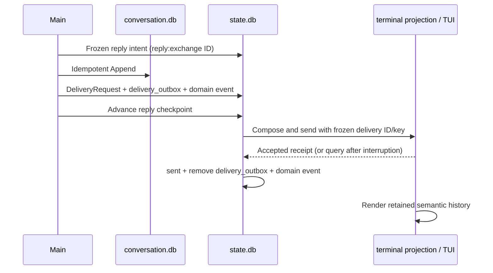

# Recoverable semantic delivery (ERII-15)

Main replies reach the local terminal through a durable Delivery Outbox. The
Conversation stores semantic content; `state.db` stores delivery intent,
transport state, and the terminal's immutable accepted-message projection.
No online accounts, broker, or model inference are needed to drain accepted
deliveries. Web/Feishu adapters and UISpec composition remain M7 work.



There is no distributed transaction. A restart reuses the accepted generation,
reply intent and IDs, appends missing semantic messages, enqueues missing delivery
requests, then advances the checkpoint. Sending never rewrites Conversation.
Duplicate ingress callbacks keep the original Main receipt. Repeated Reporter
events keep the original Main follow-up. Repeated enqueue checks all frozen
identity fields and fails closed on drift.

The producer owns the private enqueue boundary (`delivery/sqlite.Enqueue` inside
its transaction); `delivery.Service` owns transport and reconciliation; adapters
own presentation and delivery receipts. Tools and Workers do not select a
channel or send completion messages. The composer accepts assistant semantic
parts, including opaque Artifact references, and rejects Tool traces. No arbitrary
HTML or executable UI enters the protocol.

| State | Meaning | Next state |
| --- | --- | --- |
| pending | Durable intent, no dispatch claim | sending |
| sending | Leased attempt; a crashed sender may have sent | sent, retry, failed, unknown; expired lease may be reclaimed |
| retry | Known transient failure with no effect; persisted wake time | sending |
| sent | Authoritative accepted receipt | Terminal |
| failed | Definitive rejection or exhausted known-safe retries | Terminal |
| unknown | Outcome cannot be established | Query only; sent/failed on authoritative evidence |

Each claim has a fresh Host token and expiry, plus a version checked by CAS.
A late acknowledgement cannot
change a newer owner's row or a terminal receipt. Delivery state and its internal
CloudEvent commit together. `delivery_outbox` owns transport work and is distinct
from `event_outbox`, which propagates internal domain events.

An adapter declares whether the provider guarantees idempotency for the frozen
action/key. Recovery queries a prior sending attempt first. An authoritative
absence permits another send only through an idempotent adapter: the expired
sender may still be alive. A provider without idempotency or a reliable query
remains unknown. An unknown row is never automatically resent, even when a later
query reports absence. Raw provider errors are replaced with bounded codes.

The local terminal adapter implements acceptance as an immutable unique-key
insert into `terminal_message` in `state.db`, with an internal acceptance event.
Acceptance and acknowledgement use separate transactions. The TUI reads that
retained projection rather than displaying pending assistant intents. Physical stdout has no acknowledgement
protocol: reconnect and `/history` can show accepted history again. This is one
stored semantic message, not generic exactly-once rendering or external delivery.

Only completion, failure, needs-input and approval intents can enqueue. Progress
updates remain read-only activity and create no notification or Main inference.
Root completion/failure goes through Reporter and Main. Security originates
approval notices in the invocation transaction, then the normal Conversation-first
recovery path delivers them. `/approve ID HASH` and `/deny ID HASH` submit the
displayed frozen hash to Security and wake the original Run. Duplicate matching
decisions remain idempotent. Approval expiry/invalidation still fails closed.

## Commands and operations

```sh
bin/erii delivery list  # retained requests, including unknown/failed
bin/erii delivery work  # one eligible transport/reconciliation scan
bin/erii chat work      # drain Agent work, then delivery
bin/erii tui            # live delivery polling and /history
```

Delivery work runs even with `setup_required`; it does not activate an implicit
provider. TUI polls persisted transport work every 250 ms, including after its
Agent drain becomes idle. Semantic `chat history` remains independent of send
status. It can fill Conversation intents, but does not claim channel acceptance.

`config.example.yaml` documents `delivery.lease_seconds` (1–300),
`retry_milliseconds` (1–60000), and `max_attempts` (1–20). Defaults are 5 seconds,
250 ms, and five attempts. Known transient failures use bounded exponential
backoff. Failed requests remain inspectable; there is no automatic resend or
delete command. Unknown rows retain their uncertainty and reconcile by query.
Future remote adapters must supply their own truthful idempotency/query contract.

State migration v12 preserves v11 requests, keys, status, attempts and history;
it renames the old local channel `local_cli` to `tui` and creates outbox rows only
for pending requests. Prior sent messages remain visible as retained history,
without being resent. Empty/prior schemas and failed-DDL rollback are tested.
The terminal projection is part of state schema v12. Keep `state.db`,
`conversation.db`, and their SQLite WAL files together during operational backup.
New database files use mode 0600 in the private data root.

## Inspectable verification

`make verify` runs `scripts/verify_delivery.py` five times. It reuses
`MainHarness` and `Terminal` for Launch, Doctor, Drive, Evidence and Cleanup.
Each run captures 20 actual SIGKILL/restart cases: Main and Root final replies at
Conversation append, delivery commit, checkpoint, send and acknowledgement
boundaries. Root acceptance is delivered before faulting its final Main follow-up.
Database snapshots prove one semantic message/receipt, correct destination,
retired outbox, reused generations, and read-only duplicate scans. PTY transcripts
prove final replies and frozen-hash approvals reach the real terminal surface.

The explicit `-test-delivery` Fake requires `-test-bridge` and supports
`retry-once`, `unavailable`, `ambiguous`, and `unknown`. It wraps the same durable
terminal acceptance boundary. Recovery evidence covers bounded retries, query-only
unknown, accepted-send reconciliation, and duplicate approval callbacks without
unnecessary Main inference. Go tests additionally cover concurrent consumers,
claim fencing, identity drift, atomic event failures, legal/illegal transitions,
and populated v11 migration. These are M3 conformance fragments, not full product
Golden Case scores or a claim that M5 Durable Replay is complete.
