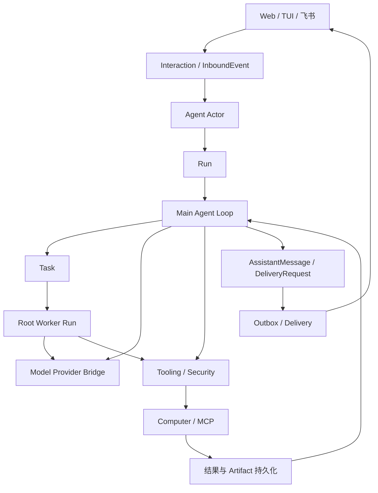

# Erii 技术方案基线（已确认设计）

> 版本：Baseline v1.0  
> 日期：2026-10-15  
> 状态：MVP 实现基线，可直接交付 Coding Agent  
> 记录原则：正文写入已确认语义、实现默认值与验收边界；仍可替换但不阻塞开工的选择统一放在“后置决策事项”。

## 0. 文档效力与实现规则

本文是 Erii MVP 的实现源文件。Coding Agent 开工时遵循以下优先级：

1. 本文中的状态机、权限边界、持久化时序、模型可见 Tool Schema 与验收场景属于规范性要求。
2. TypeScript、Go 和表结构片段用于定义协议与最小字段，不要求逐字采用命名，但实现必须保持同等语义，并用测试证明兼容。
3. “一期不做”与“后置决策事项”不得被擅自扩展为首期功能；内部可以预留接口，但不得为假设中的未来需求建立第二套领域模型。
4. 若实现细节存在歧义，优先选择能够保持数据可恢复、权限不扩大、外部副作用不重复的最小方案，并提交 ADR；不得以猜测修改模型可见协议。
5. 任何协议变更先更新本文及契约测试，再修改实现。数据库内部字段可以向后兼容地增加，模型可见 Tool Schema、事件版本和 Artifact 引用格式必须显式版本化。
6. 《Erii Baseline Golden Cases》是本文的配套产品验收规范。本文定义协议与不变量，Golden Cases 定义端到端用户场景、测试夹具、评分和发布门禁；两者冲突时先停止实现并更新文档，不得由代码自行选择解释。

MVP 的启动门禁与首条纵向链路是：

`首次启动 → 模型连接/登录 → Model Probe → 激活 ModelProfile → TUI 输入 → Main Run → task_manage(create) → Root Worker Run → agent.run() → Child Run → Root 汇总 → Main 回复 → TUI 展示`

Code Mode、Durable Replay、Approval、Artifact 与 Outbox 必须沿这条链路逐步接入；Web、飞书、多 Agent、云端拆分不得阻塞首条链路。

## 1. 产品定位

Erii 是一个通用私人助理，目标能力对标 Muse、dots、Manus Cue、Grok Bot、Hermes Agent，并参考 Pi 1.2.0 的 Agent Harness 设计。

### 1.1 当前阶段

- 一期只做好一个 Agent。
- 一期采用本地部署，不依赖云端运行时。
- 首次启动必须完成模型连接与主模型选择；一期同时支持本地 OpenAI-compatible 模型端点和 OpenAI “Sign in with ChatGPT” 订阅登录。
- Agent 运行在与宿主机器隔离的 macOS 虚拟机中，可以在虚拟机内安装剪映等桌面应用，并通过 Computer Use 或 MCP 操作应用。
- 一期采用模块化单体；模块边界和协议提前抽象，以便未来拆分为云服务。

### 1.2 长期形态

- 一个用户可以创建多个 Agent。
- 多个 Agent 彼此平等，均由用户直接调用，不设置默认的上下级关系。
- 本地与云端使用相同的核心协议和接口，仅替换底层 Provider 与部署组件。

### 1.3 用户交互原则

- 用户与 Agent 的主要交互永远是自然语言对话，而不是任务管理页面。
- Web 用于用户在电脑前交代和查看工作。
- TUI 用于研发、测试与调试。
- 飞书是未来便携下达任务和接收通知的主要渠道，默认通知到飞书，但可配置。
- 用户只感知 Agent 是“空闲”还是“忙碌”，以及当前有哪些持续进行中的工作。
- 用户通过对话追加指令、暂停、恢复或取消工作；进度页面只提供读取能力。
- 原始模型调用、工具调用和工具返回轨迹仅对研发调试开放。

## 2. 总体架构



主链路定义为：

`ChannelMessage → Interaction → InboundEvent → AgentActor → Run → MainAgentLoop → Tooling → Security → Computer/MCP → ResultPersistence → MainAgentLoop → AssistantMessage → DeliveryRequest → Outbox → Delivery → Channel`

创建异步任务时，从 Main Agent Loop 分支为：

`MainAgentLoop → Task → WorkerRun → WorkerAgentLoop → ResultEvent → MainAgentLoop`

### 2.1 Agent Actor 与 Main Agent Loop

- `Agent Actor` 是每个 Agent 的运行协调器，负责接收事件、创建 Run、处理并发、顺序和生命周期。
- `Main Agent Loop` 是面向用户的主推理循环，负责理解对话、做决策、调用工具、解释结果和生成回复。
- 两者不能合并：Actor 管运行秩序，Main Agent Loop 管智能行为。
- 用户可见消息只能由 Main Agent Loop 产生。

### 2.2 主循环与 Worker 循环

- 当前对话由 Main Agent Loop 负责。
- 实现层只有一套可复用 Agent Loop 内核。`Main` 与 `Worker` 是两种运行角色；`Root Worker` 与 `Child Worker` 又是 Worker Run 在 Run 树中的两种位置，不实现第三套 Child Agent Loop。
- 只要工作是异步、耗时，或计划中包含并行 Child Run，Main Agent Loop 就在执行前显式创建一个 Task，并启动一个 Root Worker Run；`agent.run()` 和 Runtime 都不会把正在执行的工作自动“升级”为 Task。
- Main Run 默认不能创建 Child Run，也不暴露 `agent.run()`。短时、同步且不需要独立 Agent Loop 的工作可以留在 Main Run 中直接推理或调用普通 Tool；一旦需要另一个 Agent Loop，即由 Main 创建 Task 并委派给 Root Worker Run。
- 这一限制是当前产品的默认 Capability Policy，不写死为 Agent Loop 内核限制；未来若需要允许 Main 直接创建 Child，只调整工具暴露与 Parent 校验，不重构 Run、ToolInvocation 或 Worker Loop。
- 同一 Task 同时最多只有一个活动 Root Worker Run；任务内部的并发统一由该 Run 的 Child Run 表达。不同 Task 的 Root Worker Run 可以并行。
- Root Worker Run 拥有独立上下文，可以与 Main Agent Loop 及其他 Task 的 Worker 并行运行。
- Worker 不直接向用户发消息。
- Worker 的完成、失败和异常都以事件返回 Main Agent Loop，由 Main Agent Loop 结合当前对话、人格和渠道决定如何告知用户。
- 即时 Run 通过当前对话自然呈现，不额外作为用户界面中的任务项目展示。

## 3. Task、Run 与并发模型

### 3.1 核心定义

- `Task` 是可跨多个 Run 持久化的工作对象。
- 不额外区分“长期 Task”和“短期 Task”。
- `Run` 是一次有明确开始和结束的执行实例。
- `Root Worker Run` 是直接推进某个 Task 的执行实例，必须关联该 Task。
- `Child Run` 是由 `agent.run()` 创建的子执行实例，只通过 `parent_run_id` 形成 Run 树；每次 `agent.run()` 永远只创建一个 Child Run，不创建 Task。
- Root Worker 与 Child Run 都执行同一套 Worker Agent Loop：前者是 Task 的根执行者，后者是某个 Worker Run 委派出的通用 Worker。两者共享工作面能力，但在 Prompt、归属、输入来源、结果去向和生命周期上不同。
- Root Worker 额外获得精简的 Agent Identity/人格片段与完整 Task Context，对 Task 结果负责；Child 不自动继承 Agent 人格、Conversation、Memory 内容或 Parent 模型上下文，只接收通用 Worker 规则、显式 `task` 和可访问的 ArtifactRef。Root 与 Child 均可在当前用户与 Agent 数据作用域内，按需调用只读 Memory/Conversation 检索工具补充持久化上下文。
- Main Agent Loop 和 Worker Agent Loop 都会产生 Run，但通过所属 Agent、Task、Conversation 和 Run ID 隔离，不发生语义冲突。

“分析 100 条数据”的典型结构是 `1 Task + 1 Root Worker Run + 100 Child Run`，而不是 100 个 Task。

### 3.2 用户视角

- Task 是后台为了异步、并行和持续执行而设计的内部抽象，用户不需要理解 Task 概念。
- 用户看到的是“持续进行中的工作”，而不是技术性的 Task/Run 列表。
- “完成”只表示本轮工作暂时结束，不代表用户目标永久结束。
- 健身计划、客户关系维护等工作可以在完成后再次恢复和继续。

### 3.3 并发规则

- 不同 Task 的 Root Worker Run 可以并行；同一 Task 只允许一个活动 Root Worker Run。
- 同一 Root Worker Run 可以通过 `agent.run()` 创建多个并行 Child Run；Child Run 也可以继续创建后代 Child Run。
- RunScheduler 对实际并发、Run 树深度、后代总数和安全配额实施宿主限制，JavaScript 创建的 Promise 数量不等于实际并发数。除并发额度外，其余系统硬上限保持较高，只用于防止递归爆炸、无限循环和资源失控；不以较小的 Root 级 Token、费用或总运行时长预算截断正常复杂任务。
- Main Agent Loop 在 Worker 执行时仍可继续接收用户消息。
- 新消息若与现有工作相关，在下一个稳定边界注入该 Task 的活动 Root Worker Run；若当前没有活动 Root Worker，则为原 Task 创建新的 Root Worker Run。无关工作按创建条件决定是否创建新 Task。
- macOS 操作也应尽可能并行，例如桌面应用操作和浏览器操作在不冲突时可同时进行。
- 是否允许具体 Computer 操作并行，由 Computer/VM 层根据资源占用和锁冲突判断。
- 系统只保证同一聚合对象内部的必要顺序，不使用全局串行执行。

### 3.4 Conversation、Main Run 与 Worker Run 的关系

- 一个 Agent 只有一条跨 Web、TUI 和飞书共享的主 Conversation。
- Worker 只维护独立执行上下文，不创建用户可见 Conversation。
- 每个 Agent 同时最多只有一个活动 Main Run，但可并行存在多个 Task 的 Root Worker Run，以及受配额限制的 Child Run。
- Main Run 忙碌时的新消息作为事件注入当前 Main Run，而不启动第二个 Main Run。
- 活动 Main Run 在下一个稳定边界优先接收用户 Steering，不等待整个 Run 结束。
- Root Worker 只在完成、失败、需要用户信息或外部副作用状态无法确认时生成 Main Follow-up；Child Run 的结果只返回直接 Parent，由 Root Worker 汇总后决定是否形成 Main Follow-up。Main Run 活动则排队到当前 Run 结束后，Main Run 空闲则触发新的 Main Run。
- 多条用户 Steering 可以批量注入，多条 Worker Follow-up 也可以批量注入，但用户消息与 Worker 消息不进入同一批次；用户 Steering 优先于 Worker Follow-up。Worker Follow-up 默认一次 Drain 当前可用的全部更新，避免多个 Task 同时结束导致 Main 连续启动多轮。
- 同一批次保留为多条独立消息，不拼接原始文本；Steering 的处理优先级高于 Follow-up。
- `AgentStatus` 不单独持久化，而是根据活动 Main Run、Worker Run 和 Task 动态推导为 `idle` 或 `busy`。

### 3.5 Run 状态机

```text
queued → running ↔ waiting → completed / failed / cancelled
```

`waiting` 通过独立的 `wait_reason` 说明原因：

```text
user_input
approval
external_event
resource
```

- Main Run、Root Worker Run 与 Child Run 共用同一个 Run 模型和存储；`kind: main | worker` 区分主循环与工作循环，`task_id` 和 `parent_run_id` 表达归属关系。
- Root Worker Run 必须关联 `task_id` 且没有 `parent_run_id`；Child Run 必须关联一个 Worker `parent_run_id`，并继承同一 `task_id`。当前默认策略下不存在由 Main Run 直接创建、没有 `task_id` 的 Child Run。
- 取消 Parent Run 或承载它的 ToolInvocation 时，取消意图沿 `parent_run_id` 形成的 Run 树递归传播；无法确认的外部副作用进入 `unknown`。
- Run 的终态不可逆；同一工作再次执行时创建新 Run。

### 3.6 Task 状态机

```text
active / paused / completed / cancelled
```

- Task 不设 `failed`；执行失败属于 Run，不代表用户的持续工作失败。
- `paused` 表示预计继续。
- 一次性 Task 在 Root Worker 成功且其 Run 树没有未结束后代时自动进入 `completed`。
- 持续、定时或等待外部事件的 Task 在一轮 Root Worker 结束后保持 `active`，没有可执行工作时可以进入 `paused`。
- Root Worker 失败不自动把 Task 结束为失败；失败属于 Run，由 Main Agent、后续 Root Worker 或用户决定是否继续。
- `cancelled` 表示明确终止当前调度、取消活动 Run，并拒绝迟到的 Worker 结果。
- `completed` 和 `cancelled` 都不是永久不可恢复状态；用户要求继续时，Main 对原 Task 调用 `task_manage(append)`，由 Host 将 Task 重新激活并创建新 Run，旧 Run 保持原终态。

### 3.7 Run 与 Agent Loop

- Run 是持久化执行实例，记录身份、状态、归属、时间和恢复信息。
- Agent Loop 是推动 Run 执行的算法，一次 Loop 调用可包含多个 Turn。
- Turn 沿用 Pi 的运行时定义：一次 Assistant 响应及其工具调用与结果。
- 一期不建立独立 Turn 实体或数据表，RunTrace 使用 `step_index` 记录 Loop 内部步骤。
- 一个 Run 可以因等待、审批或恢复而包含多次 Loop 调用；一次 Loop 调用只服务一个 Run。

### 3.8 Main、Root Worker 与 Child 的 Prompt 组装

Prompt 使用可组合片段，不为三种 Run 维护三份彼此分叉的完整 System Prompt：

| Prompt 片段 | Main Run | Root Worker Run | Child Worker Run |
|---|---:|---:|---:|
| Core Safety / Tool Policy | 有 | 有 | 有 |
| 完整 Agent 人格与用户交互风格 | 有 | 无 | 无 |
| 精简 Agent Identity / 稳定行为原则 | 已包含在完整人格中 | 有 | 无 |
| Conversation 与当前交互上下文 | 有 | 无 | 无 |
| Task Context 与持续状态 | 按需读取摘要 | 完整 | 仅 Parent 显式传入部分 |
| 通用 Worker 执行规则 | 无 | 有 | 有 |
| `agent.run()` 能力说明 | 无 | 有 | 按 Capability Policy 提供 |

- Main 面向用户，对用户关系、意图协调和最终表达负责。
- Root Worker 面向 Task，保持该 Erii 的稳定身份与行为原则，但不承担聊天语气和渠道表达。
- Child 面向直接 Parent，是无独立人格的通用执行单元；它不得凭空假设未显式提供的用户背景。
- Prompt 片段由 Context Builder 按 Run 位置组装；是否暴露 `agent.run()` 由 Tool Exposure/Capability Policy 决定，而不是通过复制或分叉 Agent Loop 实现。
- Main 与 Root 共享同一份 Agent 基础能力配置，包括普通 Tool、CUA、Skill、数据作用域和 Security Policy；Host 再按 Run Role 自动派生能力表面。Main 额外拥有 Task 控制和用户交付能力且默认没有 `agent.run()`；Root 不拥有 Task 控制或用户交付能力，但拥有 `agent.run()`。
- Root 能力不在 `task_manage(create)` 中指定。Host 创建 Run 时根据当前 Agent 配置与 Run Role 生成带版本的 Capability Snapshot；Run 期间配置变化不影响该 Run，新 Run 使用新版本。
- Child 默认完整继承直接 Parent Worker 的 Capability Snapshot，并应用 Child 固定禁用项；调用方不在 `agent.run()` 中指定 Tool、Skill 或权限。Child 只能缩小能力，不能扩大能力、提升权限或加载 Parent 不具备的 Skill。
- Root 与 Child 都可以调用只读 `memory_search` 和 Task Artifact 检索；`memory_search` 统一召回长期 Memory 与 Conversation 历史。检索结果只进入发起查询的 Run，不自动注入或同步给 Parent、Sibling。共享持久化用户信息不等于共享 Parent 的运行上下文。
- Loop 函数命名为 `RunAgentLoop` 和 `ContinueAgentLoop`；领域层使用 `CreateRun`、`ClaimRun` 与 `CheckpointRun`。产品层不存在复活旧 Run 的 `ResumeRun`：用户继续 Task 时创建新 Root Run，基础设施故障恢复则重新 Claim 同一个未终结 Run。

### 3.9 Task Tool

Main 对 Task 的模型可见能力只保留两个 Canonical Tool：

```text
builtin__task__search
builtin__task__manage
```

- `task_search` 是统一的只读发现工具：省略 `query` 时按 `scope/status` 列出当前或最近 Task；提供 `query` 时对历史 Task 做关键词与语义混合检索。不另设 `task_list` 或 `task_query`。
- `task_manage` 是统一的状态变更工具，使用判别联合支持 `create/append/pause/cancel`，不拆成四个工具；不向模型暴露独立的 `resume` 操作。
- 两者复用统一的 `ToolSpec → ToolInvocation → ToolExecutor` 管线；Task Tool 是 Main 的控制面能力，Root/Child Worker 默认不可见。
- `task_search` 返回内部 `TaskRef`、标题、目标摘要、状态、最近进度和更新时间，不返回 Root Run ID、Run 树或内部轨迹。唯一高置信匹配可继续；多个合理候选必须由 Main 向用户澄清。
- `task_manage(create)` 原子创建 Task、保存 Task Anchor、创建首个 Root Worker Run 并发布 `run_ready`；它只返回接收凭证，不等待任务完成。
- `task_manage(append)` 追加持久化 `TaskInstruction`，不覆盖原 Task Anchor。Task 为 `active` 且存在活动 Root 时，在稳定边界向该 Root 注入指令；Task 不是 `active`，或没有活动 Root 时，Host 将其置为 `active`、递增 `task_epoch` 并创建新的 Root Worker Run。
- `append` 同时承担“追加要求”和“重新激活”语义。用户只说“继续”“接着做”或“恢复这个工作”时，Main 也可以把该自然语言原样保存为 `TaskInstruction`；这条明确的用户指令就是重新激活的授权，不需要再构造 `resume` 操作。
- 领域层可以保留内部 `TaskService.Reactivate(...)` 动作供 `append` 实现状态迁移，但它不是模型可见 Tool，也不能被模型单独调用。
- Task Tool 的调用键、请求幂等和来源消息引用由 Runtime/ToolInvocation 自动绑定，模型不生成。
- Task 的产品状态仍只有 `active/paused/completed/cancelled`。`queued/running/waiting/failed` 属于 Run/ToolInvocation，不进入 Task 状态机；失败的 Root Run 也不会自动把 Task 改成 `failed`。
- Skill 继续使用有限目录语义的 `skill_list/skill_view`；Memory 与 Conversation 继续通过 `memory_search` 统一召回。Task 采用 `task_search`，因为它既需要无 query 的当前任务浏览，也需要有 query 的历史语义检索。

模型侧的创建与追加参数保持最小：

```typescript
type ArtifactRef = string;
type TaskRef = string;
type TaskStatus = "active" | "paused" | "completed" | "cancelled";

interface TaskSearchRequest {
  query?: string;
  scope?: "active" | "recent" | "all";
  status?: readonly TaskStatus[];
  limit?: number;
}

interface TaskSummary {
  taskRef: TaskRef;
  title: string;
  goalSummary: string;
  status: TaskStatus;
  progressSummary?: string;
  updatedAt: string;
}

type TaskManageOperation = "create" | "append" | "pause" | "cancel";

interface TaskCreateRequest {
  operation: "create";
  task: string;
  artifactRefs?: readonly ArtifactRef[];
}

interface TaskAppendRequest {
  operation: "append";
  taskRef: TaskRef;
  instruction: string;
  artifactRefs?: readonly ArtifactRef[];
}

interface TaskPauseRequest {
  operation: "pause";
  taskRef: TaskRef;
}

interface TaskCancelRequest {
  operation: "cancel";
  taskRef: TaskRef;
}

type TaskManageRequest =
  | TaskCreateRequest
  | TaskAppendRequest
  | TaskPauseRequest
  | TaskCancelRequest;

interface TaskManageReceipt {
  taskRef: TaskRef;
  status: TaskStatus;
  accepted: true;
}
```

`task_search` 返回 `TaskSummary[]`；`task_manage` 返回 `TaskManageReceipt`。两者都不返回 Run ID、ToolInvocation ID、配额或内部错误轨迹；失败使用统一 Host Tool Error。

- `task_search` 无 `query` 时默认 `scope="active"`；有 `query` 时默认 `scope="all"`。`limit` 默认 `20`、最大 `50`，结果按状态相关性、文本/语义相关性和最近更新时间稳定排序。
- `scope="recent"` 查询最近变更的 Task，保留期与数量由 Host 配置；`status` 是附加过滤，不改变 scope。
- `task_manage` 成功只表示变更已可靠接受，不表示 Root Worker 已完成；重复来源消息或重复 ToolInvocation 返回同一 receipt，不创建第二个 Task/Instruction/Run。

- `task` 必须是自包含的自然语言委派简报，在同一个字符串中说明目标、必要背景、约束、完成标准和预期产物；不另设 `goal/context/constraints/successCriteria/deliverables`。
- 背景信息在语义上仍然必要，但不作为独立 `context` 字段暴露；Main 负责把 Root 必须知道的内容写入 `task`。
- 模型不生成 `ContentPart[]`、MIME、Artifact 元数据、来源消息引用、调用键或基础设施 ID；只传递已有的简单 `ArtifactRef` 字符串。
- Host 从 `task` 自动生成用于 Activity 与检索的标题，并把模型参数规范化为内部 Task Anchor：

```typescript
interface TaskAnchor {
  title: string;
  task: string;
  artifactRefs: readonly ArtifactRef[];
}
```

- Host 自动绑定 Agent、Conversation、来源消息、创建 Run、ToolInvocation、时间和安全/预算策略。内部可以继续使用统一 `ContentPart` 表达多模态内容，但该结构不进入模型侧 Task Tool Schema。

### 3.10 暂停与恢复

- Run 只在模型响应结束、工具执行前或工具执行后的稳定边界进入 `waiting`。
- 普通 Steering 沿用 Pi 的稳定边界语义：按持久化顺序注入，不抢占正在执行的单次 Tool Call；同一批中的消息保持独立，不拼接原始文本。
- `task_manage(pause)` 是受控终止而不是粗暴杀进程：Host 先把 Task 标记为 `paused` 并阻止 Root 启动新工作，再等待当前步骤到达可持久化边界；可安全取消的 Tool 和 Child 传播取消，无法立即中止的外部副作用按恢复策略收敛到确定终态或 `unknown`。
- 暂停完成后，旧 Root Worker Run 进入不可逆的 `cancelled` 终态，并记录 `reason: task_paused`；已经提交的消息、Artifact、TaskInstruction、进度和工具结果继续保留。
- 用户随后要求“继续”时，由 Main 调用 `task_manage(append)`：创建新的 Root Worker Run，继承旧 Root 已提交的 Task Context，并从新增指令继续。这里创建新 Run，不复活旧 Run。
- Sidecar、执行器或宿主进程故障后的恢复属于运行时恢复：继续 Claim 并推进同一个未终结 Run，不创建新的业务 Run，也不需要模型调用 `resume`。
- Task 的每次暂停或重新激活都更新 `task_epoch`；Worker 事件与结果携带其启动时的 epoch，Host 拒绝旧 epoch 的迟到写入和用户通知。
- Continuation/Checkpoint 由程序自动生成，模型不感知。
- 等待审批时，系统保存待处理 ToolInvocation 的 `invocation_id`、名称和冻结参数；模型直接调用时同时保存 Provider `call_id`，Code Mode 嵌套调用则保存 Runtime `nested_call_key`，不把等待伪装成工具错误。
- 获批后执行原工具调用、追加 ToolResult，再调用 `ContinueAgentLoop`。
- 暂停是逻辑暂停，不挂住 Goroutine，也不占用 Pod。
- 分布式恢复遵循 `Persist → Release → Claim → Resume`：持久化状态后释放执行者，任意实例均可认领恢复，但同一时刻只能有一个成功执行。

### 3.11 Automation 与 RunScheduler

- 保留独立的 `RunScheduler`，因为定时提醒、周期性简报、持续跟进等能力会较早进入产品。
- 对外能力和领域对象统一命名为 `Automation`；不使用 `ScheduledTask`，避免与 Agent 为并行执行创建的内部 `Task` 混淆。
- `Automation` 表示用户持久化的自动执行意图；一期 `trigger` 支持单次 `at` 与周期 `cron`，并显式保存用户时区。
- `RunScheduler` 只负责持久化触发条件并在到期时产生统一的调度事件，不直接执行 Agent Loop，也不承载业务逻辑。
- 调度事件进入 `AgentActor`，由正常路由规则创建或唤醒 Main Run/Worker Run；定时触发与用户消息复用同一套 Run、权限、工具和交付链路。
- 实际执行仍由 `RunExecutor` 消费 `run_ready`、调用 `RunStore.Claim` 后完成，Scheduler 不绕过 RunClaim。
- 一期不在 Scheduler 内实现资源编排或复杂工作流；未来云端可将触发器实现替换为分布式调度服务，而保持内部事件协议不变。

统一链路为：

`Automation → trigger → RunScheduler → AgentActor → Run → AgentLoop → Delivery`

## 4. Conversation 与消息协议

### 4.1 ConversationMessage

以 Pi 1.2.0 的消息模型为基线，只保留必要类型：

- `UserMessage`：用户输入。
- `AssistantMessage`：Agent 面向用户的语义回复。
- `ToolMessage`：模型上下文中使用的工具结果消息。

Conversation 支持最小必要的多模态语义内容；核心 `ContentPart` 一期包含：

- `text`。
- `image`。
- `audio`。
- `video`。
- `file`。
- `tool_call`。

图片、音频、视频和文件 Part 内部统一使用 `artifact_ref` 寻址；`artifact_ref` 是资源引用机制，不替代资源的语义类型。Intelligent UI 不进入核心 Conversation/AgentMessage 内容协议，而由 Delivery 层生成和持久化渠道投影。

工具执行的完整轨迹不混入用户可见 Conversation，而是进入独立的 RunTrace/Observability 存储。

### 4.2 统一的渠道无关输出

核心输出链路统一为：

`AssistantMessage + DeliveryRequest + Outbox`

- `AssistantMessage` 保存渠道无关的语义内容。
- `DeliveryRequest` 表达投递目标、交付意图和约束，不承载某个渠道专属的最终消息结构。
- `Outbox` 保证投递的可靠性、重试和幂等。
- `Delivery Adapter` 将统一消息转换为飞书、Web、邮件等渠道格式。
- Main Agent Loop 感知 Agent 人格和当前交互场景。
- Task 的普通进度只更新 Progress Store 和用户主动打开的实时界面，不创建主动通知。
- 主动通知仅由四类语义事件触发：工作完成、工作失败、需要用户输入、需要用户审批。渠道只改变呈现方式，不扩大通知范围。
- 渠道适配层负责长度、排版、卡片、附件和 Intelligent UI 等渠道呈现。
- 工具、Worker 和业务模块不需要理解具体渠道。

Intelligent UI 采用 Delivery 层的声明式组件协议 `UISpec`：

- 一期只提供受控组件集合，例如 Markdown、表格、Artifact 卡片、任务进度、确认卡片和表单。
- Web 可完整渲染；飞书映射为消息卡片；TUI 或不支持的渠道自动降级为文本。
- `UISpec` 带 `schema_version`；未知组件或渲染失败时 fail-soft，降级为语义文本，不阻塞消息投递。
- 一期不允许模型生成或执行任意 HTML、JavaScript、React 代码。
- Main Agent Loop 输出渠道无关的语义结果；Delivery Composer 根据语义内容、结构化数据和渠道能力生成 `UISpec`，Agent 不需要感知具体渠道。
- 后续如需更自由的生成式界面，可增加 `builtin__ui__compose`，产出经过 Schema 校验和安全检查的 `UIArtifact`。

### 4.3 Artifact 协议

- 核心协议统一使用 `artifact_ref` 引用文件、图片、视频等产物。
- 模型不得直接输出 `MEDIA:/绝对路径`。
- Artifact 的真实位置、生命周期和访问方式由 Artifact/Computer 层解析。
- Artifact 二进制内容不内联写入可重放的 Conversation 或 Run 历史，避免长会话因 Base64 媒体持续膨胀。
- M3 本地实现的 `builtin__artifact__save/read/describe/list/publish` 经过同一个 ToolInvocation/Executor。`artifact_write` 只允许本地不可变新产物和显式最终输出选择，不允许外部发送、上传或删除；读取使用 `read_only`。单用户安装的 principal 绑定 data root 与 OS 用户，模型不能选择 user/Agent/Task/Run 作用域。详见 [Artifact 实现与运维](artifacts.md)。

## 5. 模型与 Agent 决策

- 一个 Agent 在任一时刻只有一个活动主模型配置；Main、Root Worker 与 Child 默认使用同一配置，不做按任务动态模型路由。
- 首次启动必须由用户完成模型连接、认证、模型选择和能力验证；在产生有效的 Active Model Profile 前，不启动 Agent Actor，也不接受 Conversation/Task。
- 用户可以在设置/TUI 中显式新增连接、重新登录、测试和切换活动模型，但这属于用户控制面，不暴露为模型可调用 Tool。
- 模型切换只影响之后创建的 Run。每个 Run 在创建时冻结 `ModelSnapshot`；Root 的所有 Child 继承同一个 Snapshot，进行中的 Run 不热切换模型。
- 是否使用工具、创建 Task、启动 Worker、召回历史或继续当前 Run，由 Agent 自行决策。
- 模型输出不直接产生外部副作用，所有副作用必须经过 Tooling 与 Security 层。

### 5.1 首次启动设置流程

TUI/Web 首次启动展示阻塞式 Setup Wizard，只提供两条等价的模型连接路径：

```text
Choose model connection
  1. Local / OpenAI-compatible endpoint
  2. OpenAI — Sign in with ChatGPT
```

统一步骤为：

1. 选择连接类型并完成 URL 配置或账号登录。
2. 获取模型目录；目录不可发现时允许手动填写模型 ID。
3. 选择一个模型，并只展示该模型确认支持的 reasoning effort、输入模态和上下文设置。
4. 执行 Connection Test 与 Agent Capability Probe。
5. 测试通过后原子保存 ModelProfile、AuthConnection 引用和 Agent Active Model，并进入正常 TUI。

Setup Wizard 可以安全取消；取消后应用的 `AppReadiness` 保持 `setup_required`，只允许重新进入设置、查看诊断或退出。`AppReadiness` 与运行期仅有 `idle/busy` 的 `AgentStatus` 分离。不得为了“先进入界面”偷偷启用 Fake、无凭据 Provider 或默认收费模型。

`AppReadiness = setup_required | ready | degraded`：`ready` 才开放 Agent Ingress；Active Profile 后续失效时进入 `degraded`，允许查看历史、修复连接和切换 Profile，但不接受新的 Agent 工作。

初次设置完成后，`model list/add/login/logout/select/test` 可以作为 TUI 命令或 Settings API 存在，但不是 `builtin__model__*` Agent Tool。模型不能自行切换到更贵、不同隐私边界或不同账号的 Provider。

### 5.2 统一 ModelProfile

```typescript
type ProviderKind = "openai_compatible" | "openai_account";
type AuthKind = "api_key" | "chatgpt_oauth";
type ModelProfileStatus =
  | "unverified"
  | "ready"
  | "unavailable"
  | "reauth_required"
  | "invalid";

interface ModelProfile {
  profileId: string;
  name: string;
  providerKind: ProviderKind;
  endpoint?: string;
  wireApi: "openai_completions" | "openai_responses";
  modelId: string;
  authConnectionId?: string;
  reasoningEffort?: string;
  contextWindow: number;
  maxOutputTokens: number;
  generationDefaults?: {
    temperature?: number;
    topP?: number;
  };
  compatibility: ModelCompatibility;
  capabilities: ModelCapabilities;
  status: ModelProfileStatus;
  verifiedAt?: string;
  version: number;
}

interface ModelCompatibility {
  developerRole: boolean;
  reasoningEffort: boolean;
  parallelToolCalls: boolean;
  streamUsage: boolean;
  toolResultFormat: "openai" | "provider_specific";
}

interface ModelCapabilities {
  textInput: true;
  imageInput: boolean;
  audioInput: boolean;
  toolCalls: boolean;
  streaming: boolean;
  reasoningEfforts: readonly string[];
}

interface AuthConnection {
  connectionId: string;
  provider: string;
  authKind: AuthKind;
  status: "connected" | "refreshing" | "reauth_required" | "logged_out";
  accountLabel?: string;
  workspaceLabel?: string;
  expiresAt?: string;
  version: number;
}
```

- `ModelProfile` 保存连接和模型元数据，不保存 access token、refresh token 或 API Key。
- `ModelSnapshot` 是 Run 创建时对 Profile 版本、模型 ID、Wire API、兼容性、能力、生成参数和 endpoint hash 的不可变拷贝；只保存稳定的 `auth_connection_id`，不复制 CredentialRef 或 Secret。AuthConnection 可以在不改变 Snapshot 的前提下刷新同一账号凭据。
- Context Builder、Tool Schema 和 Provider request 必须使用同一个 Snapshot，避免运行中配置变化导致 Prompt/Tool/重放不一致。
- Profile 变更创建新版本；选择另一个 Profile 只更新 Agent 的 `active_model_profile_id`。旧 Snapshot 和历史用量继续可审计。
- Provider 返回的价格、上下文、最大输出、Reasoning 等目录元数据只作为候选；激活前必须规范化并冻结。用户手填值不能突破宿主安全上限。

### 5.3 本地 Qwen / OpenAI-compatible 端点

本地路径借鉴 Pi 的 `models.json` 语义，但落入本产品的 ModelProfile，不要求用户手写 JSON。最小输入为：

```yaml
provider_kind: openai_compatible
endpoint: http://127.0.0.1:8000/v1
wire_api: openai_completions
model_id: Qwen3.8-27B-Splash
auth_connection_id: null
```

- `endpoint` 支持用户明确配置的 `http/https` URL，默认建议 `http://127.0.0.1:8000/v1`；`localhost` 从 Erii Go 主进程所在网络命名空间解析，不指向 Computer macOS Guest。
- API Key 可为空；需要认证时创建 `AuthConnection{auth_kind: api_key}` 并只把值保存到 SecretStore。不得为了满足 SDK 校验向网络发送伪造 Key；若上游要求任意 Bearer 值，可由用户显式配置。
- 模型目录通过 `GET /models` 最佳努力发现；端点不支持目录时允许手动输入 `model_id`，但仍必须通过实际推理 Probe。
- Compatibility 不能仅因服务声称“OpenAI compatible”就推断。至少显式记录 `developer_role`、`reasoning_effort`、`parallel_tool_calls`、`stream_usage` 和 Tool Result 格式；未知项通过 Probe 或保守默认确定。
- MVP 必须支持常见 Qwen/vLLM/SGLang/LM Studio 风格 Chat Completions；Responses API 只有在实际端点通过契约测试后才启用。
- 可选 `temperature/top_p` 只在模型声明支持时发送；未设置时使用 Provider 默认值。Reasoning 模型拒绝的采样参数不得强行注入。
- Connection Test 检查 URL、TLS/连接、鉴权、模型存在性和一次最小流式生成；Agent Capability Probe 还必须验证 Tool Call、Tool Result continuation、取消和长输出裁剪。不能完成 Tool Call 的 Profile 可以保存用于诊断，但状态不是 `ready`，不能设为 Erii 主模型。
- URL、Header、响应 Body 和模型输出都按不可信外部输入处理；禁止跨 Origin 自动携带 Authorization，禁止把凭据或完整 Provider 响应写入日志。

### 5.4 OpenAI — Sign in with ChatGPT

第二条路径采用 Pi 当前 OpenAI Provider 的 “Sign in with ChatGPT” 语义，而不是 legacy `openai-codex` Provider：

- Setup Wizard 启动带 PKCE S256、state 和 OIDC nonce 的浏览器登录；Loopback Callback 只监听 `127.0.0.1` 的随机端口，state 单次使用并带短时过期，回调内容不得进入 access log。以 OpenAI JWKS 验证 ID Token 签名、issuer、issued-client audience、期限和 nonce；重新登录必须匹配所选账号身份。Device Authorization 保留为明确的后续需求，待当前官方 Provider 的受支持协议确认后实现；不作为当前 M1/ERII-8 里程碑阻塞条件，不得记为已交付或已测试（2026-10-16 用户批准方案 A，见 [ADR 001](adr/001-current-openai-account-auth.md)）。
- 登录完成后创建 `AuthConnection{provider: openai, auth_kind: chatgpt_oauth}`，刷新凭据进入 SecretStore；`state.db` 只保存 credential ref、账号/Workspace 的脱敏显示信息、过期状态和版本。
- `AuthConnection.status = connected | refreshing | reauth_required | logged_out`。状态迁移由 Auth 层持久化；模型和 Run 只引用 Connection ID，不能读取 CredentialRef。
- Access token 到期前由 Provider Auth 层自动刷新；同一 Credential 使用单飞锁，避免多个并发 Run 同时刷新。刷新失败或服务返回确定的授权失效时，连接进入 `reauth_required`，停止接收新 Run 并提示用户重新登录。
- 安装级稳定 `device_id` 保存为非 Secret 配置，用于 Provider 登录连续性；不写入普通日志、Bug Report 或模型上下文。
- 登录后从 OpenAI Provider 获取该账号当前可用的模型目录，只允许选择实际返回且适用于当前客户端的模型。模型上线、下线和账号权益由目录决定，不在代码中硬编码具体 Codex 型号。
- ChatGPT 登录表示使用账号订阅权益；它与 OpenAI Platform API Key 是不同的认证和计费路径。MVP 的该入口不接受 API Key，也不把二者静默互相回退。
- Logout 删除 SecretStore 中的 refresh/access token、清理 Provider Session/Prompt Cache，并将关联 Profile 置为 `reauth_required`；不删除历史 Run、Conversation 或用量记录。
- Host 在请求解析时捕获账号 epoch，最终接受结果时在 usage 写事务内重验该 epoch 与账号状态；该事务与其他 Host 的鉴权状态写入串行化。若 auth loss/logout 已先提交，旧结果记录 `AUTH_REQUIRED`，不得返回成功文本或发布 completed 事件；同一身份的成功刷新不改变 epoch。该 fence 不进入 ModelSnapshot、模型上下文或 Bridge RPC。
- Generate/Continue 的注册保留到 Host 最终接受完成。Cancel/Dispose 的确认与 usage 提交使用同一注册级接受锁；确认先完成时，未接受的结果记录 `GENERATION_CANCELLED`，不返回成功或发布 completed。usage 提交先完成时，后来的取消不改变已接受的结果；鉴权事务拒绝仍返回 `AUTH_REQUIRED`。接受锁只保护实际 usage 写入/提交，不包围 observer 等待、RPC 或 sink 回调；SQLite writer admission 在获取接受锁之前完成。接受控制仅存在于 Go Host 内存，不改变 RPC、ModelSnapshot 或存储格式。
- 不读取或修改用户现有 `~/.codex/auth.json`，不调用 `codex login` 后复制凭据，也不让多个产品争用同一凭据文件。Erii 拥有独立的 AuthConnection 生命周期。

### 5.5 Provider Bridge 与安全边界

MVP 使用独立的 Model Provider Bridge 复用 Pi AI 的 Provider、OAuth、模型目录、流式 Responses/Completions 与 token refresh 行为；它和 Code Mode Sidecar 是两个权限隔离的进程：

| 进程 | 可以访问 | 明确不能访问 |
|---|---|---|
| Go Host | 领域状态、SecretStore、Run/Context、Provider Bridge RPC | 不直接实现 Provider 私有 OAuth/Wire 细节 |
| Model Provider Bridge | 当前请求、Tool Schema、运行时 access token、Provider 网络 | ToolExecutor、Computer、ArtifactStore 直接读取、业务数据库 |
| Code Mode Sidecar | 当前 JavaScript、受控 Host Call | 模型凭据、LLM Provider、数据库和任意网络 |

- Provider Bridge 使用固定版本依赖和版本化本地 RPC，至少提供 `auth.start/auth.continue/auth.logout/auth.status`、`models.list`、`model.probe`、`generation.start/cancel` 与流式事件。
- RPC 与 Code Mode Sidecar 一样采用 JSON-RPC 2.0，MVP 使用长生命周期 Stdio 子进程；每个 generation 携带 `generation_id/run_id/model_snapshot_id`，流式事件在单 generation 内带单调 `sequence` 并可去重，最终完成事件只能提交一次。
- OAuth UI 回调是 UI-neutral 事件：打开 URL、显示 device code、报告进度、选择 Workspace 或要求用户输入，均由 Interaction 层呈现。
- Bridge 通过受控 Secret RPC 读取当前 Credential、写回刷新后的 Credential；不自行维护第二份 `auth.json`。refresh token 仅在内存和 SecretStore 出现。
- 每个 Agent Run 使用独立、稳定的 Provider `session_id = run_id`，允许 Provider 复用 Prompt Cache 或 WebSocket；Child 不复用 Parent session。Run 终态时显式清理 session 资源，缓存命中不进入正确性语义。
- Pi 依赖升级必须通过 Provider 契约测试、登录测试与流式事件 golden test；未来可以替换为原生 Go Adapter，但不得改变 ModelProfile、ModelSnapshot 或 LLMProvider 语义。
- Provider Bridge 崩溃不等于 Run 失败。Host 重启 Bridge，并根据 generation 是否已得到可持久化完成结果决定重试同一模型请求或返回明确错误；不得把部分 Assistant 输出当成已完成消息。

### 5.6 切换、故障与隐私语义

- 系统不在本地 Qwen 与 OpenAI 账号模型之间自动 fallback。切换 Provider 会改变费用、隐私和能力边界，必须由用户控制面显式选择。
- Erii 不负责启动、下载或升级本地 Qwen/vLLM 进程；它只保存连接并报告可操作的健康诊断。端点恢复后可以重新 Test 并恢复同一 Profile。
- Active Profile 暂时不可用时，新 Run 进入可恢复等待或返回设置级错误；后台已有 Task 不自动换模型。用户选择新 Profile 后，由 Main 决定对受影响工作创建新 Run。
- Root 的后代树始终继承 Root ModelSnapshot；同一 Durable Replay 不允许换 model ID、endpoint、Wire API、兼容性或 Tool Schema。需要换模型时创建新业务 Run。
- 本地模型请求只发送到配置的 endpoint；OpenAI Account 请求只发送到 Provider 固定的受信端点。模型连接的隐私说明在激活前展示一次，并可在设置中查看。
- Token、延迟、错误和费用按 ModelSnapshot 记账；本地模型只有显式配置四类零费率后才可记为零货币成本；缺少定价保持 unpriced，仍记录 tokens、时延、失败和主机资源指标。
- Provider 错误统一归一为 `AUTH_REQUIRED | MODEL_NOT_FOUND | MODEL_INCOMPATIBLE | RATE_LIMITED | CONTEXT_LENGTH_EXCEEDED | PROVIDER_UNAVAILABLE | GENERATION_CANCELLED | INVALID_PROVIDER_RESPONSE`。限流、断连和服务暂时不可用可以在同一 generation 内有限重试；鉴权失效、模型不兼容和无效响应不得通过切换 Provider 掩盖。`CONTEXT_LENGTH_EXCEEDED` 只允许 Context Builder 在同一 ModelSnapshot 下压缩后重试。

实现参考：

- Pi 模型配置：<https://github.com/earendil-works/pi/blob/main/packages/coding-agent/docs/models.md>
- Pi Provider/OAuth：<https://github.com/earendil-works/pi/blob/main/packages/ai/README.md>
- Pi 自定义 Provider：<https://github.com/earendil-works/pi/blob/main/packages/coding-agent/docs/custom-provider.md>
- OpenAI Codex Authentication：<https://developers.openai.com/codex/auth>

## 6. Tooling 与 JavaScript Code Mode

### 6.1 工具命名规范

所有工具使用 snake_case，并通过前缀体现来源：

```text
mcp__<server_name>__<tool_name>
builtin__<domain>__<tool_name>
```

示例：

```text
mcp__gmail__read_email
builtin__memory__search
builtin__skill__list
builtin__task__search
builtin__task__manage
```

该命名方式可作为 JavaScript 对象属性或字符串键使用，不要求工具名必须是 JavaScript 标识符。

### 6.2 Code Mode

ERII-19 实现进度：真实 Node/Pi QuickJS 执行、统一嵌套 ToolInvocation、同步持久 Store、发现/角色隔离和 Fake Computer Facade 的运行与证据入口见 `docs/codemode.md`。当前每次 Start 独占 Sidecar/Worker；固定源码全量 Durable Replay、专用 Claim/Wake 与 37+8 kill/restart 验收仍由 ERII-20/21 完成，不据此宣称 M5 完成。

- 采用类似 Pi 1.2.0 / CUA REPL 的 JavaScript Code Mode。
- 模型侧只暴露一个**代码执行入口** `builtin__codemode__execute`；这不排斥经过 Tool Exposure Policy 选出的普通 Direct Tool。输入直接使用 JavaScript 源码，不再另设 `builtin__computer__run`、Agent 专用 Code Cell 或第二个 CUA JavaScript 工具。
- Agent 可以在 Code Mode 中搜索、组合和调用工具。
- Code Mode 在同一个 JavaScript Code Cell 中按 Capability Policy 注入 `tools.*`、`cua.*` 与可选的 `agent.*`：三者只是同一 Tool Registry 和 ToolInvocation 管线的不同 Facade，不创建第二种 Code Cell 或 Agent 专用执行协议。Main 默认不注入 `agent.*`，Worker 在允许委派时注入。
- 简单工具调用仍允许直接执行；复杂工作可在一次 JavaScript 执行中组织多个工具调用。
- 核心后端使用 Go；模型生成的 JavaScript 运行在独立的 QuickJS 隔离环境中，不直接拥有 Node.js、文件系统、网络或定时器能力，只能通过宿主注入的受控能力访问外部世界。MVP 固定采用独立 Node.js Sidecar 承载 Pi Code Mode 的 QuickJS Worker；Node.js 只是宿主，不是脚本的安全边界。
- 每次 `builtin__codemode__execute` 都创建一次性 QuickJS 执行环境，调用完成、失败或取消后销毁；不提供跨调用持久 JavaScript REPL。长期状态保存在 Task/Run、ToolInvocation、Code Mode Store、Computer Checkpoint 和 ArtifactStore 中，而不是 JS Heap 中。
- Code Mode 不获得绕过 Tooling、Security、权限和审计的能力。
- 单次脚本内可以持有 CUA Surface 句柄；跨脚本只保存稳定的逻辑引用并重新获取对象，不依赖 JavaScript 内存延续。

#### 6.2.1 融合后的发现与调用协议

Pi Code Mode、Codex CUA REPL 与 Child Agent 共享执行入口、渐进式文档、输出语义和 ToolInvocation 管线；Tool Executor 可以不同，但调用抽象必须一致：

- `tools.*` 表示注册在 Tool Registry 中的无状态或显式状态工具函数。
- `cua.*` 表示当前 Computer 中动态存在的 App、Window、Browser、Tab 及其 Surface 句柄。
- `agent.*` 是仅向有权委派的 Worker 暴露的 Agent Tool JavaScript Facade；`agent.run()` 与普通 Tool 一样创建 ToolInvocation，只是由 `AgentToolExecutor` 唤起 Child Run。
- App、Window 和 Tab 不注册为 `ALL_TOOLS` 中的伪工具；它们由当前 Computer 的实时 Inventory 发现，否则工具目录会随界面状态频繁变化，并破坏 Prompt Cache 与句柄正确性。

Code Mode 提供与 Pi 1.2.0 对齐的工具发现能力：

```typescript
declare const ALL_TOOLS: Array<{ name: string; description: string }>;

declare function searchTools(
  query: string,
  options?: { limit?: number; namespace?: string },
): Promise<Array<{ name: string; description: string }>>;

declare function describeTool(name: string): Promise<ToolDescription | undefined>;
declare function describeNamespace(name: string): Promise<NamespaceDescription | undefined>;
```

- `ALL_TOOLS` 只包含可调用工具的轻量元数据，不内联完整 Schema。
- `searchTools()` 对当前 Run 实际可访问的工具进行相关性检索。
- `describeTool()` 按需返回描述、输入/输出 TypeScript 声明和模型必须遵守的使用说明。
- `describeNamespace()` 返回 MCP Server、Builtin Domain 或虚拟命名空间的说明与工具列表；`describeNamespace("cua")` 返回稳定的 CUA 根协议，`describeNamespace("agent")` 只返回 `agent.run()` 的参数、结果、错误和生命周期语义，不返回 Capability Snapshot、并发槽位或预算余额。
- 工具的 Canonical Name 始终可以通过 `tools[name](args)` 调用；只有不存在命名冲突时才同时提供经过转义的 `tools.<js_name>(args)` 便利别名，避免名称规范化产生碰撞。
- `tools.*`、`cua.*` 和 `agent.*` 的每次执行调用都进入统一 `ToolExecutor` 并创建 ToolInvocation；脚本只接收规范化后的结构化结果，失败、审批拒绝或参数错误以可捕获的 JavaScript `Error` 表示。

CUA 使用“静态能力文档 + 动态资源清单 + 绑定后的对象能力”三级发现：

```typescript
declare const cua: {
  getState(options?: ObservationOptions): Promise<ComputerState>;
  listApps(options?: ObservationOptions): Promise<AppInfo[]>;
  listWindows(options?: ObservationOptions): Promise<WindowInfo[]>;
  listBrowsers(options?: ObservationOptions): Promise<BrowserInfo[]>;
  listTabs(options?: BrowserOptions & ObservationOptions): Promise<TabInfo[]>;
  getApp(target: string | { windowId: string }): Promise<App>;
  getBrowser(options?: GetBrowserOptions): Promise<Browser>;
  getTab(reference: string | StableTabReference, options?: BrowserOptions): Promise<Tab>;
  createBrowserTab(browserId: string, url?: string, options?: CreateTabOptions): Promise<Tab>;
};
```

- `describeNamespace("cua")` 负责回答“CUA 能做什么”；`cua.getState()` 与 `list*()` 负责回答“当前有哪些对象”；`getApp/getBrowser/getTab` 负责把稳定引用绑定为当前脚本可用的 Surface 句柄。
- 绑定 App、Browser 或 Tab 只返回脚本内句柄；脚本随后显式调用观察或文档方法。与独立 CUA REPL 不同，融合后的 Code Mode 不自动把绑定结果、文档或界面状态写入顶层输出，只有 `text()`、`image()` 和顶层 `return` 能进入模型上下文。
- Surface 暴露稳定的通用观察与操作方法；Provider 或 Browser 特有能力通过 `documentation()` 与 `capabilities.list/get/documentation` 延迟披露，不把 Playwright、WebMCP、GPU、剪贴板等全部塞进顶层工具描述。
- 所有句柄都携带当前 Computer、Instance、Surface 与 Lease 身份；恢复或迁移后旧 Lease 失效，调用方必须通过稳定逻辑引用重新绑定。
- 每次界面操作后必须重新观察，再使用新的元素引用；一次脚本可以批量执行确定性动作，但结束前必须获取并输出可验证的最新状态。

#### 6.2.2 `builtin__codemode__execute` 描述策略

顶层工具描述保持短小、稳定，只包含：

1. 输入是原始 JavaScript，支持顶层 `await` 与 `return`。
2. `tools.*`、`cua.*`、`agent.*`、发现函数、`text()`、`image()`、`store()/load()` 和 `exit()` 的最小声明。
3. 优先结构化工具、必要时使用 CUA；所有实际调用仍受 Security 与 Approval 管控。
4. 已被 Go Host 接受的 `agent.run()` 不会因为 JavaScript 未 `await` 或脚本先结束而取消；它继续执行，但结果不会进入已结束脚本的输出。脚本失败也不会回滚已经发生的外部副作用。
5. 结果只通过 `text()`、`image()` 或顶层 `return` 进入模型上下文，嵌套调用的完整结果保留在 RunTrace 中。

高频、稳定的 Direct Tool 可以在描述中内联 TypeScript 声明，并设置可配置的 Token Budget；MCP、大型工具集、Provider 特有 CUA 能力和实时 Computer Inventory 一律按需发现，避免动态内容破坏 Prompt Cache。

`store(key, value)` / `load(key)` 是当前 Code Mode ToolInvocation 作用域内的持久化 JSON KV，不是通用文件系统：

- `key` 是由脚本选择的普通字符串，Host 以 `execution_id + key` 隔离；`value` 必须可 JSON 序列化，超出大小上限时改用 Artifact。
- `store()` 在返回前持久化；固定源码重放时 `load()` 可读取相同值。重复写同一键采用 last-write-wins，并写入 CodeCall/RunTrace 便于审计。
- Store 不跨 Code Mode ToolInvocation、Run 或 Task 自动共享，也不向 Child 注入；跨边界传递使用 ArtifactRef。
- Store 的读取和写入也受执行 epoch、取消和输出大小限制，不能用于保存凭据、绕过 Artifact Policy 或制造外部副作用。

#### 6.2.3 Runtime 放置与 Host Bridge

MVP 不在 Go 中重新实现 Pi Code Mode，也不把业务执行权交给 Node.js：

```text
Agent Loop
  → builtin__codemode__execute
  → Node Sidecar / QuickJS Worker
  → Host Bridge
  → Go ToolExecutor / ToolInvocation
      ├─ tools.* → Provider Tool Executor
      ├─ cua.*   → Computer Tool Executor
      └─ agent.* → AgentToolExecutor → Child Run
```

- Node Sidecar 复用 Pi Code Mode 的 QuickJS 生命周期、资源限制、Host Namespace、发现函数、输出裁剪、取消和 Promise 语义。
- Go 负责 Agent Loop、Tool Registry、ToolExecutor、Security、Approval、ToolInvocation、RunTrace 和所有 Provider 调用；Node Sidecar 不直接持有业务凭据或访问 Provider。
- Go 与 Node Sidecar 使用带 `execution_id/call_id` 的本地双向 RPC；本地可采用长生命周期子进程与 Stdio/Unix Socket，云端可部署在同一 Pod，协议不依赖具体传输。
- `tools.*` 使用 Pi Code Mode 原生 Tool Host Callback；`cua.*` 由可信 JavaScript Prelude 构建对象 Facade，底层只依赖三个内部 Host Call：

```text
__cuaDiscover(input)
__cuaBind(input)
__cuaInvoke(handle_token, method, args)
```

- App、Tab、Browser 等对象只是 QuickJS 内持有 `handle_token` 的轻量 Proxy。`__cuaInvoke` 回到 Go 后必须创建嵌套 `ToolInvocation` 并进入统一 `ToolExecutor`，不能直接调用 Driver。
- `agent.run()` 以 Canonical Tool `builtin__agent__run` 进入同一个 `host.invoke`、Tool Registry 和 ToolExecutor；Sidecar 不识别“Agent 调用”这种特殊协议，只等待普通 Tool Promise。
- Sidecar 或 Go 进程故障时不恢复正在运行的 JavaScript 栈；依赖已持久化的 CodeExecutionState、CodeCall、ToolInvocation 和 Child Run 判断外部效果，再由父 Code Mode ToolInvocation 重放或 Agent Loop 重新规划。

#### 6.2.4 Go ↔ Node Sidecar 内部协议

参考 Codex app-server 对“命令、异步事件、审批和可恢复运行状态”的分离方式，但不依赖其私有实现细节。MVP 使用版本化的双向 JSON-RPC 2.0 协议，传输优先采用 Stdio；需要多进程复用或独立部署时切换为 Unix Socket，消息语义保持不变。

Go 是所有领域状态和执行结果的权威来源；Node Sidecar 只保存当前活跃的 QuickJS 执行上下文，不保存业务凭据，不直接连接 Tool Provider、Computer Driver 或数据库。

Go 向 Sidecar 发起的核心方法：

```text
runtime.initialize
execution.start
execution.cancel
execution.dispose
runtime.shutdown
```

Sidecar 向 Go 发起的核心 Host Call：

```text
host.discover
host.invoke
host.store_get
host.store_put
```

Sidecar 通过 `execution.event` 通知 Go：

```text
execution_started
output_appended
call_started
call_finished
execution_suspended
execution_completed
execution_failed
execution_cancelled
heartbeat
```

统一信封至少包含：

```typescript
interface RuntimeEnvelope {
  protocolVersion: string;
  runtimeId: string;
  executionId: string;
  sequence: number;
  occurredAt: string;
  traceId?: string;
}

interface HostInvokeRequest extends RuntimeEnvelope {
  callId: string;
  parentInvocationId: string;
  toolName: string;
  arguments: unknown;
  deadlineAt?: string;
}
```

- `execution_id` 只标识 Code Mode ToolInvocation 的一次内部执行状态；`call_id` 标识脚本内一次 Host Call；领域执行身份仍是 Go 创建的 `ToolInvocation.invocation_id` 或 Child Run ID。
- `sequence` 在单个 `execution_id` 内严格递增。Go 按序消费事件并以 `(execution_id, sequence)` 去重；JSON-RPC 响应只能解决请求，不能代替权威状态事件。
- `execution.start` 必须声明执行类型、源码哈希、资源限制、可访问能力集合和父 Run 身份。Sidecar 不能仅凭脚本中的工具名扩大权限。
- 所有 `host.invoke` 都按 `toolName` 进入 Tool Registry 和 ToolExecutor。`builtin__agent__run` 的 Executor 在 ToolInvocation 内部创建 Child Run；CUA Tool 的 Executor 绑定 ComputerUseRuntime。Facade 不构成不同执行协议。
- 审批在 Go 内暂停对应 Host Call；Sidecar 只看到 Promise 仍未完成。批准、拒绝和超时由 Go 以正常结果或结构化错误解决该调用，不把审批逻辑复制到 JavaScript Runtime。
- 取消由 Go 传播到 Sidecar、QuickJS 和尚可取消的下游调用；Parent Run 或 ToolInvocation 的取消意图沿 Run 树递归传播。已经形成外部副作用的调用仍按 `ToolInvocation` 恢复策略处理，不能把“脚本已取消”等同于“副作用未发生”。
- Sidecar 断线后，Go 将活跃 JavaScript 标记为 `interrupted` 并回收 Runtime；不恢复 JS 栈。可恢复的 Code Mode ToolInvocation 从 CodeCall Ledger 重放，不能安全恢复的短时执行交给 Agent Loop 重新规划。
- `execution_suspended` 是 Code Mode Tool Executor 的内部能力：当脚本只剩等待中的 Host Promise、没有可继续执行的 JavaScript 时，Sidecar 返回 `pending_call_ids` 并销毁 QuickJS；CodeCall 状态变化后由 Go 重新唤醒父 ToolInvocation 并重放脚本。暂停期间不占用 JS Heap、Goroutine 或 Pod。
- RPC 层实施消息大小、输出大小、并发数、CPU 时间、内存和未决 Host Call 数量限制；大对象只传 `artifact_ref` 或 Store 引用。
- `output_appended` 只接收由 `text()`、`image()` 或最终 `return` 显式选择的内容；完整嵌套结果在 Go 的 RunTrace/CodeCall Ledger 中保存，避免 RPC 输出反向污染模型上下文。

#### 6.2.5 可替换的 JavaScript Runtime 边界

业务层不直接依赖 QuickJS 或某个 Node 库。Sidecar 适配层实现一个版本化 Runtime 协议，使 MVP 可以复用 Pi/QuickJS，将来若需要更强的静态限制，也能替换为 OpenCode 风格的 JavaScript 子集解释器：

```go
type JavaScriptRuntime interface {
    Start(ctx context.Context, req ExecutionRequest, events ExecutionEventSink) (ExecutionOutcome, error)
    Cancel(ctx context.Context, executionID ExecutionID, reason string) error
    Dispose(ctx context.Context, executionID ExecutionID) error
}

type ExecutionOutcome struct {
    Kind        OutcomeKind // completed | suspended | failed | cancelled
    Result      *ArtifactRef
    PendingCall []HostCallID
    Error       *ExecutionError
}
```

- `ExecutionRequest` 必须携带 `runtime_version`、`prelude_version`、`source_hash`、执行类型、能力清单和资源上限；Runtime 不从全局环境隐式继承能力。
- Code Mode Runtime 接受 `completed/suspended/failed/cancelled`，并将 `PendingCall` 映射到持久化 CodeCall。
- `ExecutionEventSink` 必须先将重要事件写入 RunTrace/CodeCall Ledger，再确认 Sidecar 事件；日志或 Token 流等非权威信息可以降级丢弃。
- Runtime 替换不得改变 Host Call、错误码、输出裁剪、取消和重放语义；语言实现是基础设施细节，不进入 Agent、Task 或 Run 的领域 API。

### 6.3 ToolExecutor

- `ToolExecutor` 是唯一的工具执行入口；Agent Loop 直接工具调用、JavaScript Code Mode、MCP、Builtin Tool 和 Computer 操作全部通过它执行。
- 统一管线负责工具解析、参数校验、安全策略、审批、幂等、超时、取消、执行、结果规范化和 RunTrace 记录。
- `ToolExecutor` 统一管理有界并发调用，提供全局、Agent、Run、Provider 和工具级并发限制，避免无限制创建 Goroutine。
- 模型或 Code Mode 可以提出并行调用；`ToolExecutor` 根据工具元数据、副作用等级、依赖关系和资源冲突做最终并发决策。
- 并发控制采用“有界并发额度 + 动态 `conflict_keys`”：调用在执行前根据参数和目标资源生成零到多个冲突键，只有存在互斥键冲突的调用才串行等待。
- 一期每个 Computer 使用独占 `DesktopLease`：同一时间只允许一个活跃 CUA 操作流，避免键盘焦点、鼠标、剪贴板、系统弹窗、文件选择器和应用 Modal 相互干扰；普通外部工具和不同 Computer 仍可并行。
- 后续只对可证明隔离的结构化 Browser Surface 放宽并发，例如 CDP/Playwright 按 Tab 使用冲突键；原生桌面继续保持 Computer 级串行，不在一期实现通用 Surface 冲突推断。
- 模型直接发出的调用使用 Provider 协议 `call_id/tool_call_id` 关联 ToolResult；Code Mode 内部调用使用 Runtime 生成的 `nested_call_key`。并发完成顺序不改变消息关联关系，返回 Agent Loop 时必须形成确定、可重放的 ToolResult 序列。
- 对齐 Pi 1.2.0 的嵌套执行模型：Code Mode 内部调用仍进入同一个 `ToolExecutor`，使用 `parent_tool_call_id` 关联顶层调用，并将有界 `nested_calls` 写入 RunTrace。
- Code Mode 可以用 `Promise.all` / `Promise.allSettled` 表达并行意图；只有脚本显式选择的输出进入顶层 ToolResult，内部调用结果不逐条污染模型上下文。
- 嵌套工具的安全策略、审批、参数校验和结果 Hook 与直接工具调用完全一致，Code Mode 不形成旁路。
- 并发完成事件可以实时按完成顺序发布，但最终注入 Agent Loop 的 ToolResult 按原始调用声明顺序稳定排列。
- 取消和超时向底层 Provider 传播；无法安全中止的外部副作用仍依赖幂等键和结果查询完成恢复。

每次实际工具调用都持久化为独立 `ToolInvocation`。它是 `tools.*`、`cua.*` 与 `agent.*` 共用的内部执行记录，不是 Task，也不会因工具类型不同而切换生命周期协议：

```text
queued → running ↔ waiting → succeeded / failed / cancelled / unknown
                                     unknown → succeeded / failed
```

- 不持久化 `created` 或 `prepared` 领域状态；成功写入 `queued` 就是 Host 接受调用的唯一边界。Host 只有在 `ToolInvocation`、最终参数、恢复策略、幂等键及必要 Outbox 事件原子落库后，才向调用方确认已经接受。
- `invocation_id` 是系统生成且跨恢复稳定的调用标识，不直接依赖 Provider 仅在单批次内有效的 `tool_call_id`。
- `waiting` 使用独立 `wait_reason: approval | child_run | external_event | retry_backoff | resource`；等待期间释放 Worker、JavaScript Runtime 和 Provider 连接，只保留持久化状态及唤醒条件。
- `agent.run()` 对应的 ToolInvocation 通常经历 `running → waiting(child_run) → succeeded/failed`；进入 `waiting` 不代表另外创建 Task，Child Run 仍由 `parent_run_id` 挂在原 Run 树下。
- 工具一旦产生完整结果就立即持久化终态，不等待同批次中更早或更慢的调用。`result_ready_at`、批次序号和投递标记负责按模型原始调用顺序注入 Agent Loop，结果投递顺序不再伪装成 ToolInvocation 生命周期状态。
- 宿主对限流、断连等瞬态基础设施错误只在同一个 ToolInvocation 内增加 `attempt_count` 并进入 `waiting(retry_backoff)`；不会为一次重试创建新的 ToolInvocation。模型、Agent、业务错误和普通超时直接返回调用方决策。
- 任意外部副作用不承诺 exactly-once；工具 Provider 必须尽可能使用自身幂等能力，并根据能力声明恢复策略：
  - `safe`：读取、查询等操作可在崩溃后安全重放。
  - `query_before_retry`：邮件发送、下单、支付等通过稳定幂等键查询外部结果，确认未执行后才允许复用同一键重试。
  - `never`：无法安全重放或查询的调用不自动重试，恢复为 `unknown`。
- `unknown` 表示副作用结果无法确认，不得伪装为普通失败，也不得自动重试；只有 Reconciler 根据外部权威证据才能将其收敛为 `succeeded` 或 `failed`。没有证据时保持 `unknown` 并交给 Main Agent 或用户处理。
- Parent Run 或承载调用的 ToolInvocation 被取消时，取消意图递归传播到可取消的后代 ToolInvocation 和 Child Run；已经发生或无法确认的外部副作用仍按恢复策略进入确定终态或 `unknown`。
- Code Mode 内部嵌套调用同样各自拥有 `ToolInvocation`，不能只持久化顶层 Code Mode 调用。

Pi 的参考边界必须保持明确：普通 Pi 使用 `tool_execution_start/update/end` 事件和统一 `execute()` 管线表达短时工具执行；Pi Durable 则把 generation 和每个 tool call 都建模为通用 Durable Task，并通过 ownership、`waiting/completing`、稳定嵌套调用 key 与 replay 恢复。本文只借鉴其统一工具管线、owner 边、稳定调用 key、持久化后暴露、等待释放资源、重放复用与自底向上取消；不采用“每个 Tool Call 都是 Task”，也不采用父调用结束时自动中止所有未等待嵌套调用的语义。

### 6.4 Agent Loop 协议

- `internal/agent/loop.go` 承载可复用的无状态 Agent Loop 内核，并由 `loop_test.go` 验证。
- 一期不为了抽象提前建立独立子包，也不定义只有一个实现的 `AgentLoop` 接口。
- Main Agent Loop 与 Worker Agent Loop 复用同一内核，仅在上下文来源、工具集合、事件接收器和结束策略上不同。
- `AgentMessage` 与 `ConversationMessage` 分离：前者是 Loop 运行时协议，后者是产品持久化模型，由 Context Builder 转换。
- `AgentMessage` 使用最小运行时联合类型：

```text
SystemMessage
UserMessage
AssistantMessage
ToolResultMessage
CustomMessage
```

- Root Worker 仅在 `completed`、`failed`、`needs_input` 或 `unknown` 时，以 `CustomMessage{custom_type: "task_update", ...}` 返回 Main Agent Loop；普通运行进度、取消和等待审批不唤醒 Main Loop。Child Worker 只向直接 Parent 返回结果，不直接生成 Main Follow-up。
- `CustomMessage` 只存在于 Agent Loop 上下文和 RunTrace；Task/Run 模块保存权威状态，不将它作为普通消息写入用户 Conversation。
- `CustomMessage` 的最小字段为 `message_id`、`custom_type`、`content`、`details`、`origin` 和 `created_at`，不引入 Pi 面向 TUI 的 `display` 字段。
- `task_update.content` 保存供 Main Loop 理解的自然语言业务摘要；其 `details` 使用具名的 `TaskUpdateDetails`，模型可见字段只包含 `task_ref`、`kind: completed | failed | needs_input | unknown` 和可选 `artifact_refs`。
- `event_id`、`root_run_id`、`agent_id`、`task_id`、`task_epoch`、`sequence`、`occurred_at` 和投递次数属于持久化事件信封，不进入模型可见 `details`。Reporter 使用稳定 `event_id` 派生幂等 Request ID，重复队列投递只进入 Main Inbox 一次。
- `needs_input` 表示缺失信息会实质阻塞执行；Main 先尝试用已有上下文回答，仍无法处理时再集中询问用户。`unknown` 表示外部副作用是否发生无法确认，必须由 Main、Reconciler 或用户进一步处理。
- `cancelled` 由 Main 的 `task_manage(cancel)` 已知，不产生重复 Follow-up；审批由 Security/Approval 直接生成确定性审批请求，审批结果唤醒原 Root Run，不先触发 Main 模型推理。
- 每种 `custom_type` 在 Go 内对应具体的 `details` 结构体，只在存储和传输边界序列化为 JSON；业务代码不直接操作 `map[string]any`。
- `CustomMessage` 是内部一等消息类型，只有在 LLM Provider 边界才由按 `type` 注册的转换器映射为模型兼容消息。
- 转换后的消息必须保留可持久化的 `origin: runtime` 来源，并带明确的运行时内容边界；不得被 Conversation、Compaction、Memory 或任务锚点识别为用户原话或用户意图。
- 不将 Worker 结果提升为高权限 System Message；未知 `type` 或缺失转换器时 fail-closed，不注入模型上下文。
- 所有 `AgentMessage.content` 进入 Agent Loop 前统一规范化为 `[]ContentPart`；对外提供纯文本便捷构造函数，但 Loop 内不保留 `string` 特例。
- Worker 不直接生成面向用户的最终回复；Main Agent Loop结合人格、当前语境和投递场景决定是否以及如何通知用户。
- Root 产生关键更新时，Host 先原子持久化 Run/Task 状态、`TaskUpdate` 与 Outbox，再由 durable Reporter 以 Pi 风格的 Follow-up 提交 Main Inbox；Main 忙碌时排队，空闲时启动新的 Main Run。Root 的自然语言、图片和文件结果由 Host 包装为运行时消息，不要求模型通过 JSON Schema 或 constrained decoding 生成 `TaskUpdateMessage`。
- Agent Loop 对外事件与 Pi 保持一致：

```text
agent_start
agent_end
turn_start
turn_end
message_start
message_update
message_end
tool_execution_start
tool_execution_update
tool_execution_end
```

- 外层事件信封补充 `agent_id`、`run_id`、`task_id`、`sequence` 和 `occurred_at`，不修改 Loop 核心事件语义。
- 为支持可恢复审批，仅对 Pi 风格的 `BeforeToolCallResult` 增加最小 `suspend` 能力。

### 6.5 Agent Event Sink 与可靠性边界

- Agent Loop 只依赖一个 `EventSink`，由外部 Composite Sink 将事件路由到实时流、持久化、事件队列和可观测性实现。
- `message_update`、`tool_execution_update` 等增量更新是 best-effort 实时事件，不进入 EventQueue。
- Conversation 最终消息、Run 状态、Checkpoint 和 Outbox 初始记录属于 durable 写入；日志、指标、流式 Token 和临时进度属于 best-effort。
- durable 写入先于 best-effort 通知；durable 写入失败时进行有限指数退避，并在稳定边界停止，由恢复机制继续。
- `state.db` 与 `conversation.db` 不做分布式事务，使用确定性 ID 和幂等写入；只有所有必要 durable 写入成功后才推进 Checkpoint。
- ToolExecutor 与 EventSink 是独立边界：工具执行日志、结果持久化和副作用幂等由 ToolExecutor 负责，结果持久化成功后才发出 `tool_execution_end`。

### 6.6 `agent.*`：Code Mode 的一等 Host 能力

对于“对 100 条数据逐条分析”“分阶段调查”“多 Agent 生成后交叉验证”等工作，不引入独立的 Workflow 产品与领域模型。系统只扩展统一 Code Mode：`agent.*` 与 `tools.*`、`cua.*` 平级，JavaScript 自身表达循环、分支、并发和结果汇总。

所谓 Dynamic Workflow 只是“一段调用了 Agent Tool 的代码”的使用模式，不是新的运行对象。Durable 是 Run、ToolInvocation 及其内部恢复状态的基础设施属性，不是 Workflow 的专属属性。

#### 6.6.1 统一能力表面

ERII-17 Direct Tool 实现说明：`builtin__agent__run` 已通过同一 ToolInvocation/Worker Loop 接通原子 Child admission、冻结快照继承、递归结果与审批/停止恢复。操作、迁移与证据入口见 `docs/children.md`。公平 Child 调度的后续进度见下文；M5 JavaScript/CodeCall 仍待后续 slice 完成，不据此宣称 M4 或 Durable Replay 已完成。

ERII-18 实现进度：Direct Tool 路径已增加持久化公平调度、默认 16/硬上限 32 的 Child 并发、Worker turn 熔断、树/Task/账户用量聚合和 100 项批处理验证。账户支出授权采用显式货币策略与冻结的 Provider/模型价格版本；无定价或无账户额度时显示 unpriced/unconfigured，不猜测价格。Root 合并可恢复货币审批，Child 高风险 Tool 仍需独立审批。迁移、配置、剩余边界与验证入口见 `docs/children.md`。

Worker Run 的 Code Mode Runtime 注入同一组稳定命名空间：

```text
tools.*      结构化工具与 MCP
cua.*        Computer、App、Browser、Tab
agent.*      Child Agent Run
```

- Canonical Tool 名称是 `builtin__agent__run`；拥有 `can_spawn_agents` 的 Worker 模型执行单次委派时可以直接调用它，进入 Code Mode 后则通过更自然的 `agent.run()` Facade 调用。两者引用同一个 ToolSpec、ToolInvocation 状态机和 `AgentToolExecutor`，不是两套实现。
- Root/Child Worker 在 Capability Policy 允许时看到 `agent.*`，不需要先选择 `builtin__workflow__start`，也不存在另一套 Workflow DSL。Main 默认不暴露 `builtin__agent__run` 或 `agent.*`，它通过创建 Task 启动 Root Worker。
- “可见”不等于“有权执行”。Host Bridge 根据当前 Run 的 `can_spawn_agents`、最大深度、高安全配额、工具范围和数据作用域进行强制校验；不能依赖 Prompt 约束。
- Root Worker 与具备委派能力的 Child Worker 使用相同 JavaScript API。Child Run 可以继续调用 `agent.run()` 形成 Run 树；宿主统一限制最大深度、后代总数、调用次数和并发。是否向某类 Run 暴露该命名空间由 Tool Exposure/Capability Policy 决定。
- Worker 的普通能力来源于统一 Agent 配置，而不是 Task 或 `agent.run()` 参数。Root 使用 Agent 配置的 Worker Role View；Child 继承 Parent Worker 的带版本 Capability Snapshot，并再次经过深度、高安全配额、Computer 资源锁和固定禁用项校验。
- 不提供 `workflow.*`、`WorkflowDefinition`、`WorkflowRun`、`WorkflowStep` 或单独的 Workflow Scheduler。
- 顶层入口保持一个：`builtin__codemode__execute`。暂停、取消、恢复和后台执行沿用 Run/Continuation 的通用协议。

#### 6.6.2 JavaScript API

真正的 Host 能力保持最小：

```typescript
interface AgentRunRequest {
  task: string;
  artifactRefs?: readonly ArtifactRef[];
}

interface AgentResult {
  readonly text: string;
  readonly artifactRefs: readonly ArtifactRef[];
}

declare const agent: {
  run(request: AgentRunRequest): Promise<AgentResult>;
};
```

MVP 对有权委派的 Worker 只保留 `agent.run()`；Canonical Direct Tool 是 `builtin__agent__run`。不提供 `capabilities/spawn/get/cancel/send/broadcast` 等第二套能力发现、资源监控、生命周期或通信 API。

模型不查询预算余额、当前并发槽位或剩余后代数量。调用是否可接受由 Host 在 `agent.run()` admission 时原子判断：并发不足时透明排队，达到极高的深度、后代数或调用次数安全上限时以统一 `RESOURCE_LIMIT` Host Tool Error reject。带版本的 Capability Snapshot 仍作为宿主内部数据，用于 Child 权限继承、Tool/Skill 集合冻结、Durable Replay 一致性校验和防止扩权，但不暴露给模型或 JavaScript。

`agent.run()` 永远启动通用 Worker，不接受 Agent/Profile、Skill、Tool、权限、输出 Schema、超时、标签或重放 Key 参数。Child 继承 Parent 的工作面 Capability Snapshot，包括 Skill 发现、执行类 Tool、Code Mode、只读 Memory/Conversation 检索、Task Artifact 检索、数据作用域和 Security Policy；它不获得直接用户通信、Task/Conversation/Session 管理、Agent 配置、凭证/授权管理或长期 Memory 写入等控制面权力。具体副作用的 Approval 不从 Parent 继承，仍逐 ToolInvocation 裁决；Child 是否继续获得 `agent.run()` 由同一 Capability Policy 和宿主深度、安全配额限制决定。

不额外提供 `parallel.*`。顺序、并发、分支和错误收集直接使用标准 JavaScript：`Promise.all()` 表达 fail-fast，`Promise.allSettled()` 收集逐项结果；无论脚本创建多少 Promise，AgentService/RunScheduler 的宿主配额始终是实际并发上限。

顺序处理：

```javascript
const results = [];

for (const row of input.rows) {
  results.push(await agent.run({
    task: `分析下面这条数据，把完整结论作为内容或产物返回：\n${JSON.stringify(row)}`
  }));
}

return results;
```

100 条数据的并发处理：

```javascript
const results = await Promise.allSettled(
  input.rows.map((row) => agent.run({
    task: `分析记录 ${row.id}，把结论和必要证据作为内容或产物返回：\n${JSON.stringify(row)}`
  }))
);

const resultSet = await tools.artifact.save({
  value: results,
  name: "item-analysis.json"
});

return agent.run({
  task: "汇总逐条分析结果，指出共性、异常和需要人工复核的项目。",
  artifactRefs: [resultSet]
});
```

- 模型直接发出的 Tool Call 复用模型/API 协议提供的 `provider_call_id`；模型只看到顶层 Code Mode Tool Call，看不到其中的 Host Call。受信 Runtime 因此为 `tools.*`、`cua.*` 和 `agent.run()` 嵌套调用根据父 `provider_call_id`、固定源码位置与动态出现序号生成稳定 `nested_call_key`。模型和 JavaScript 都不生成或传入这些 Key；ToolExecutor 另根据稳定 `invocation_id` 生成外部 Provider 使用的 `idempotency_key`。
- Child Agent 正常完成完整 Agent Loop，不对其最终模型生成施加 JSON Schema 或 constrained decoding。Harness 在生成完成后用代码把最终自然语言和明确发布的 Artifact 封装为 `{ text, artifactRefs }`；这是 Host 传输包装，不会干预模型的推理轨迹。
- 大型输入、中间结果、JSON/CSV、图片和文件使用 Run-scoped `ArtifactRef`，不能把数十万 Token、二进制或裸文件路径复制进 QuickJS 或 Child Agent 上下文；Artifact 在 Task 生命周期内可恢复、可传递，之后按保留策略清理。
- Root 与 Child 都可以按需搜索、读取同一 Task 的 Artifact，内容不会自动注入上下文。`artifactRefs` 只用于明确提示本次 Child 优先使用的产物，不用于扩大数据权限。
- Child 新产物先写入自己的 Run-scoped、不可变 Artifact 空间；只有明确发布为最终输出的文件、图片和大体量内容进入 `AgentResult.artifactRefs`。修改既有 Artifact 会生成新 Artifact 或新版本，不允许并行 Child 原地覆盖。
- `agent.run()` 成功时只向 JavaScript 返回 `{ text, artifactRefs }`；Run ID、用量、状态和内部轨迹不进入 API 返回值。Parent 如需结构化数据，应在 Child 完成后自行读取、解析、校验或另行转换产物。
- `agent.run()` 与 `tools.*`、`cua.*` 使用相同 Promise 语义：Host 调用成功执行则 resolve；“没有找到证据”等业务负面结论仍是正常 `AgentResult`；参数非法、Capability 拒绝、审批拒绝、超时、取消、模型最终失败或 Runtime 故障则使用统一 Host Tool Error reject。MVP 不增加 Agent 专属错误类、`status` 联合返回值或 `partialResult` 字段。
- Host 只自动重试限流、短暂断连、Provider 暂时不可用等明确的瞬态基础设施错误；不会替 JavaScript 重试结果不合格或业务失败。
- Parent 与 Child 只通过显式 `task`、可访问的 ArtifactRef 和最终 `AgentResult`/统一 Host Tool Error 通信；它们可以独立检索同一用户的持久化 Memory/Conversation，但不共享 Parent 的可变运行上下文，也不提供同级消息、广播或 Agent Teams。
- Child Agent 的中间消息和工具轨迹默认只进入其 RunTrace；只有最终 `text` 和明确发布的 `artifactRefs` 进入直接 Parent Worker，再由 Root Worker 决定汇总为何种 Task 结果或 Main Follow-up。
- Child Run 可以用相同的 `agent.run()` API 继续委派；它只能在自身数据作用域内用自包含 `task` 与可访问的 ArtifactRef 向后代传递工作。
- Child 遵循 work-first 原则：优先检索上下文、调用工具、基于证据作合理假设并继续；只有缺失信息会实质阻塞任务，或继续可能造成不可逆错误时，才在最终 `text` 中明确说明所缺信息，且不直接向用户发问。批量调用继续完成其他 Child，由 Parent 聚合、去重问题后交给 Main Agent 一次性询问。
- `agent.run()` 一旦被 Host 接受，即使 JavaScript 没有 `await` 它也继续执行。其 Promise 结果被已结束的脚本丢弃，最终结果仍保留在内部 RunTrace；Parent Run 或 ToolInvocation 被取消时仍按 Run 树递归取消。

#### 6.6.3 Host Bridge 与 Child Run

`agent.run()`、`cua.*` 与 `tools.*` 在 JavaScript 和 Go 调用层都走同一套 ToolInvocation 协议，仅 Executor 不同：

| JavaScript Host Call | Go 侧执行对象 |
|---|---|
| `tools.*` | ToolInvocation |
| `cua.*` | ToolInvocation + ComputerUseRuntime |
| `agent.run()` | ToolInvocation + Child Run |

执行链路：

```text
Worker Agent Loop
  → builtin__codemode__execute
  → JavaScript Runtime
  → host.invoke(toolName="builtin__agent__run")
  → ToolExecutor
  → AgentToolExecutor.StartChildRun
  → Child Run
  → persisted result
  → resolve JavaScript Promise
```

- Node Sidecar 不直接调用模型，也不实现第二套 Agent Loop；它只把 `agent.run()` 转成带 `execution_id/call_id/nested_call_key` 的普通 Tool Host Call，其中 `nested_call_key` 由受信 Runtime 生成，不接受模型或脚本传入。
- Go 在同一事务中创建 CodeCall、ToolInvocation、Child Run 和 `run_ready` Outbox 事件，然后才向 Sidecar 确认调用已经登记；该调用永远不会隐式创建 Task。
- `AgentToolExecutor` 负责把 Tool 参数转换为 Child Run 输入，并在 Child Run 终态后把最终业务结果规范化为 ToolResult；Child 生命周期、用量和轨迹仍由 Agent 模块管理。
- 唤起 Child Run 本身不创建第二个 JavaScript Code Cell；Child 先进入正常 Agent Loop，只有当它自行调用 `builtin__codemode__execute` 时才创建属于该 Child Run 的 Code Cell。
- Child Run 使用现有 Worker Agent Loop，只接收显式 `task`、重点 `artifactRefs`、通用 Worker 规则、Task-scoped Artifact 可见范围和数据作用域；它继承 Parent 的工作面 Capability Snapshot，但不继承 Parent 的 Agent Identity、模型上下文、可变状态、控制面权力或具体 ToolInvocation Approval。Child 可以通过只读检索工具独立召回持久化 Memory 与 Conversation，这不构成 Parent 上下文继承。
- Child 正常结束时只把 `{ text, artifactRefs }` 交还给直接 Parent；调用失败沿用统一 Host Tool Error。Run ID、用量和轨迹留在宿主内部，也不存在 Child 之间的直接消息通道。
- Child Run 完成、失败、等待审批或进入不确定副作用状态时更新 Agent ToolInvocation 和 CodeCall，并通过事件唤醒父 Code Mode ToolInvocation；不轮询模型。
- 100 个 Child Run 的普通进度只进入 Progress Store，不触发 Main Agent 进行 100 次思考。父 ToolInvocation 终态、需要用户审批或不可恢复错误只唤醒直接 Parent Worker；由 Root Worker 在 Task 边界聚合后通知 Main。
- `agent.run()` 的启动权限、Run 树深度、后代总数、调用次数和并发由 AgentService/RunScheduler 控制；Child 保留相同的 Agent Tool。所有后代共享 Root Run 的高安全配额与用量账本；硬上限只作安全熔断，Code Mode 只表达调用意图。

#### 6.6.4 Code Mode ToolInvocation 的内部恢复状态

`CodeExecutionState` 不是独立领域对象，而是 `builtin__codemode__execute` ToolInvocation 的内部可恢复状态。它可以使用独立表实现租约和重放，但不拥有面向 Agent 或用户的 API、调度器和生命周期。是否在脚本中调用 Agent 不改变这一模型：

```typescript
interface CodeExecutionState {
  executionId: string;
  toolInvocationId: string;
  parentRunId: string;
  sourceHash: string;
  runtimeVersion: string;
  preludeVersion: string;
  inputRef?: ArtifactRef;
  inputHash: string;
  state: "running" | "suspended" | "completed" | "failed" | "cancelled";
  desiredState: "running" | "paused" | "cancelled";
  resultRef?: ArtifactRef;
  error?: ExecutionError;
  wakeSeq: number;
  processedWakeSeq: number;
  executionEpoch: number;
  version: number;
  createdAt: Timestamp;
  updatedAt: Timestamp;
}

interface CodeCallRecord {
  executionId: string;
  callKey: string;
  callId: string;
  toolName: string;
  requestHash: string;
  status: "queued" | "running" | "waiting" |
          "succeeded" | "failed" | "cancelled" | "unknown";
  toolInvocationId: string;
  childRunId?: string;
  outputRef?: ArtifactRef;
  error?: CodeCallError;
  attemptCount: number;
  createdAt: Timestamp;
  updatedAt: Timestamp;
}
```

- `CodeCall.callKey` 在语义上是 `nested_call_key`；数据库对 `(execution_id, call_key)` 建唯一约束。它只标识 Code Mode 内部的 `tools.*`、`cua.*` 与 `agent.run()`，由受信 Runtime 使用父 Provider Call、源码位置和动态出现序号生成，不向模型或 JavaScript 暴露。模型直接调用不创建 CodeCall，直接保存协议 `provider_call_id`。
- ToolExecutor 为外部副作用调用根据稳定 `invocation_id` 生成独立的 `idempotency_key`；模型不负责构造业务幂等键。重放时控制流或参数变化会触发 request hash 校验，而不是静默复用另一次调用。
- 同一 `call_key` 重放时必须得到相同 `request_hash = hash(tool_name + arguments + tool_schema + resolved_capabilities)`；不一致时以 `NON_DETERMINISTIC_REPLAY` fail-closed。
- Code Mode ToolInvocation 的源码、输入、Runtime/Prelude 版本在启动后不可变。脚本或输入变化时创建新的 ToolInvocation，不覆盖旧记录。
- 已成功的 Agent CodeCall 直接复用 Child Run 的持久化业务结果；仍运行的调用重新附着；不会为同一个逻辑调用再创建 Task 或第二个 Child Run。
- Sidecar 或进程崩溃后，恢复器使用固定源码、输入和 Runtime 版本自动重放 JavaScript：已完成调用从 Ledger 取结果，未完成 Child Run 重新附着，只继续尚未开始的调用。QuickJS Heap 和调用栈本身不持久化。
- `unknown` 表示存在无法确认的外部副作用，Runtime 不自动重试。
- Forget 隐私撤销优先于未完成 Run 的上下文/已完成召回结果复用；fencing 拒绝旧 epoch，不修改既有调用键或请求哈希。审计记录仍保留（ADR 003）。
- 所有嵌套 Tool 调用继续采用 ToolInvocation 的 `safe/query_before_retry/never` 恢复策略；Code Mode Tool Executor 不承诺任意外部副作用 exactly-once。
- QuickJS 禁用无输入的时间、随机数、动态 import、文件系统和网络。时间、种子与外部数据通过明确输入或 Host Call 获得。
- 当 JavaScript 只剩等待中的 Host Promise 时，Sidecar 返回 `execution_suspended(pending_call_ids)` 并销毁 QuickJS。CodeCall 状态变化后重新运行同一源码，已完成调用由 Call Ledger 直接解析。
- Suspend/Replay 是 Code Mode Tool Executor 的通用内部能力，不是 Agent Workflow。仅使用 `tools.*` 或 `cua.*` 的长时调用也能采用相同机制。

#### 6.6.5 Claim、Wake 与取消

- Code Mode ToolInvocation 使用租约式 ExecutionClaim；每次成功 Claim 都递增 `execution_epoch`。Sidecar 事件、Host Call 回调和终态提交必须携带 `claim_token + execution_epoch`，拒绝旧执行者的迟到写入。
- 其内部状态保存单调递增的 `wake_seq` 与 `processed_wake_seq`。Child Run、审批、预算、Task append/重新激活等状态变化在事务内递增 `wake_seq`；释放 Claim 前再次比较，避免“最后检查”和“进入 idle”之间丢失唤醒。
- 服务正常关闭只中断当前 JavaScript Replay，并保留未结束 ToolInvocation 的恢复意图；用户 cancel 才写入取消意图并向待执行/活动的 Child Run 和嵌套 ToolInvocation 传播。
- JavaScript 正常结束不会取消已被 Host 接受但未 `await` 的 Child Run；父 Code Mode ToolInvocation 可以先完成，Child Run 继续到终态，其结果仅留在内部轨迹。
- Cancel 是两阶段过程：先提高 `execution_epoch` 并阻止新调用，再沿 Run 树递归取消可取消的子执行；所有调用进入稳定终态或 `unknown` 后提交父 ToolInvocation 终态。
- 启动恢复器扫描过期 Claim、`wake_seq > processed_wake_seq` 和已终结但结果尚未投递的 CodeCall，重新发布 `code_execution_ready`。
- EventQueue 只负责唤醒；ToolInvocation、CodeExecutionState、CodeCall 和 Run 数据库记录是权威状态。

#### 6.6.6 安全、配额与上下文

- `agent.*` 是统一 Code Mode Runtime 支持的一等 Host Namespace，但只向 Capability Policy 允许的 Worker Run 暴露；Main 默认不暴露。ToolExecutor 仍必须验证当前 Run 是否拥有 `can_spawn_agents`，伪造 `builtin__agent__run`、提高深度或扩大工具集合都会被拒绝。
- Root Worker 是整棵后代 Run 树的预算控制与记账边界，但“控制预算”表示宿主调度、累计用量和防止失控，不表示为正常任务预先分配一笔容易耗尽的小额度。新 Root 获得新的树级执行保护计数器；Task、用户和账户级 Token、费用及调用用量跨 Root 累计。
- 一期采用高安全上限：Child 并发建议默认 `16`、部署级硬上限 `32`；Run 树深度建议默认 `8`、硬上限 `16`；累计后代 Run 建议默认 `4096`、硬上限 `10000`；单个 Worker Agent Loop 建议默认 `256` turns、硬上限 `512`；Root 树 Tool 调用建议默认 `10000`、硬上限 `50000`；单个 Code Mode ToolInvocation 的 Host Call 建议默认 `10000`、硬上限 `50000`。这些数字是可配置的初始容量基线，后续只依据容量测试和真实任务分布调整，不进入模型协议。
- 超过并发额度只进入公平队列，不返回预算不足。深度、后代数、Loop turns 和调用次数上限只作为递归爆炸、无限循环及异常资源放大的安全熔断，正常的 100 条或 1000 条批处理不应触发。
- Root/Task 不设置较小的 `max_tokens`、`max_cost`、`max_wall_time` 或简单累计 `max_failures`。Token 与费用持续记账并受账户级消费额度约束；长时 Task 可以跨小时、跨进程恢复；模型调用和 ToolInvocation 使用各自超时与无进展 watchdog；故障保护依据连续基础设施错误或异常失败率触发 circuit breaker，而不是因少量业务失败停止整棵 Run 树。
- 触达账户支出授权边界时，由 Root 合并为一次可恢复审批；不会让并发 Child 分别询问用户。一次允许 Agent 批处理也不等于批准 Child Agent 内的高风险工具副作用。
- 账户授权边界必须是用户显式配置的货币额度和币种，不是 Token allowance。费率由显式的 Provider/模型/价格版本元数据提供，和账户策略一起冻结为 ModelSnapshot 的不可变组成部分，Child 继承。每百万 Token 的整数微货币费率覆盖互斥的 input/output/cache-read/cache-write 四类；先求和再向上取整到微货币，禁止浮点估价、隐式免费或自动汇率换算。同一账户币种固定，同一价格版本不能换费率。
- 每次模型 dispatch 前，在同一 admission 事务中以冻结的 context/output 上限和明确费率预留保守货币投影。账户累计已知实际费用加未决预留及新调用投影达到边界时，停止新 dispatch，并由 Root 持久化一次冻结审批；并发 Child 共用它，不各自询问。usage、实际货币结算和模型结果在同一 fenced 事务提交，已完成调用及预留不重复记账；最后一条或失败模型响应的实际费用触界时，也必须原子创建同一个 Root 审批并保留结果，Loop 在交付/终态之前等待，批准后复用已保存结果而不重调模型；未报告 usage 时实际费用保持 unknown 并保留预留，不记为零。
- 该审批明确授权此 Root Run 批次在账户边界之外继续模型消费，不再为此批次设一个货币上限；仍受冻结的树级安全熔断约束。它绑定 Root、Task epoch、账户、币种、价格快照和冻结动作 hash；不授权任何 Tool 副作用，也不传递给新 Root 或独立 Main Run。同步 Main Run 经过同一货币 admission，但使用该 Main Run 自己的一次控制面审批。denied 使被阻塞的模型调用以 SPEND_AUTHORIZATION_DENIED 失败；pause/cancel 拒绝旧 epoch 回调并使未决审批失效。进程退出不丢失或重复该审批。
- 未配置定价或正账户额度时，只保留用量记账并在本地控制面明确显示 unpriced/unconfigured，不发起猜测的货币审批。没有额度但有明确费率时仍可记已知货币费用。历史未定价用量不能回填估价，审批和状态展示未定价/缺失 usage 的数量。配置更改只影响新 Run，旧树和恢复继续使用原快照。模型及 JavaScript 不获得 budget/capability 查询工具。

- 模型和 JavaScript 不通过 `agent.capabilities`、`budget.*` 或其他接口读取剩余额度、申请预算或预留并发槽。Host 对调用进行原子 admission；如果未来评测证明 Agent 在安全上限附近无法合理收尾，可以增加一次性的宿主系统事件提示其优先汇总，但不增加预算查询工具。
- RunScheduler 使用用户、Agent、Provider、Computer 和全局额度做公平调度，不能让单个 100 项脚本占满所有 Worker。
- 同一批 Child Run 的通用 Worker 规则、模型、Skill 摘要和工具集合相同时可以复用 Prompt Prefix Cache；这只是成本优化，不进入正确性语义，也不要求 Child 使用结构化输出。
- Code Mode ToolInvocation 不等待任意的业务追问。需要用户补充业务判断时结束当前脚本，由 Main Agent 交互后发起新的 ToolInvocation；工具审批仍使用 durable ToolInvocation waiting。
- 用户界面只在 Task 上聚合展示 Child Run 的 `queued/running/succeeded/failed/waiting` 数量；不展示 CodeExecutionState、原始 Prompt、Token 流和内部 Tool Trace。

#### 6.6.7 Codex / Claude Code / OpenCode 取舍

截至 2026-10-15 的公开资料与源码调研结论：

| 参考实现 | 借鉴内容 | 本方案的选择 |
|---|---|---|
| OpenAI Codex Multi-agent | 将 `spawn_agent/wait_agent/send_message/...` 作为模型可见的 hosted collaboration actions；子 Agent 拥有独立上下文并形成 Agent 树 | 借鉴“Agent 是 Tool/Action，由 Executor 唤起子 Agent”的核心边界；MVP 将 `spawn + wait` 收敛为返回最终业务结果的 `agent.run()`，不暴露消息与句柄管理 API，并允许它在同一个 Code Cell 中调用 |
| Claude Code Dynamic Workflow | JavaScript 持有循环、并发、分支和中间结果；独立 Agent 上下文；后台执行、暂停与恢复 | 只借鉴运行语义，不引入 Workflow 产品对象；它被表达为调用 `agent.*` 的普通 Code Mode |
| OpenCode Subagent | Child Session/parent 关系、按 ID 继续、前后台 Job、权限与深度限制、完成结果投递父 Session | 将 Child Session 映射为 Child Run；不为每次调用创建 Task |
| OpenCode Run Coordinator | 单执行者、Wake 合并、写前 Claim、正常关闭保留恢复意图 | 泛化为 Code Mode ToolInvocation 的内部 Claim、`wake_seq` 和 fencing token |
| OpenCode Code Mode | Host-only 外部能力、调用 Hook、资源上限、输出选择和脚本结束清理 Promise | OpenCode 当前把 Subagent 标记为 `codemode: false`；本方案有意不同，把 `agent.*` 作为与 `cua.*` 平级的一等 Host Namespace |
| OpenCode JavaScript 子集 | 自研解释器使语法与外部能力完全可控 | MVP 继续复用 Pi/QuickJS，保留 `JavaScriptRuntime` 接口以便未来替换 |
| Pi 1.2.0 Tool Pipeline | `ToolExposure` 只控制 direct/codemode/deferred 等暴露方式；直接调用、Code Mode 与 `ctx.executeTool()` 嵌套调用复用参数校验、Hook、执行事件和 Tool Result 管线 | 将 `tools.*`、`cua.*`、`agent.*` 统一为同一个 ToolSpec → ToolInvocation → ToolExecutor；嵌套调用使用 `parent_tool_call_id` 和有界 `nested_calls`，不污染主 Transcript |
| Pi Durable Harness | 每个 generation/tool call 都是通用 Durable Task；以 owner 边、稳定 nested-call key、checkpoint/replay、`waiting/completing` 和自底向上取消实现恢复 | 只借鉴持久化与重放机制；产品 Task 继续只表示用户级异步/耗时/并行工作，每次 Tool Call 只创建 ToolInvocation，`agent.run()` 只额外创建 Child Run |

调研依据：

- OpenAI 官方 Multi-agent 文档：<https://developers.openai.com/api/docs/guides/responses-multi-agent>
- Pi 1.2.0 Extension/Tool 文档：<https://github.com/earendil-works/pi/blob/main/packages/coding-agent/docs/extensions.md>
- Pi Agent Loop：<https://github.com/earendil-works/pi/blob/main/packages/agent/src/agent-loop.ts>
- Pi Durable Harness：<https://github.com/earendil-works/pi/tree/main/packages/durable>
- 结构化生成与 constrained decoding 基准：<https://arxiv.org/abs/2501.10868>
- Draft-Conditioned Constrained Decoding：<https://arxiv.org/abs/2603.03305>
- Claude Code 官方 Dynamic Workflow 文档：<https://code.claude.com/docs/en/workflows>
- OpenCode `dev` 分支快照：`c458ad72d37efbb5540acbae2e5550564bbb362f`
- OpenCode 关键源码：[run-coordinator.ts](https://github.com/anomalyco/opencode/blob/c458ad72d37efbb5540acbae2e5550564bbb362f/packages/core/src/session/run-coordinator.ts)、[execution.ts](https://github.com/anomalyco/opencode/blob/c458ad72d37efbb5540acbae2e5550564bbb362f/packages/core/src/session/execution.ts)、[job.ts](https://github.com/anomalyco/opencode/blob/c458ad72d37efbb5540acbae2e5550564bbb362f/packages/core/src/job.ts)、[subagent.ts](https://github.com/anomalyco/opencode/blob/c458ad72d37efbb5540acbae2e5550564bbb362f/packages/core/src/tool/plugin/subagent.ts)、[Code Mode tool](https://github.com/anomalyco/opencode/blob/c458ad72d37efbb5540acbae2e5550564bbb362f/packages/core/src/codemode/tool.ts)、[Code Mode README](https://github.com/anomalyco/opencode/blob/c458ad72d37efbb5540acbae2e5550564bbb362f/packages/codemode/README.md)

#### 6.6.8 MVP 代码落位

```text
internal/agent/
  service.go            # StartChildRun、能力与深度校验
  scheduler.go          # Worker 公平调度和额度
  child_run.go          # Parent/Child Run 树与 Task 作用域继承

internal/tool/codemode/
  execution.go          # Code Mode ToolInvocation 内部执行状态
  call.go               # CodeCall Ledger 与 request hash
  replay.go             # 重放、缓存命中和确定性校验
  claim.go              # Claim、Wake Drain 与 fencing
  runtime.go            # JavaScriptRuntime 使用方接口
  sidecar.go            # JSON-RPC、进程监督与事件去重
  protocol/             # 请求、事件、Host Call 和错误协议
  sqlite/               # CodeExecutionState/CodeCall/Claim/Outbox

runtime/javascript/
  src/                  # Node Sidecar、QuickJS Worker、可信 Prelude
  testdata/             # 超时、取消、输出上限、挂起与协议样例
```

依赖方向为：`tool/codemode → agent + ToolExecutor + ComputerUseRuntime`。Agent 仍拥有 Task/Run，Code Mode 只通过 AgentService 创建 Child Run，不拥有新的调度器或 Agent Loop。

#### 6.6.9 MVP 验收场景

| 场景 | 验收结果 |
|---|---|
| Main 或无委派权限的 Worker 尝试使用 `agent.run()` | Main 默认看不到 `agent.*`；伪造 Direct Tool Call 或越权 Host Call 会被 ToolExecutor 拒绝 |
| 100 条记录，宿主 `max_concurrency=16` | 整体只有 1 Task 和 1 Root Worker Run；即使脚本一次创建 100 个 Promise，同时运行的 Child Run 也不超过 16；其余透明排队，每条记录只有一个稳定 CodeCall/Child Run |
| 第 37 条完成后杀死 Sidecar | 已完成 Child Run 不再次调用模型；重启后附着未完成 Run；等待期间没有残留 QuickJS |
| Child Run 完成顺序变化 | 按 Runtime 生成的稳定 `call_key` 命中结果，不因完成顺序不同扩大重跑 |
| 同一 `call_key` 的请求改变 | 返回 `NON_DETERMINISTIC_REPLAY`，不复用旧结果也不创建同名新调用 |
| Claim 接管后旧进程迟到回调 | fencing token 拒绝旧 epoch，新执行者状态不被覆盖 |
| Call 在释放 Claim 前完成 | `wake_seq > processed_wake_seq` 使执行者继续 Drain，不丢失唤醒 |
| Child Run 继续调用 `agent.run()` | 在深度、后代总数、调用次数和并发限制内正常创建后代 Run；超过高安全上限时以统一 Host Tool Error reject |
| 未 `await` 的 `agent.run()` 后脚本结束 | Host 已接受的 Child Run 继续执行；Promise 结果不进入脚本输出，结果和轨迹保留在内部 |
| 限流或短暂断连 | Host 在策略上限内自动重试同一调用；模型、Agent、业务错误和超时返回 JavaScript |
| 多个 Child 同时缺少信息 | 其他 Child 继续执行；受阻 Child 在最终 `text` 中说明所缺信息，由 Parent 聚合去重，再由 Main Agent 最多发起一次集中询问 |
| 用户取消且存在后代 Run 或外部副作用 | 取消沿 Run 树递归传播；可确认调用正常落终态，不可确认调用进入 `unknown` |
| Child Run 等待审批数小时 | 父 ToolInvocation 与 Child Run 均可恢复，不持有 JS 栈；审批结果通过事件唤醒 |
| 单项结果很大 | CodeCall 只返回 ArtifactRef；Main Agent 上下文不出现 100 份原始输出 |
| 并发已满 | 新 Child Run 透明排队，不要求模型查询容量或修改代码 |
| 触达极高安全上限 | 新 `agent.run()` 以统一、不可重试的 `RESOURCE_LIMIT` reject；Parent 使用已有结果收尾，不自动请求扩大额度 |
| 触达账户支出授权边界 | Root 合并为一次可恢复审批；批准后继续原 Run，拒绝后基于已有结果收尾 |
| 执行正常完成 | 顶层结果只投递一次；重复 EventQueue 消息不会重复唤醒或交付 |

性能基线记录：Code Mode ToolInvocation 启动与 Replay 延迟、Call Ledger 命中数量、Child Run 排队时间、实际并发、Token/成本、Wake 合并率和 Sidecar 常驻内存。具体阈值在选定模型与本机基准测试后冻结。

## 7. Skill 系统

### 7.1 Skill 结构与加载

M3 实现说明：本地 Agent 从显式配置的受控目录读取摘要；list/view 对 Main 与 Root 开放，manage 不对普通循环开放。完整目录（含 references/scripts/assets）的内容版本和 scope 进入冻结 ToolSpec `resource_hash` 及 Capability Snapshot `skill_set_hash`。仅摘要进入 Tool description，全文按需读取。旧 Run 不热更新 Skill；内容或配置漂移时 fail closed。配置、权限和兼容规则见 `docs/capabilities.md`。

- 使用成熟的 Agent Skills 目录约定。
- 每个 Skill 以 `SKILL.md` 为入口，可选包含 `scripts/`、`references/` 和 `assets/`。
- 启动时只加载 Skill 摘要，需要使用时再读取完整内容，以减少上下文占用。
- Skill 保存可复用的方法、工作流和经验，不保存原始执行日志。

### 7.2 Skill 工具

```text
builtin__skill__list
builtin__skill__view
builtin__skill__manage
```

- Main Agent Loop 和 Worker Agent Loop 可以列出和读取 Skill。
- Skill 修改主要由 Experience Reviewer 执行，普通 Agent Loop 不直接随意修改 Skill。
- 用户明确纠正，或一次失败后得到验证成功的解决方案，可以快速形成候选经验。
- 普通成功执行先保留为候选，重复验证后再提升为稳定 Skill。

## 8. Security 与审批

- 使用分级风险控制，而不是所有操作统一确认。
- 只读、可逆且低风险的操作默认自动执行；高风险操作以及发送、发布、购买、删除、转账等对外副作用，在具体副作用发生前要求用户确认。
- Approval 绑定最终参数已经冻结的具体 `ToolInvocation`，而不是绑定 Task、Run、Agent 或整段 Code Cell。批准一个 Task 或父 Run，不代表批准其中当前或未来的 Child Run。
- 每个需要审批的 Child Run 工具调用独立进入 `waiting(approval)`；相同操作只有在 Security Policy 明确支持且用户明确授予范围授权时才可复用，不做隐式批量放行。
- 重要结果的生成、保存和内部汇总不需要审批；只有其正式发送、发布或产生其他外部效果时才审批。
- 可提供更严格或更宽松的高级模式。
- Tooling 在执行 Computer/MCP 外部副作用前必须经过 Security Policy 判断。
- 投资理财场景中的每一笔真实交易都必须明确确认；具体规则在接入真实金融能力时再设计。
- Memory 的自动维护不需要人工审批。

## 9. Computer、Instance 与恢复

### 9.1 概念分离

- `Computer` 是逻辑上持续存在的工作环境，包含应用、文件、状态和 Artifact。
- `Instance` 是承载 Computer 的一次性运行实例，可以启动、暂停、销毁和替换。
- Computer 与 VM Instance 不是同一概念；Computer 的身份和状态应跨 Instance 存续。

### 9.2 ComputerProvider

- 使用统一的 `ComputerProvider` 接口屏蔽底层实现。
- 一期本地 macOS VM 运行时采用 `Lume`，桌面与应用控制采用运行在 Guest 内的 `Cua Driver`。
- 只复用 Lume 的虚拟机生命周期、镜像和 Guest 访问能力，以及 Cua Driver 的桌面控制能力；不采用 Cua 自带的 Agent Runtime，也不让模型直接访问其原始接口。
- Go 服务在 `computer/macosvm` 中实现适配器，通过 Lume 本地 HTTP API 管理 VM；Cua Driver 通过 Guest 登录会话提供截图、Accessibility、窗口、鼠标和键盘操作。
- Lume 与 Cua Driver 的所有操作仍统一经过 `ToolExecutor → Security → ComputerProvider`。
- 云端可替换为虚拟机、容器/Pod、远程桌面运行时或其他隔离执行环境。
- Provider 负责实例分配、启动、暂停、销毁、检查点、恢复、并发仲裁和资源回收。

### 9.3 生命周期

- Agent 空闲后，Instance 可以暂停或销毁，以节省资源。
- Computer Checkpoint 分为两级：
  - `Durable Checkpoint`：保存磁盘、NVRAM、VM 配置、已安装应用、用户文件、Artifact 与恢复清单；允许停止 VM 进程、重启宿主机，未来也可以在兼容宿主机上重建 Instance。
  - `Warm Checkpoint`：额外保存内存和打开中的应用状态，只是同一宿主机上的快速唤醒优化，不属于跨 Provider、跨宿主机的可移植语义。
- 一期必须实现 Durable Checkpoint；空闲回收采用“优雅停止 VM → 持久化 Durable Checkpoint → 释放 CPU/RAM”。
- 下次使用时从 Durable Checkpoint 启动 Instance、恢复登录会话并重新连接 Cua Driver；必要时由恢复清单重新打开应用和工作文档。
- Warm Checkpoint 作为 `ComputerProvider` 的可选能力，不作为一期正确性依赖，也不承诺跨宿主机迁移。
- 生命周期策略由系统自行决定；即使允许配置，也只放在高级设置中。
- 用户不感知 Instance 的启动、暂停、迁移或恢复状态。
- 用户只看到 Agent 空闲/忙碌和持续进行中的工作。

ERII-24 的本地切片在同一已接受 Code Mode ToolInvocation 内执行生命周期策略：
首次 `cua.getState()` 获取逻辑 Computer，已接受嵌套调用全部结束后优雅关机、
提交 Durable Checkpoint、销毁 Instance。Computer 元数据、冻结操作和 Outbox
同处 `state.db`，使用 Run/Code claim 与 instance epoch fencing。Guest 的签名、
权限、登录及 Driver 连接和三文件原子恢复由 `computer/macosvm` 负责。
Surface Inventory/Handle/Action 的后续切片独立验证；当前身份响应明确报告
Inventory 不可用。配置、恢复和故障处理见 [Computer 运维](computer.md)。

生产 CUA bridge 的 `ToolSpec.internal` 随 Capability Snapshot 冻结，仅供 Code
Mode 的宿主绑定使用，不投影到模型 Tool 列表；直接模型调用仍被 Code claim
校验拒绝。该可选元数据缺省为 false 且省略编码，保留既有非 Computer Run
及显式旧 Fake 的冻结 Tool 表示；已接受快照不自动改写或扩权。

### 9.4 镜像与兼容性

- 使用不包含用户凭据和个人文件的基础 macOS 镜像，通过 Lume 克隆形成具体 Computer。
- VM 磁盘、NVRAM 与配置必须作为一个一致性单元管理，不能只复制磁盘文件。
- Cua Driver 使用固定签名的应用构建并预置必要权限，避免克隆或升级后因权限身份变化导致 Computer Use 失效。
- 正式实现前必须通过剪映兼容性验收：安装与启动、素材导入、时间线编辑、字幕与转场、音视频导出、Computer Use 稳定性、停止后恢复以及异常恢复全部通过。
- 若剪映在 Lume 上存在无法接受的兼容性或性能问题，Parallels 作为备选 Provider；切换不改变上层 Computer 协议。

### 9.5 Computer Use 分层

参考 Codex Computer Use 的设计，将 Computer 能力拆成三层：

1. `ComputerProvider`：只管理 Instance 分配、启动、停止、Checkpoint、恢复、销毁、状态和 Provider 能力，不暴露 `click`、`type` 等界面操作。
2. `ComputerUseRuntime`：作为 Code Mode 中 `cua.*` 的宿主侧桥接层，与当前 Run、Computer 自动绑定，不再建立第二套 JavaScript 解释器；模型不处理 `instance_id`、`session_id` 或底层连接信息。
3. `ComputerSurface`：统一 App、Window、Browser 和 Tab 的发现、绑定、观察与操作协议；Lume 负责生命周期，Guest 内 Cua Driver 实现 macOS App Surface，浏览器可由 CDP/Playwright Surface 实现。

执行原则：

- `cua.*` 是与 Provider 无关的稳定协议；Code Mode 和 Agent 不感知本地或云端、Pod、宿主机、VM 地址及连接方式，底层可按任务替换 macOS VM、Linux Desktop 或 Browser Computer。
- 本地使用 Lume 与 macOS Cua Driver；未来云端由对应的 `ComputerProvider` 和 Guest/Browser Driver 实现相同协议，上层代码无需改变。
- Computer Instance 被暂停、销毁或迁移后，Provider 从 Durable Checkpoint 恢复环境，`ComputerUseRuntime` 重新连接当前 Instance，并通过稳定逻辑引用重新发现 Surface。
- 不尝试迁移正在执行的 JavaScript 调用栈；运行中故障由持久化的 Run、ToolInvocation 和 Computer Checkpoint 恢复。
- Conversation 状态、Code Mode 状态和 Computer 状态彼此分离。
- JavaScript 变量和 Surface 句柄只在当前 Code Mode 调用内有效，不写入 Durable Checkpoint；Computer 恢复后通过稳定逻辑引用重新发现并绑定 Surface。
- Surface 同时支持 Accessibility State 与 Screenshot；优先使用稳定的元素引用或语义动作，无法操作时再降级到截图坐标。
- Accessibility State 默认允许增量 Diff，但每次操作后必须重新观察，不复用已经失效的元素引用。
- 一次 JavaScript 执行可以批量组织确定性操作，并在同一调用结尾获取最新状态验证结果。
- 如果目标应用存在 API、MCP 或其他结构化能力，优先使用结构化工具；Computer Use 用于必须依赖视觉判断或 GUI 操作的部分。
- JavaScript 内部的每个实际操作仍形成独立的嵌套 `ToolInvocation`，逐项经过 ToolExecutor、Security、权限、审计和资源冲突检查，不能因外层是一次代码执行而绕过管控。
- 操作系统 Screen Recording/Accessibility 权限、应用访问授权和具体高风险操作审批分别管理。

### 9.6 Codex 风格的 CUA 最小协议

#### 9.6.1 Computer Inventory 与显式绑定

CUA 根对象只负责发现当前 Computer 的运行资源和创建脚本内句柄：

```typescript
type Platform = "macos" | "linux" | "windows";

interface ComputerState {
  computerId: string;
  instanceEpoch: string;
  platform: Platform;
  apps: AppInfo[];
  windows: WindowInfo[];
  browsers: BrowserInfo[];
  errors?: InventoryError[];
}

interface Cua {
  readonly computer: {
    readonly platform: Platform;
    launchApp(input: { app: string }): Promise<void>;
  };
  readonly files: ComputerFileAPI;

  getState(): Promise<ComputerState>;
  listApps(): Promise<AppInfo[]>;
  listWindows(): Promise<WindowInfo[]>;
  listBrowsers(): Promise<BrowserInfo[]>;
  listTabs(options?: { browser?: string }): Promise<TabInfo[]>;

  getApp(selector: string | AppSelector): Promise<App>;
  getBrowser(selector?: BrowserSelector): Promise<Browser>;
  getTab(reference: string | StableTabReference, options?: { browser?: string }): Promise<Tab>;
  createBrowserTab(browserId: string, url?: string, options?: CreateTabOptions): Promise<Tab>;
}
```

- `getState()` 采用 Codex 的容错 Inventory 思路：某个 Browser 或 Driver 枚举失败时写入 `errors`，不使其他 Inventory 一并失败。
- `getApp/getBrowser/getTab` 只绑定已经存在的资源，不隐式启动应用或创建 Tab；启动与创建是显式副作用，分别使用 `launchApp()` 和 `createBrowserTab()`。
- 字符串 Selector 只是便捷写法；权威引用使用稳定的逻辑 `app_id/window_id/browser_id/tab_id`，不把 Provider 原始连接信息暴露给模型。
- `instanceEpoch` 在 Instance 重建、恢复或迁移后变化。Surface Handle 同时绑定 `computer_id + instance_epoch + surface_id + lease_id`；旧 Handle 调用返回 `STALE_SURFACE_HANDLE`，由脚本使用稳定引用重新绑定。
- JavaScript Handle 不允许通过 `store()` 持久化；只能持久化稳定 ID、URL、Bundle ID、窗口标题等可重绑定信息。

#### 9.6.2 Surface、Observation 与元素版本

参考 Codex 的 `Target → App/Tab` 结构，所有可观察界面实现统一 `Surface`：

```typescript
type Vec2 = [x: number, y: number];
type Direction = "up" | "down" | "left" | "right";

interface ElementRef {
  observationRevision: string;
  index: number;
}

type ElementTarget = number | ElementRef;
type PointerTarget = ElementTarget | Vec2;

interface AXObservation {
  surfaceId: string;
  revision: string;
  baseRevision?: string;
  kind: "full" | "diff";
  state: string;
}

interface ScreenshotObservation {
  surfaceId: string;
  revision: string;
  width: number;
  height: number;
  image: ImageBlock;
}

interface CombinedObservation {
  ax: AXObservation;
  screenshot: ScreenshotObservation;
}

interface Surface {
  readonly ref: StableSurfaceReference;
  readonly capabilities: CapabilityCollection;

  documentation(): Promise<string>;
  getAXState(options?: { full?: boolean }): Promise<AXObservation>;
  getScreenshot(): Promise<ScreenshotObservation>;
  getAXStateAndScreenshot(options?: { full?: boolean }): Promise<CombinedObservation>;

  click(target: PointerTarget, options?: ClickOptions): Promise<void>;
  drag(from: Vec2, to: Vec2, options?: PointerOptions): Promise<void>;
  scroll(target: PointerTarget, direction: Direction, amount?: ScrollAmount): Promise<void>;
  setValue(target: ElementTarget, value: string): Promise<void>;
  selectText(target: ElementTarget, text: string, options?: SelectTextOptions): Promise<void>;
  performSecondaryAction(target: ElementTarget, action: string): Promise<void>;
  waitForChange(options?: { sinceRevision?: string; timeoutMs?: number; full?: boolean }): Promise<AXObservation>;
}
```

- AX State 默认返回相对上一观察的 Diff；首次观察、`full: true`、Handle 重绑定或 Diff 基线丢失时返回完整状态。
- `number` 元素索引沿用 Codex 的简洁写法，隐式绑定该 Handle 最近一次 AX Observation；`ElementRef` 是可显式传递的安全写法。Observation 更新后，旧索引和旧 `ElementRef` 必须 fail-closed，返回 `STALE_ELEMENT_REFERENCE`。
- 坐标始终相对于最近 Screenshot 的 Surface 视口；没有有效 Screenshot Revision 时拒绝坐标操作，避免恢复、缩放或窗口移动后误点。
- AX Revision 与 Screenshot Revision 分开维护；仅获取截图不会让 AX 元素引用静默指向另一棵树。
- `performSecondaryAction()` 沿用 Codex 命名，只能调用最新 AX State 明确暴露的非默认语义动作，不允许猜测任意 Action Name。
- 观察是 Read Barrier：必须排在当前 DesktopLease 已提交动作之后返回。一期所有原生桌面 Surface 共享 `conflict_key=computer:<id>:desktop`，不允许不同窗口或 App 并行操作；未来 Browser Provider 可以对经过隔离验证的 Tab 使用独立冲突键。

#### 9.6.3 App、Browser 与 Tab

```typescript
interface App extends Surface {
  paste(text: string, options?: { format?: "text" | "md" | "html" }): Promise<void>;
  pressKey(key: string, options?: { durationMs?: number }): Promise<void>;
  typeText(text: string): Promise<void>;
}

interface Browser {
  readonly browserId: string;
  readonly capabilities: CapabilityCollection;
  documentation(): Promise<string>;
}

interface Tab extends Surface {
  readonly tabId: string;
  paste(target: ElementTarget | null, text: string, options?: PasteOptions): Promise<void>;
  pressKey(target: ElementTarget | null, key: string, options?: KeyOptions): Promise<void>;
  typeText(target: ElementTarget | null, text: string): Promise<void>;
  goto?(url: string): Promise<void>;
  back?(): Promise<void>;
  forward?(): Promise<void>;
  reload?(): Promise<void>;
  close?(): Promise<void>;
}
```

- App 与 Tab 复用相同观察和指针操作协议；输入方法单独定义，因为 Browser 可能需要先聚焦具体元素，而原生 App 通常对当前焦点输入。
- 导航、关闭等方法为可选能力；Provider 不支持时不伪造实现，而是在 `documentation()` 与 Capability Inventory 中明确缺失。
- 不复制 Codex 的 `markDeliverable/markHandoff` 到 CUA 核心协议。Erii 的长期 Tab 生命周期属于 Run/Computer 的资源保留策略，而不是 UI Driver 方法。
- Agent 创建的临时 Tab 默认属于当前 Run Lease；需要跨 Run 保留时，由上层 Resource Policy 持久化稳定 Tab Reference，不能依赖 JavaScript Handle。

#### 9.6.4 等待模型

Code Mode 没有 `setTimeout()` 或任意网络轮询能力。一期不建立通用条件 DSL，只提供 `waitForChange()`：

```typescript
waitForChange(options?: {
  sinceRevision?: string;
  timeoutMs?: number;
  full?: boolean;
}): Promise<AXObservation>;
```

- Runtime 负责等待 Driver 事件或执行有界轮询，模型不指定 `poll_interval`，也不能用 Sleep 制造大量空转。
- 成功时返回变化后的最新 AX Observation；超时返回结构化 `WAIT_TIMEOUT`，并携带最后一次 Observation 摘要。
- 模型在拿到新 Observation 后自行判断文本、元素或窗口条件；Browser 的 DOM Locator、URL 和导航同步由 `playwright` Capability 提供。
- 只有实际场景证明 `waitForChange()` 往返成本不可接受时，才增加声明式语义条件，避免一期维护复杂且 Provider 难以一致实现的等待 DSL。

#### 9.6.5 按需 Capability

沿用 Codex 的 Capability Collection，稳定核心协议之外的能力全部延迟披露：

```typescript
interface CapabilityInfo {
  id: string;
  description: string;
}

interface CapabilityCollection {
  list(): Promise<CapabilityInfo[]>;
  get<T = unknown>(id: string): Promise<T>;
}

interface DocumentedCapability {
  documentation(): Promise<string>;
}
```

一期只实现一个标准 Capability：

| Scope | Capability | 用途 |
|---|---|---|
| Tab | `playwright` | DOM Locator、导航等待和下载/文件选择器 |

`visibility`、`viewport`、`history`、`webmcp`、`page_assets`、`clipboard`、`content` 和 `dev_logs` 保留为未来候选，不进入一期验收范围；只有出现明确产品场景时才加入。

- 模型必须先 `capabilities.list()`，再 `get(id)`；Capability Handle 可过期，导航、恢复或 Provider 变更后重新获取。
- `documentation()` 返回精确 TypeScript 声明、使用指导和安全说明；未请求的 Capability 不占用 `builtin__codemode__execute` 描述预算。
- Capability 方法仍逐次形成嵌套 `ToolInvocation`，不能把 Playwright 或 WebMCP 当成绕过 ToolExecutor 的本地对象。

#### 9.6.6 文件传输与 Artifact 边界

文件传输属于 ComputerUseRuntime 的稳定桥接能力，不作为 App/Tab 的通用方法，也不允许模型直接访问宿主机任意路径：

```typescript
interface ComputerFileRef {
  computerId: string;
  path: string;
  size?: number;
  mediaType?: string;
}

interface ArtifactDescriptor {
  artifactId: string;
  name: string;
  size?: number;
  mediaType?: string;
}

interface ComputerFileAPI {
  importArtifact(input: {
    artifactRef: string;
    destination?: string;
    overwrite?: boolean;
  }): Promise<ComputerFileRef>;

  exportArtifact(input: {
    path: string;
    name?: string;
    mediaType?: string;
  }): Promise<ArtifactDescriptor>;
}
```

`ArtifactRef` 在所有模型可见与跨模块协议中始终是不可解析的字符串；`ArtifactDescriptor` 只是在需要展示或审计时返回的内部元数据视图。模型不得自行拼接 `artifactId`、路径或下载 URL。

- `importArtifact()` 将 ArtifactStore 中的对象物化到当前 Computer 的受控 Transfer Root；`exportArtifact()` 将 Guest 文件校验并写回 ArtifactStore。
- 不接受宿主机绝对路径、任意 URL 或未经登记的 Guest 外部路径；底层可以通过 Lume、SSH、共享目录或云 Provider 传输，但模型侧协议不变。
- `overwrite: true`、敏感文件导入、文件上传到第三方页面和导出隐私数据分别经过 Security Policy；文件传输本身不能暗含上传授权。
- Browser 下载先落入 Computer 的受控下载目录，再由 `exportArtifact()` 生成可持久化 Artifact；Browser 上传通过 `playwright` 的 File Chooser 使用 `ComputerFileRef`，不直接暴露宿主路径。
- 大文件只在 JS 中传递引用和元数据，不把二进制或 Base64 放入 QuickJS 内存、RunTrace 或模型上下文。

#### 9.6.7 融合后的输出语义

- Codex 的独立 `cua_repl` 可以自动展示 `getState/getApp/getAXState` 的结果；在本方案中所有 CUA 调用只是 Code Mode 内部值，不自动进入顶层 ToolResult。
- 脚本必须显式使用 `text(observation.state)`、`image(screenshot.image)` 或 `return` 选择模型下一轮真正需要的内容。
- RunTrace 保存完整结构化 Observation、Action、Capability Call、文件引用和错误；模型上下文只接收脚本筛选后的结果。
- 这种差异保留了 Pi Code Mode“内部执行丰富、模型输入受控”的核心价值，同时复用 Codex 的 Computer Surface 交互模式。

## 10. Conversation 上下文与 Compaction

### 10.1 数据职责

- Conversation 是用户与 Agent 沟通的权威原始记录。
- RunTrace 保存模型推理过程需要的工具调用、工具返回、错误和运行事件。
- 用于模型的 Context 是从 Conversation、Memory、Skill 和 Run 状态动态组装的工作集，不等于完整存储。

### 10.2 分级压缩

主对话和 Worker 内部上下文都使用同一套分级压缩原则：

1. 较早的历史先删除中间工具调用和工具结果，仅保留 UserMessage 与 Assistant 最终结果。
2. 如果仍超过预算，对更早历史生成 Compaction Summary。
3. 被省略的原始内容仍保存在 Conversation/RunTrace 中，需要时可通过 Conversation 召回恢复。

Compaction 触发条件统一为：

```text
context_tokens > context_window * threshold_percentage
```

不使用固定的 `context_window - reserve_tokens` 作为唯一触发规则。

### 10.3 召回与 Prompt Cache

- 每一轮同时执行 `Memory 召回` 与 `Conversation 召回`。
- 两路召回并行、分别排序，再在统一上下文预算下合并。
- 本轮召回结果冻结，避免 Agent Loop 中途改变上下文。
- 用户于 2026-10-18 确认：Forget 覆盖未完成 Run。可靠接受 Forget 时提交隐私 epoch，撤销旧上下文的后续 dispatch、模型结果接受及重放；旧快照仅保留作审计，不原地改写。首版保守停止同 Agent 作用域全部未完成 Run，新的自动上下文不导入撤销点之前的证据。详见 ADR 003 与 `docs/memory-maintenance.md`。
- 撤销点之后接受的新输入归属新的排队 Main，保留不可变回执；旧 Main owner join 或租约失效并完成 stop settlement 后，才允许调度或 Claim 后继 Run。同内容的新显式 remember 保留独立的新来源与时间戳，不能因去重而继续指向撤销点之前的证据。
- System Prompt、人格、规则和 Core Memory 尽量保持静态。
- 动态召回内容放在 Prompt 后部，以减少对 Prompt Cache 的破坏。

## 11. Memory 与 Conversation

### 11.1 边界

| 组件 | 职责 | 特性 |
|---|---|---|
| Conversation | 保存用户与 Agent 的原始沟通证据 | 权威、可审计、以追加为主 |
| Memory | 保存从历史中提炼出的长期状态 | 派生、可合并、可替代、可遗忘 |

分类原则：

| 信息 | 存储位置 |
|---|---|
| 用户偏好、事实、关系、稳定决策 | Memory |
| 可复用方法、工作流、经验 | Skill |
| 安全规则与审批要求 | SecurityPolicy |
| 持续工作的状态与进度 | Task |
| 工具步骤、错误和原始结果 | RunTrace |
| 用户与 Agent 的原始消息 | Conversation |

完整工具轨迹不写入 Memory。

### 11.2 可插拔接口

对业务层只暴露两个 Provider：

```text
MemoryProvider
ConversationProvider
```

- Store、Index、Recall 是各 Provider 内部可替换的实现部分，不拆成六个公共接口。
- 一期每个组件只选择一个 Provider，不设计运行时热切换、双写或通用迁移层。
- 将来更换 Provider 时通过一次性迁移工具完成。

### 11.3 一期存储

Memory 与 Conversation 分别存储：

```text
memory.db
conversation.db
```

- 两者均以 SQLite 保存权威数据。
- 各自维护 FTS 与向量索引。
- 召回使用 FTS5 与向量搜索并行，再通过 RRF 融合。
- Memory 与 Conversation 使用各自的领域排序逻辑。
- Provider 故障采用 fail-closed，不静默切换到未知或降级的数据源。

### 11.4 Memory 数据模型

Memory 支持用户级和 Agent 级作用域，以及 Core/Recall 两级：

```ts
interface MemoryRecord {
  memory_id: string;
  scope_type: "user" | "agent";
  scope_id: string;
  tier: "core" | "recall";
  content: string;
  source_refs: SourceRef[];
  supersedes_memory_id?: string;
  created_at: Timestamp;
  deleted_at?: Timestamp;
}
```

- `core` 用于稳定且高频需要的关键信息。
- `recall` 用于按需搜索的长期信息。
- 修正不覆盖原记录，而是创建新记录并通过 `supersedes_memory_id` 建立替代关系。

### 11.5 Memory 召回工具

Agent 只使用一个统一搜索工具：

```text
builtin__memory__search
```

该工具内部同时搜索 MemoryProvider 与 ConversationProvider，Agent 不选择数据源。

输入：

```text
query
limit?
time_range?
```

输出：

```text
content
source_type
source_ref
occurred_at
author_role?
```

相关性分数仅供系统内部排序，不暴露给 Agent。

### 11.6 Memory 写入与维护

ERII-23 实现与配置：`docs/memory-maintenance.md`。可信本地 Experience Reviewer 使用 `skill manage` 完成候选、验证、晋升与退役；普通 Main/Worker 不获得 Skill 修改能力。

显式管理工具：

```text
builtin__memory__manage
```

支持：

```text
remember
forget
```

- Agent Loop 不直接写 Memory 数据库，只提交 Memory Mutation Event。
- Root 与 Child Worker 都可以在当前用户与 Agent 作用域内调用只读 `memory_search`，统一检索长期 Memory 与 Conversation 历史；检索内容按需进入各自 Run Context，不自动复制完整历史，也不在 Run 之间同步检索结果。
- Worker 不直接提交长期 Memory 写入。Conversation、Root/Child Run、Task 结果和用户反馈都进入统一 Memory 提取管线，由后台 Curator 无感完成证据判断、去重、冲突合并与持久化，避免并行 Child 重复或相互覆盖。
- 后台 Memory Curator 串行合并事件，处理去重、冲突、替代和遗忘。
- Curator 是机器审核与归并流程，不是人工审批。
- Memory 默认无感形成：后台自动观察 Conversation、Task 结果和用户反馈，异步提取、归并、降级与淘汰，不阻塞当前回复，也不为单条记忆请求用户确认。
- 用户偏好、身份事实、关系和长期承诺在证据足够时自动写入；不因为信息敏感而弹出确认。敏感 Memory 使用更严格的本地加密、作用域、召回与日志脱敏策略。
- 凭据、访问令牌、支付密钥等 Secret 不进入语义 Memory；需要保存时进入独立 Secret Store。这是存储边界，不是记忆确认流程。
- 模糊推断先进入低置信 Recall，只有稳定、重复或被后续行为验证的信息才提升为 Core，避免一次随口表达永久改变 Agent 行为。
- 显式 remember/forget 只同步到事件被可靠写入，后续由 Curator 异步重试直至合并。
- `remember/forget` 是用户主动覆盖、纠错和删除记忆的控制入口，不是普通 Memory 写入的必经路径。
- Memory 维护、晋升、淘汰及其暂时性失败默认不告知用户，只进入内部可观测性系统；用户可随时查询、更正、删除或要求“不再记住”某类信息。
- Memory 写入不属于副作用审批。Security Approval 只约束发送、购买、删除、发布等外部动作，不能复用来打断后台记忆维护。

## 12. EventQueue

### 12.1 统一事件总线

- 系统使用一个统一 EventQueue，而不是为 Memory 单独建立队列。
- Task、Worker、Memory、Delivery、Computer 生命周期等异步流程共享统一事件协议。
- 本地与云端协议一致，只替换 Broker Adapter。

### 12.2 交付语义

- 使用 at-least-once 交付。
- 消费者通过 `event_id` 保证幂等。
- 不保证全局顺序，只按聚合键保证必要顺序，以保留多 Task 并行能力。
- 超过重试阈值的事件进入 DLQ，并通知研发人员。
- DLQ 不直接通知用户，也不阻塞其他无关事件。

### 12.3 一期选型

- Broker：NATS JetStream。
- Go Client：官方 `nats.go`。
- 事件信封：CloudEvents Structured JSON。
- `CloudEvent.subject` 用作聚合键。
- Broker 通过薄适配层接入，未来可映射到 Kafka record key/partition 或 RocketMQ message group。
- EventQueue 是支撑基础设施，不在一期投入过多自研设计。

### 12.4 权威运行状态与执行权

- Agent、Task、Run、ToolInvocation、CodeExecutionState/CodeCall/ExecutionClaim、Continuation、Approval、Outbox 和 Computer 元数据统一存入独立的运行状态库；其中 CodeExecutionState/CodeCall/ExecutionClaim 是 ToolInvocation 的内部实现表。
- 一期运行状态库为 SQLite `state.db`，未来云端实现替换为 PostgreSQL。
- EventQueue 只负责唤醒和分发，不是权威状态源。
- RunStore 的 `Claim` 返回一个不向 Agent Loop 暴露内部细节的 `RunClaim`。
- Agent Loop 只持有 `RunClaim`；RunStore 在保存 Checkpoint、进入等待状态和提交最终结果时验证执行权。
- RunClaim 内部可使用随机 claim/lease token、过期时间和版本号实现分布式互斥与故障接管，Pod 身份不进入领域模型。
- 外部工具副作用通过持久化 `invocation_id` 和 ToolExecutor 生成的 `idempotency_key` 防止重复执行；Provider `call_id` 只负责模型协议内的调用—结果关联，不能单独承担副作用幂等，也不能仅依赖 RunClaim。

### 12.5 状态与事件一致性

- 运行状态数据库是唯一事实源，NATS JetStream 只承担异步通知、唤醒和分发。
- 每次领域状态变更与对应的 `event_outbox` 记录在同一个数据库事务内提交，不在数据库与 Broker 之间使用分布式事务。
- Outbox Publisher 异步发布事件到 JetStream，成功后将 Outbox 记录标记为已发布；发布失败可安全重试。
- JetStream 使用 at-least-once 交付；消费者在提交业务状态与 `event_id` 去重记录后才确认消息。
- 消费者通过数据库唯一约束或等价 Inbox 记录实现幂等，重复事件不得重复推进 Run、重复写 Memory 或重复创建 DeliveryRequest。
- 一期在 SQLite `state.db` 中实现领域表、`event_outbox` 和消费去重记录；未来迁移 PostgreSQL 时保持同一事务语义和接口。
- 面向外部渠道的 Delivery Outbox 与内部 `event_outbox` 职责分离：前者保存待投递消息，后者可靠传播领域事件。

## 13. 可观测性与用户进度

### 13.1 Observability

- Observability 与业务 Operations 分离。
- 内部保存结构化日志、指标、分布式追踪、RunTrace、工具轨迹和 DLQ 状态。
- 原始工具调用轨迹只对研发调试开放。
- 内部异常先由 Main Agent Loop 解释和处理，不向用户直接暴露底层错误。

### 13.2 用户可见进度

- 默认只展示 Task 的总体状态、完成数量/总数量、当前阶段和简短阶段摘要。
- 用户进度来自 Agent 在执行中主动生成的有意义状态更新。
- 不把底层工具步骤机械地映射成用户进度。
- Worker 的普通运行进度写入 Progress Store，并在用户主动查看时更新实时 UI；它不创建主动通知，也不作为 `CustomMessage` 注入 Main Loop。“展示进度”“通知用户”和“触发 Agent 思考”是三个独立机制。
- 包含 Child Agent Tool 的 Task 只聚合展示 `queued/running/succeeded/failed/waiting` 数量；默认不向用户展示 Child Run 列表、单项 label、原始 Prompt、Token、Run ID 或内部 Tool Trace。
- 只有完成、失败、需要用户输入或需要用户审批时主动通知；大量 Child Run 的逐项完成不得形成通知风暴。
- 进度展示是只读能力，不发展为要求用户操作的任务管理后台。
- 渠道适配器可以根据 Web、飞书等载体选择合适的简洁程度和呈现形式。

## 14. 技术选型

| 层次 | 已确认选型 |
|---|---|
| 核心后端 | Go |
| 部署形态 | 一期模块化单体，未来可拆服务 |
| 模型 Provider | 独立 Node.js Model Provider Bridge：复用 Pi AI 行为；支持本地 OpenAI-compatible 与 OpenAI Sign in with ChatGPT |
| Code Mode | 独立 Node.js JavaScript 沙箱 |
| Agent Tool | `builtin__agent__run`、Code Mode `agent.run()` 与 `tools.*`、`cua.*` 共用 ToolInvocation 管线；复用 QuickJS 和父 ToolInvocation 的内部恢复协议 |
| 本地隔离环境 | Lume macOS VM + Guest 内 Cua Driver |
| Memory/Conversation 权威存储 | 分离的 SQLite 数据库 |
| 事件队列 | NATS JetStream |
| 事件协议 | CloudEvents Structured JSON |
| 本地/云端执行抽象 | ComputerProvider |
| Artifact 传递 | `artifact_ref` |

### 14.1 Go 工程组织

- 一期只使用 `cmd/ + internal/`，暂不创建 `pkg/`；只有未来确实需要对外 SDK 时才增加公共包。
- `cmd/personal-agent` 是一期唯一的 Go 主进程入口。
- `internal/app` 是不包含业务逻辑的 Composition Root，负责依赖组装、启动和关闭。
- 接口由使用方所在模块定义；SQLite、NATS、飞书、macOS VM 等实现放在对应模块的具名子包中。
- 不建立通用的 `ports/`、`adapters/`、`controller/`、`service/`、`repository/` 大目录。

```text
cmd/personal-agent/
internal/
  app/
  config/
  interaction/
  agent/
  task/
  conversation/
  memory/
  context/
  llm/
  secret/
  skill/
  tool/
  security/
  computer/
  artifact/
  delivery/
  event/
  observability/
runtime/
  model-provider/        # Pi AI Provider/Auth Bridge；无 Tool/Computer 权限
  javascript/            # QuickJS Code Mode Sidecar；无模型凭据
```

具名实现子包示例：

```text
memory/sqlite
conversation/sqlite
llm/providerbridge
secret/keyring
event/nats
computer/lume
computer/cua
interaction/feishu
tool/mcp
```

### 14.2 模块职责边界

- `interaction`：渠道接入、身份绑定，并将输入归一化为 `InboundEvent`。
- `agent`：Agent Actor、Main/Worker Agent Loop、Task 创建决策、Run 树生命周期、创建权限、深度与 Worker 调度；Code Mode 通过 AgentService 只创建 Child Run，不建立 Workflow 模块。
- `task`：持久化工作对象、状态及其关联 Run，不承载执行循环。
- `conversation`：保存权威消息历史。
- `memory`：长期记忆、召回与 Memory Curator。
- `context`：为每次 Turn 组装、裁剪、冻结和压缩上下文，不拥有来源数据。
- `llm`：管理 ModelProfile/ModelSnapshot、Provider Bridge、模型目录、能力 Probe 与固定主模型调用；一期不做动态模型路由。
- `secret`：封装 OS Credential Store 与测试用内存实现；只返回受控 Credential，不把 Secret 暴露给领域存储或模型。
- `skill`：Skill 的发现、读取、候选、审核和生命周期。
- `tool`：工具注册、发现、ToolInvocation 与调用；包括 AgentToolExecutor、Computer Tool Executor、Code Mode 的内部 CodeExecutionState/CodeCall Ledger 和 Sidecar 桥接。
- `security`：在产生副作用前执行风险识别、授权与确认裁决。
- `computer`：管理逻辑 Computer、运行 Instance、Checkpoint、恢复和并发仲裁。
- `artifact`：管理产物生命周期及 `artifact_ref`。
- `delivery`：管理 `DeliveryRequest`、Outbox 和渠道发送。
- `event`：定义 CloudEvents 信封、发布订阅接口及 NATS JetStream 实现。
- `observability`：承接日志、指标、Trace、RunTrace 和 DLQ 告警，不参与业务决策。
- `config`：加载和校验进程配置。
- `app`：组装模块并管理进程生命周期，不承载业务逻辑。

## 15. 明确不做的过度设计

- 一期不实现多模型动态路由。
- 一期不实现 Memory/Conversation Provider 热切换与双写。
- 不把 Run、Task、Instance 等内部状态完整暴露给用户。
- 不做全局事件顺序。
- 不让 Worker 直接给用户发消息。
- 不让模型直接写数据库或绕过安全层产生副作用。
- 不把完整工具轨迹写入 Memory。
- 不因为参考 Coding Agent 而引入 Tree/Lane 等当前产品不需要的概念。
- `agent.*` 作为统一 Code Mode Host 能力按 Capability Policy 暴露；Main 默认不注入，允许委派的 Worker 只获得 `agent.run()`。Host 必须继续强制执行创建权限、深度、并发、安全上限和工具范围；不向模型暴露 Capability Snapshot 或预算监控接口。
- 一期不建立 Workflow 领域模型；Child Run 允许递归委派但必须受宿主深度、后代总数、调用次数、并发和高安全配额限制，也不提供任意文件系统、网络、动态 import 或不可重放的时间/随机能力。
- 不为 EventQueue 自研复杂基础设施。

## 16. Coding Agent 实现契约

### 16.1 通用数据约定

- 所有领域 ID 都是不透明字符串；MVP 默认使用 UUIDv7，模型与 JavaScript 不生成 ID。
- SQLite 时间保存为 UTC 微秒整数，进程间协议使用 RFC 3339 UTC；禁止使用本地时区时间参与排序、租约或幂等判断。
- JSON 字段使用 `snake_case`；进入哈希、幂等或重放校验前必须做 canonical JSON 编码。
- 所有可并发修改的聚合根包含从 `1` 开始的 `version`，更新使用 compare-and-swap；状态机迁移失败不得静默覆盖。
- 删除默认采用保留审计信息的 tombstone/终态，不级联删除 Task、Run、ToolInvocation、Approval、Conversation 或 Artifact 元数据。
- 模型可见的 `ArtifactRef`、`TaskRef` 等引用都是不可解析字符串；只有对应 Store 可以解析。

一期使用三个 SQLite 数据库：

| 数据库 | 权威内容 | 必要设置 |
|---|---|---|
| `state.db` | Task、Run、ToolInvocation、Code Mode、Approval、Artifact 元数据、Automation、Outbox/Inbox | WAL、`foreign_keys=ON`、`busy_timeout`、版本化 migration |
| `conversation.db` | ConversationMessage、消息序号、Compaction 结果 | WAL、单 Conversation 单调序号、幂等消息 ID |
| `memory.db` | Memory 记录、证据、FTS/向量索引 | WAL、FTS5；向量索引通过接口接入 |

数据库文件、Artifact 二进制和日志位于配置的 data root 下；不得依赖进程当前目录。migration 必须前向执行、可在空库重建，并在不兼容版本时 fail-fast，不能带病启动。

`state.db` 的空库初始化可使用从前二十个历史 migration 生成的 schema，减少重复 ALTER 引起的 schema 解析。快照对应 schema version 20，不是另一种磁盘格式；既有库照常逐版升级，快照之后的迁移仍逐版执行，包括 Computer 的 migration 21。生成文件绑定历史脚本摘要，漂移时 fail-closed；创建、版本更新和后续 migration 在同一个 immediate transaction 内。测试必须验证表/索引/触发器及初始数据与逐版重放一致、失败全回滚，以及提交前后 kill/restart。

### 16.2 最小持久化模型

以下是 Coding Agent 必须落库的最小逻辑字段。实现可以拆表或增加内部字段，但不得删除语义：

| 记录 | 最小字段 |
|---|---|
| `AgentConfig` | `agent_id, active_model_profile_id?, setup_status, config_version, created_at, updated_at` |
| `AuthConnection` | `connection_id, provider, auth_kind, credential_ref, account_label?, workspace_label?, status, expires_at?, last_refreshed_at?, created_at, updated_at, version` |
| `ModelProfile` | `profile_id, name, provider_kind, endpoint?, wire_api, model_id, auth_connection_id?, reasoning_effort?, context_window, max_output_tokens, generation_defaults_json, compatibility_json, capabilities_json, status, verified_at?, created_at, updated_at, version` |
| `ModelSnapshot` | `snapshot_id, profile_id, profile_version, provider_kind, endpoint_hash?, wire_api, model_id, auth_connection_id?, reasoning_effort?, context_window, max_output_tokens, generation_defaults_json, compatibility_json, capabilities_json, created_at` |
| `Task` | `task_id, agent_id, conversation_id, title, anchor_task, anchor_artifact_refs, status, task_epoch, created_at, updated_at, completed_at?, cancelled_at?, version` |
| `TaskInstruction` | `instruction_id, task_id, task_epoch, source_message_id?, instruction, artifact_refs, created_at` |
| `Run` | `run_id, agent_id, task_id?, parent_run_id?, root_run_id?, kind, worker_position?, status, wait_reason?, task_epoch?, depth, capability_snapshot_id, model_snapshot_id, desired_state, checkpoint_ref?, result_ref?, error_code?, started_at?, ended_at?, created_at, updated_at, version` |
| `CapabilitySnapshot` | `snapshot_id, agent_config_version, role, tool_specs_hash, skill_set_hash, data_scope, can_spawn_agents, created_at` |
| `ToolInvocation` | `invocation_id, run_id, parent_invocation_id?, provider_exchange_id?, provider_call_id?, tool_name, arguments_json, request_hash, replay_policy, idempotency_key?, status, wait_reason?, attempt_count, result_ref?, error_json?, result_ready_at?, delivery_seq?, created_at, updated_at, version` |
| `CodeExecutionState` | `execution_id, tool_invocation_id, source_ref, source_hash, input_ref?, input_hash, runtime_version, prelude_version, state, desired_state, wake_seq, processed_wake_seq, execution_epoch, claim_token?, claim_expires_at?, result_ref?, error_json?, created_at, updated_at, version` |
| `CodeCall` | `execution_id, call_key, call_id, tool_name, request_hash, tool_invocation_id, child_run_id?, status, output_ref?, error_json?, attempt_count, created_at, updated_at` |
| `CodeStoreEntry` | `execution_id, key, value_ref, value_hash, updated_at, version` |
| `Approval` | `approval_id, invocation_id, risk_type, scope, frozen_arguments_hash, status, decision_source?, expires_at?, decided_at?, created_at, version` |
| `Artifact` | `artifact_id, owner_agent_id, task_id?, run_id?, media_type, name, byte_size, content_hash, storage_key, visibility, retention_class, created_at, expires_at?, deleted_at?` |
| `ConversationMessage` | `message_id, conversation_id, sequence, role, content_json, source, source_event_id?, created_at` |
| `DeliveryRequest` | `delivery_id, message_id, channel, destination_ref, status, idempotency_key, attempt_count, last_error?, created_at, updated_at` |
| `EventOutbox` | `outbox_id, event_id, subject, type, payload_json, occurred_at, published_at?, attempt_count` |
| `EventInbox` | `consumer, event_id, processed_at` |
| `Automation` | `automation_id, agent_id, instruction, trigger_type, trigger_spec, timezone, enabled, next_fire_at?, created_at, updated_at, version` |

枚举值以本文状态机为准：

- `Run.kind = main | worker`；Worker 的 `worker_position = root | child`。
- `Task.status = active | paused | completed | cancelled`。
- `Run.status = queued | running | waiting | completed | failed | cancelled`。
- `ToolInvocation.status = queued | running | waiting | succeeded | failed | cancelled | unknown`。
- `ToolInvocation.replay_policy = safe | query_before_retry | never`。未声明策略的新 Tool 必须按 `never` fail-closed，不能默认安全重放。

最低唯一约束与索引：

1. 同一 Agent 只能有一个非终态 Main Run。
2. 同一 Task 只能有一个非终态 Root Worker Run。
3. `AgentConfig.active_model_profile_id` 必须引用 `ready` Profile；ModelSnapshot 创建后不可更新。`ModelProfile(provider_kind, model_id, endpoint)` 与 `AuthConnection(provider, status)` 必须可索引查询。
4. `Run(parent_run_id, status)`、`Run(task_id, status)` 和 `Task(agent_id, status, updated_at)` 必须可索引查询。
5. 模型直接调用对 `(run_id, provider_exchange_id, provider_call_id)` 唯一；`provider_call_id` 只在一次 Provider exchange 内有效，不能单独承担 Run 级幂等。Code Mode 调用对 `(execution_id, call_key)` 唯一。
6. `ConversationMessage(conversation_id, sequence)`、`DeliveryRequest(idempotency_key)`、`EventOutbox(event_id)` 与 `EventInbox(consumer, event_id)` 唯一。
7. Outbox 必须有 `published_at IS NULL` 索引；Claim、waiting、到期 Approval、到期 Automation 必须可按下一次唤醒时间扫描。
8. Artifact 以 `content_hash` 校验内容完整性，但不能仅以内容哈希代替权限和所有权检查。

### 16.3 原子事务、跨库提交与不变量

以下事务边界不可拆开：

- 首次激活模型：已验证 ModelProfile + AuthConnection 引用 + AgentConfig `active_model_profile_id/setup_status/config_version`。SecretStore 写入先成功，再提交引用；数据库提交失败时清理未被引用的新 Credential。
- 创建 Run：读取 Active ModelProfile，生成不可变 ModelSnapshot 与 Capability Snapshot，并与 Run/必要 Outbox 原子提交；Child 使用 Root/Parent 已有 ModelSnapshot，不重新读取 Active Profile。
- `task_manage(create)`：Task + Task Anchor + Root Run + Capability Snapshot 引用 + `run_ready` Outbox。
- `task_manage(append)`：TaskInstruction + Task 状态/epoch 更新 + 新 Root Run（若需要）+ Steering/`run_ready` Outbox。
- `agent.run()` admission：CodeCall（若来自 Code Mode）+ Agent ToolInvocation + Child Run + Root 树计数 + `run_ready` Outbox。
- 任意状态迁移：领域记录 + 对应 EventOutbox；Broker 发布不参与数据库事务。
- Tool 成功：规范化结果/Artifact 元数据 + ToolInvocation 终态；提交成功后才能发送 `tool_execution_end`。Artifact 二进制先写临时对象、校验哈希并原子发布，再提交元数据；恢复器清理无引用临时对象。
- `conversation.db` 与 `state.db` 不做分布式事务。Main 最终回复使用确定性的 `message_id/delivery_id`、幂等 Append 和可恢复提交顺序：先写 ConversationMessage，再写 DeliveryRequest，二者都成功后才推进 Main Checkpoint；任一步崩溃都由恢复器补齐，渠道发送成功只更新 DeliveryRequest，不重写语义消息。

必须始终成立：

1. EventQueue 消息可以重复或丢失后重发，但不能重复创建 Child Run、重复推进状态或重复投递用户消息。
2. 已返回“Host 已接受”的调用一定能从数据库恢复；没有持久化成功的调用视为未接受。
3. Run 与 CodeExecution 的终态不可逆；ToolInvocation 除 `unknown` 外的终态不可逆，`unknown` 只能由 Reconciler 基于外部权威证据收敛为 `succeeded/failed`。
4. 取消、暂停、恢复与接管都通过 epoch/fencing token 拒绝迟到写入。
5. 同一 `call_key` 的 `request_hash` 变化必须返回 `NON_DETERMINISTIC_REPLAY`，不能静默创建第二个逻辑调用。
6. 外部副作用不宣称 exactly-once；系统提供的是“持久化意图、幂等键、执行结果查询与不确定状态显式化”。

### 16.4 统一 Host Tool Error

Direct Tool、`tools.*`、`cua.*` 与 `agent.run()` 共用同一错误外形：

```typescript
interface HostToolErrorShape {
  code: string;
  message: string;
  retryable: boolean;
  details?: Record<string, unknown>;
}
```

JavaScript 收到带安全字段的 `Error`，其中可读取 `code/retryable/details`；不得包含密钥、内部路径、Prompt、SQL、Run ID 或原始 Provider 响应。MVP 至少支持：

| 错误码 | 语义 | 模型/脚本处理 |
|---|---|---|
| `INVALID_ARGUMENT` | Schema 或引用无效 | 修正请求，不自动重试 |
| `NOT_FOUND` | Tool/对象/Artifact 不存在或不可见 | 检索或询问，不自动重试 |
| `PERMISSION_DENIED` | Capability/Data Scope 不允许 | 不得绕过 |
| `APPROVAL_DENIED` | 用户或策略拒绝副作用 | 基于已有结果收尾 |
| `TIMEOUT` | 单次模型或工具超时 | 返回调用方决定是否重试 |
| `CANCELLED` | Parent/用户取消 | 停止派生新工作 |
| `PROVIDER_UNAVAILABLE` | 瞬态重试耗尽 | `retryable=true`，由调用方决定下一步 |
| `RESOURCE_LIMIT` | 触达高安全硬上限 | `retryable=false`，使用已有结果收尾 |
| `UNKNOWN_SIDE_EFFECT` | 外部效果无法确认 | 禁止自动重试，交 Main/用户处置 |
| `NON_DETERMINISTIC_REPLAY` | 固定调用键对应请求改变 | fail-closed，记录故障 |

`STALE_EPOCH`、`CLAIM_LOST`、`DUPLICATE_EVENT` 等只用于宿主协调与日志，正常情况下不暴露给模型；Executor 应接管或重放。

### 16.5 配置与 Secret

配置使用一个版本化 YAML 文件，环境变量只做部署覆盖；Secret 使用环境变量引用或 OS Secret Store，不把明文写入 YAML、SQLite、Artifact、RunTrace 或日志。最小配置组：

```text
app.data_root / app.log_level
llm.provider_bridge_command / llm.provider_bridge_version
llm.active_profile_id（由首次设置生成，不要求用户手写）
llm.request_timeout / llm.catalog_cache_ttl / llm.probe_timeout
secret.backend（macOS 默认 keychain；测试为 memory）
embedding.provider / embedding.model / embedding.api_key_ref
nats.url / nats.stream_prefix
codemode.sidecar_command / codemode.runtime_version / codemode.resource_limits
computer.provider / computer.instance_profile
limits.child_concurrency / limits.max_depth / limits.max_descendants
limits.max_turns / limits.max_root_tool_calls / limits.max_code_host_calls
security.policy_file / artifact.retention / delivery.default_channel
```

- 进程配置启动时一次性校验；用户级 ModelProfile/AuthConnection 在 Setup Wizard 或设置中校验。没有 Active Profile 时进入 `setup_required`，而不是进程 crash。
- Active Profile 存在但 Credential 缺失、Provider Bridge 不兼容或 Profile 校验失败时，Agent Ingress 保持关闭并进入可修复的设置状态；数据库、迁移和诊断仍可使用。
- Agent Config 变更生成新版本和新 Capability Snapshot；进行中的 Run 不热更新权限。
- 开发测试必须提供 Fake LLM、Fake Tool、Fake Computer、内存/临时目录 ArtifactStore，不要求真实账号或 macOS VM 才能运行核心测试。

### 16.6 进程启动、关闭与恢复顺序

启动顺序固定为：

1. 加载并校验配置，初始化日志、Trace 与进程身份。
2. 打开 SQLite，执行 migration，校验数据库和 ArtifactStore 可写性。
3. 初始化 SecretStore，启动并校验 Model Provider Bridge；加载 Active ModelProfile/AuthConnection。
4. 若没有可用 Active Profile，开放仅含 Setup/Diagnostics 的 TUI/Web，完成首次设置后继续；不得开放 Agent Ingress。
5. 连接 NATS JetStream 并校验/创建版本化 Stream 与 Consumer。
6. 初始化 Tool Registry、Security、ComputerProvider；启动并握手 Code Mode Sidecar。
7. 启动 Outbox Publisher 与 Inbox Consumer。
8. 扫描过期 Run/Execution Claim、未发布 Outbox、未投递结果、到期 Approval/Automation 与 `wake_seq` 差异，幂等发布恢复事件。
9. 启动 RunExecutor/Delivery/Memory Curator，最后开放 Conversation/Task 渠道 Ingress。

正常关闭顺序相反：先停止接收新 InboundEvent 和新 Tool admission，再把活动执行推进到最近的可持久化边界、停止续租并保留恢复意图；随后 Drain Consumer/Outbox、请求 Sidecar 正常关闭、关闭 NATS 和数据库。正常进程退出不是用户 cancel，不得把 Task、Run 或 Child 标记为 cancelled。

### 16.7 模块接口的最小边界

首个实现至少定义并用 Fake 实现验证以下使用方接口：

- `ModelProfileService.Add/Test/Select/List`：用户控制面；只允许 `ready` Profile 成为 Active。
- `ProviderAuth.Start/Continue/Refresh/Logout/Status`：浏览器、Device Code 与 token refresh 统一为 UI-neutral 事件。
- `ModelCatalog.List/Refresh` 与 `ModelProbe.Run`：目录发现和能力验证分离，目录声明不能代替 Probe。
- `LLMProvider.Generate/Continue/Cancel`：必须接收不可变 ModelSnapshot，流式事件规范化为 Agent Loop 事件；Provider 专属消息不进入领域层。
- `SecretStore.Get/Put/Delete`：OS Credential Store 实现与测试 Fake；领域表只保存 `credential_ref`。
- `RunStore.Claim/Checkpoint/Wait/Complete/Fail`：所有写入验证 claim token 与 epoch。
- `TaskService.Search/Manage`：唯一的 Task 控制面。
- `ToolRegistry.Describe/Resolve` 与 `ToolExecutor.Execute`：所有工具调用的统一入口。
- `AgentService.StartChildRun`：只创建 Child Run，不创建 Task。
- `JavaScriptRuntime.Start/Cancel/Dispose`：遵循 6.2.4 的版本化 RPC。
- `ArtifactStore.Put/Open/Describe/Delete`：返回不透明 ArtifactRef，读取强制校验作用域。
- `ComputerProvider.Ensure/Checkpoint/Restore/Destroy` 与 `ComputerUseRuntime`：Provider 和使用协议分离。
- `EventBus.Publish/Subscribe`：实现只传 CloudEvents；领域服务不依赖 NATS 类型。
- `ConversationStore.Append/List`、`MemoryStore.Search/Apply`、`DeliveryService.Enqueue`。

接口由使用方包定义；不要先建立通用 Repository/Service 基类，也不要为了未来云端拆分引入远程 RPC。

## 17. 实现里程碑与交付顺序

Coding Agent 按纵向可运行切片实现。每个里程碑必须包含 migration、Fake、单元测试、集成测试和可从命令行复现的演示；前一里程碑未通过不得并行建立替代架构。

### M0：工程骨架与持久化

- 建立 `cmd/personal-agent`、`internal/*`、配置、日志、Trace、SQLite migration 和 NATS 薄适配层。
- 实现 ID/时间/版本约定、Outbox/Inbox、ModelProfile/ModelSnapshot/AuthConnection、SecretStore Fake、Fake LLM 与测试夹具。
- 建立版本化 Model Provider Bridge RPC 骨架和 Fake Bridge；此阶段不要求真实账号登录。
- 提供 `make test` 或等价单命令，不依赖真实外部服务运行单元测试。

完成条件：空库可启动并迁移；没有模型时稳定进入 `setup_required`；重复启动不改变数据；Outbox 重发与 Inbox 去重测试通过。

### M1：Main Run 与 Conversation

- 实现 Agent Actor、单活动 Main Run、基础 Agent Loop、Context Builder、ConversationMessage 与 TUI。
- 实现首次启动 Setup Wizard、ModelProfile 控制面与两条 Provider 路径：本地 OpenAI-compatible URL，以及 OpenAI Sign in with ChatGPT。
- Model Provider Bridge 固定复用 Pi AI 行为；Provider 未配置或真实登录不可用时仍可用 Fake 完成自动化测试。
- 先支持无副作用 Direct Tool，验证 ToolInvocation、RunTrace 与稳定结果投递顺序。

完成条件：`http://127.0.0.1:8000/v1` 的测试端点可完成模型发现/手填、Tool Call Probe 和对话；ChatGPT Browser OAuth + PKCE 登录可列出账号可用模型并完成对话；切换 Profile 只影响新 Run；进程在模型调用前后崩溃均不会重复消息。Device Authorization 按 §5.4/ADR 001 明确延后，不计为当前 M1 阻塞条件或已通过的验收项。

### M2：Task 与 Root Worker

- 实现 `task_search/task_manage`、Task Anchor/Instruction、Root Worker、Main Follow-up、pause/append/cancel 与 `task_epoch`。
- 实现多 Task 并行、同 Task 单 Root、不打扰式进度聚合。

完成条件：Main 可把耗时工作委派给 Root；对话仍可继续；Root 完成后只触发一次 Main 汇总。

### M3：统一 Tooling、Approval 与 Artifact

M3 的 MCP 与 Coding 验证使用真实 stdio 协议和受控磁盘 fixture：进程由 macOS Seatbelt / Linux bubblewrap 隔离，网络与 Host 用户目录不可达；生产 Lume/Guest ComputerProvider 仍在 M6。它们共享现有 ToolExecutor/Security/Artifact 管线，不另建 Computer Agent Loop。新增 ToolSpec 的可选 description/resource_hash 随 tools_json 冻结，旧快照不自动扩权；不需要新增 schema 或领域状态。该中间验证边界的限制和证据见 `docs/capabilities.md`。

- 完成 Tool Registry/Executor、Capability Snapshot、Security Policy、可恢复 Approval、ArtifactStore 和 Delivery Outbox。
- 为每个 ToolSpec 强制声明风险、`replay_policy`、超时、输出限制与冲突键生成器。

完成条件：审批跨重启恢复；拒绝不执行工具；`query_before_retry/never` 故障测试不会重复副作用。

### M4：Child Run 与 `agent.run()`

- 实现 `builtin__agent__run`、AgentToolExecutor、Parent/Child Run 树、高安全上限与公平队列。
- 先验证 Direct Tool 形式，再接入 Code Mode Facade；二者必须复用同一个 ToolSpec 和 Executor。

完成条件：100 项任务产生 1 Task、1 Root、100 Child；最大实际并发不超过配置；Child 可继续委派且不能扩权。

### M5：Code Mode 与 Durable Replay

- 实现 Node/QuickJS Sidecar、JSON-RPC、可信 Prelude、发现函数、CodeExecution/CodeCall/Store、Claim/Wake/fencing 与固定源码重放。
- 接入 `tools.*`、`agent.*`，再接入 `cua.*`；未 `await` 调用、挂起释放与输出裁剪遵循本文语义。

完成条件：在第 37/100 项后杀死 Sidecar 与 Go 进程，重启后复用 37 项结果，只执行剩余工作；故意改变相同 `call_key` 请求时 fail-closed。

### M6：Memory、Context 与 Computer

- 实现 Conversation/Memory 分库、FTS5、Compaction、Memory Curator 与只读统一召回。
- 实现 Lume ComputerProvider、Checkpoint、Guest CUA Driver、DesktopLease、Artifact 导入导出与一期 Playwright Capability。

完成条件：Root/Child 可以独立召回持久化上下文但看不到 Parent 运行上下文；VM 重启后逻辑 Computer 与 Artifact 引用保持稳定。

### M7：Automation、渠道与生产加固

- 实现 Automation/RunScheduler、Web/飞书适配、UISpec 降级、DLQ、容量指标、备份恢复和升级演练。
- 基于压测校准默认并发与高安全硬上限，不改变模型协议。

完成条件：定时任务、TUI/Web/飞书使用相同核心链路；重复渠道回调和 Broker 重投不会重复执行或重复通知。

M0–M5 构成可验证的 Core MVP；M6–M7 完成本文定义的一期产品能力。若需要更早试用，可在 M2/M4 提供内部版本，但不得把未实现的 Durable/Security 语义宣称为已完成。

## 18. 测试、故障注入与 Definition of Done

### 18.1 必须自动化的测试层级

- 单元测试：所有状态机合法/非法迁移、Capability 派生、Context 裁剪、错误映射、冲突键与重放策略。
- 契约测试：Model Provider Bridge、OAuth UI 事件、LLM Adapter、Tool Provider、Sidecar RPC、ComputerProvider、ArtifactStore、EventBus 和渠道 Adapter。
- 集成测试：真实 SQLite + NATS；数据库可以临时目录运行，测试结束不依赖手工清理。
- 属性/竞态测试：重复事件、乱序完成、并发 append/cancel、Claim 接管、旧 epoch 写入、同 `call_key` 参数漂移。
- 端到端测试：Fake LLM 驱动完整 TUI → Main → Task → Root → Child → Main → Delivery 链路。
- 故障注入：在“事务提交前/后、Outbox 发布前/后、Tool 副作用前/后、结果持久化前/后、Sidecar Host Call 前/后”杀进程。

Go 测试必须运行 race detector；Sidecar 必须包含协议 fixture、资源上限、Promise 挂起、未 await、取消和非法 Host Call 测试。所有外部依赖都应有确定性 Fake，不能用线上账号作为 CI 前提。

### 18.2 核心验收矩阵

| 主题 | 必须证明 |
|---|---|
| 首次启动 | 无 Active Profile 时只能进入 Setup；本地 URL 与 ChatGPT 登录都能创建并激活通过 Probe 的 Profile |
| 模型快照 | Profile 切换不改变活动 Run；Root/Child 树固定使用同一 ModelSnapshot；Durable Replay 拒绝模型漂移 |
| 登录刷新 | OAuth state/PKCE、防重复回调、并发单飞刷新、过期重登和 Logout 均不泄露或残留 Secret |
| Provider 隔离 | Provider Bridge 无 Tool/Computer/数据库权限；Code Mode Sidecar 无模型凭据或任意网络 |
| 单 Main | 并发消息只注入一个活动 Main Run，用户 Steering 优先于 Worker Follow-up |
| Task 生命周期 | create/append/pause/cancel 与四状态一致；失败 Run 不产生 `failed` Task |
| Root/Child | Main 不可直接创建 Child；`agent.run()` 永不创建 Task；Child 只回直接 Parent |
| 权限 | Child 不获得用户交付、Task 管理、凭据管理或 Parent 没有的能力 |
| 并发 | 100/1000 项在高上限内透明排队，用户无并发询问风暴 |
| Durable | 崩溃后固定源码重放，已完成调用零重复，未完成调用重新附着或继续 |
| 副作用 | `safe/query_before_retry/never` 三种策略分别通过故障注入；不确定结果进入 `unknown` |
| 取消与暂停 | 取消递归传播；暂停受控落盘；迟到事件因 epoch/fencing 被拒绝 |
| Approval | 冻结参数跨重启不变；批准仅执行原调用；拒绝不会调用 Provider |
| Artifact | 大结果不进入消息历史；引用越权、过期、篡改和路径穿越均被拒绝 |
| Delivery | AssistantMessage 与 DeliveryRequest 原子建立，渠道重试不重复发送 |
| 安全 | API Key、access/refresh token 不出现在 SQLite、YAML、Artifact、Trace、错误或日志；模型无法读取 CredentialRef 或伪造内部 ID 扩权 |

### 18.3 完成定义

一个里程碑只有同时满足以下条件才算完成：

1. 代码、migration、配置样例、Fake、测试和最小运维说明均已提交。
2. 新增模型可见 Tool 有稳定 Schema、权限矩阵、错误码、重放策略和契约测试。
3. 新增状态有合法迁移表、并发/幂等策略、恢复扫描和故障注入测试。
4. `go test -race ./...`、Sidecar 测试、静态检查与端到端测试全部通过。
5. 至少完成一次“运行中 kill -9 → 重启 → 自动恢复”的演示，并保存可审计结果。
6. 文档与实现没有新的未标注差异；必要偏差以 ADR 记录，并回写本文后才合并。

### 18.4 产品级 Golden Case 门禁

产品效果不以单轮 Prompt 展示或主观 Demo 作为验收依据。实现必须运行配套文档《Erii Baseline Golden Cases》中定义的 20 个端到端场景，并保存版本化 fixture、断言、评分、Artifact 和 Trace。

- 单 Case 必须达到 80 分且没有硬失败；全套平均不低于 85，最低 Case 不低于 80。
- 安全、审批、取消、Durable Replay 和 Coding 工作区保护场景必须连续 5 次通过；文字质量不能抵消未授权副作用、重复执行、越权读取、虚假完成或覆盖用户数据。
- 每个里程碑只要求运行已经到期的 Case；未实现的后续 Case 记为 `not_applicable`，不得记为通过。M0–M5 Core MVP 的到期 Case 全部通过后，才能宣称 Core MVP baseline 完成。
- CI 使用 Fake 与固定沙箱执行确定性 L0/L1；真实网页、账号和桌面兼容性使用发布前 L2 Live Shadow，不把线上账号作为 CI 前提。
- 本地 Qwen 与 OpenAI 登录模型必须使用相同 fixture、Context Builder、Capability、工具版本和运行上限分别报告，不为某一模型隐藏放宽断言。

## 19. 后置决策事项

以下选择不阻塞 Coding Agent 按 M0–M5 开工；实现必须放在接口后，不得把某个临时选择泄漏到领域协议：

1. Embedding 与 SQLite 向量实现已在 ERII-22 选择：显式配置 OpenAI-compatible embedding endpoint/model/dimensions，SecretStore 引用凭据；SQLite 保存 dense vectors，私有 adapter 在用户/Agent/时间分区内执行 exact cosine，并与 FTS5/BM25 并行后 RRF。无新增 native extension，不声称 ANN 或次线性性能。未配置 embedding 时不提供召回能力，不将 FTS-only 视作完整向量交付。实现与离线重建限制见 `docs/recall.md`；模型质量留给 release-time Live Shadow。
2. Web 框架、TUI 框架、飞书 SDK 与视觉实现；TUI 只需支持首次模型设置、首条纵向链路和审批。
3. Context Compaction 的最终阈值与 Token 分配；算法和配置点先实现，数值通过用户选择的模型压测冻结。
4. 各具体 Tool 的风险映射、范围授权文案与审批 UI；未知副作用 Tool 默认要求审批且 `replay_policy=never`。
5. Artifact 的最终保留周期、配额与清理批次；MVP 必须先有可配置默认值、引用计数/作用域检查和 dry-run 清理。
6. 公平调度权重、NATS Stream/Consumer/DLQ、租约时长、退避与 watchdog 的生产参数；先使用保守可配置默认值并记录指标。
7. 高安全上限的最终容量校准、成本估算与可复用脚本管理界面；模型仍不获得预算查询工具。
8. 金融交易与其他受监管能力的合规设计；未单独评审前不得启用真实交易 Tool。
9. 云端服务拆分、租户隔离、多 Agent 创建体验和迁移；一期保持模块化单体与单 Agent 产品面。

若后置选择影响模型可见协议、数据兼容性、安全边界或 Durable Replay，必须重新评审并提高本文版本；仅替换 Adapter 或调参不需要改变领域模型。

